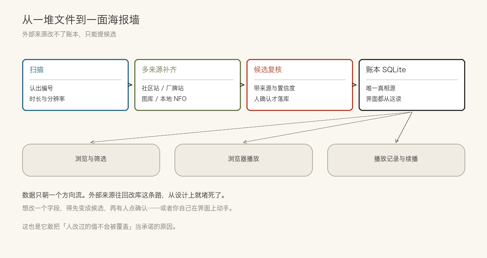
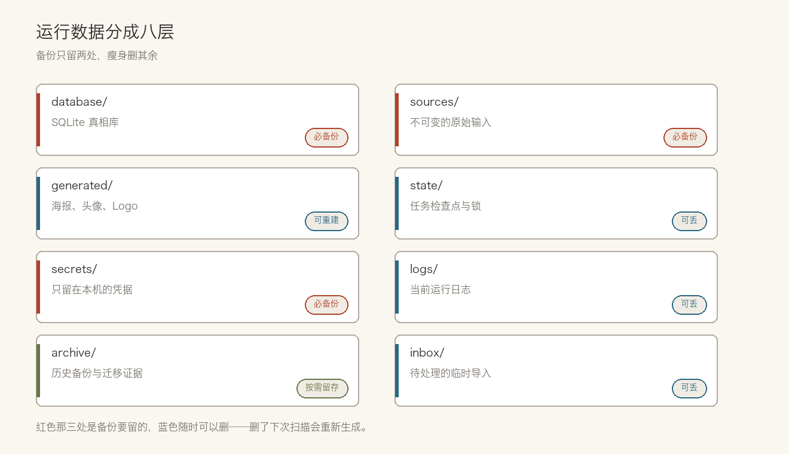

> **摘要**：散在硬盘、SMB 和网盘里的影片，它能聚成一个库，按编号认出来，自动补齐标题和海报，浏览器里直接播。项目开源两个多月拿到一万三千星。好用，但门槛和边界它也写在明面上。

你硬盘里躺着几百个视频文件，名字长这样：`abc-123_1080p.mkv`、`新建文件夹 (2)`、`最终版_真的最终.mp4`。

三个月后再打开，你已经分不清哪个看过、哪个是重复的、哪个版本更清楚。

想找一部看，只能在文件夹里靠记忆翻。翻到了还得猜能不能播、字幕放在哪。

自己攒媒体库的人都会撞上这面墙。

## 有人把它做成了一整套

Jellyfin、Emby 这些老牌方案解决的也是这件事，但它们默认你已经把文件名理干净了、元数据有人刮过了。整理这一步，往往比看片本身还费劲。

Peach 想省掉的就是这一步。把目录指给它，剩下的它自己认。

一句话说清它是干什么的：**把散在本地盘、SMB 共享和网盘上的影片聚成一个库，按编号认出来，多来源补齐标题、演员、厂牌和封面，然后在浏览器里浏览和播放。**

项目开源两个多月，GitHub 上一万三千星、一千五百多次 fork。这个速度在自托管工具里不算常见。

代码是 Python 3.14 加 FastAPI，前端 React，桌面端打成 Windows 和 macOS 的安装包，NAS 上可以直接跑 Docker。许可证 AGPL-3.0。

## 认片，补资料

影片编号是这套东西的钥匙。它从文件名里把编号抠出来，认出来之后，再去几个来源分别取标题、演员、厂牌、封面，让它们互相核对。

那这些资料从哪来？项目自己列了一份来源清单，社区站、厂牌官网、图库都在里面。本地 NFO 也读，认不出来的文件还留着手工补录的入口。

几个来源给出不一样的答案，听谁的？**人改的优先。**你手改过的字段，后面的自动刮削不会覆盖回去。

听着像常识，真做对的项目不多。只要一个工具带自动刮削、又没有字段级的归属记录，默认就是「最后写入者赢」——脚本一跑，你上周订正的名字就没了，还查不出是谁改的。

## 放在哪都能看

本地硬盘、SMB 共享、已经挂载的网盘，在界面上是一视同仁的。

不用先同步到一块盘再看。

播放直接走浏览器，也能把地址丢给外部播放器。字幕、倍速、画面旋转、续播、时间轴预览这些都有。

那远端文件呢？总不能先拖回本地再看。

远端文件默认发标准 Range 请求，不做转码。什么时候开 HLS 是个显式开关——他们的理由写得很实在：HEVC 封进 TS 会静默黑屏，与其默认开一个会出事的模式，不如让需要的人自己打开。

## 找得到，也管得住

关注人物和创作者的更新，有新作品会冒出来，不用一个个站去翻。

看到想看的、库里又没有，先扔进「想要」清单。等哪天扫描到同名文件，自动对上。

云下载是另一条路：按编号找磁力，交给网盘离线，文件落地之后由扫描登记入库。下载和入库是分开的两件事，中间不断链。

馆藏那边管标签、重复文件、多版本和分卷。资料和观看记录都存在本机，不上传。

## 一趟走完，数据是怎么流的



从一堆文件到一面海报墙，中间是这么几道：扫描把文件认出来，探测拿到时长和分辨率，按编号去外部来源补元数据，全部落进本机一个 SQLite 库，界面和播放器都从这个库读。

关键的一条是：**外部来源改不了这个库。**它们产出的是「候选」——带来源、带置信度，你确认过才算数。

这条边界在他们的协作约定里写死了：模型打分、冲突、多候选，只产生候选，不许自己标成已批准。让程序提议、让人拍板，这条在代码层就卡住了。

## 装起来麻烦吗

NAS 上三步。仓库根有个 `compose.yaml`，在旁边建个 `.env`，填三个值——地址换成你 NAS 的局域网 IP，别照抄：

```dotenv
PEACH_BIND=192.168.1.10
PEACH_PORT=8900
PEACH_MEDIA_ROOT=/srv/videos
```

然后 `docker compose up -d`。浏览器打开 `http://192.168.1.10:8900`，会让你输登录口令。没有默认密码，口令在容器里现查：`docker compose exec peach peach token`。

媒体目录默认只读挂载。扫描和播放都不需要写权限，要整理、移动、删除时才得自己开可写。这个默认值是对的——一个上来就能删你文件的工具，谁敢用。

端口默认只绑 `127.0.0.1`，也就是只有宿主机能访问。想在局域网里别的设备上看，得显式改 `PEACH_BIND`。容器里的服务固定监听 8900，宿主机这头用什么端口由你挑。

装完之后，运行数据都落在一个数据卷里，分八层：



SQLite 真相库、可重建的产物（海报、头像、厂牌 Logo）、不可变的原始输入（浏览器导出、追更抓取）、任务检查点和锁、只留在本机的凭据、日志、历史备份、待处理导入。

这么分的好处很实际：想备份只备数据库和原始输入，想瘦身就删可重建的那部分。不用猜哪个文件夹能动。

## 几处跟同类不一样的选择

媒体默认原地不动，除非你主动点整理——它不接管你的目录结构，这一条让很多人敢把它直接指向已有的盘。

技术选型更保守。数据库是 SQLite，架构文档里明确写了不做微服务、不做消息总线、不做整站重写。前后端逻辑分开，但部署起来只有一个进程；桌面安装包和 Docker 镜像共用一套代码，不是两条分支各维护一份。

这几条单独看都不稀奇，凑一起就少见了。一个要长期跑在自己机器上的东西，很多方案会先上 PostgreSQL 和一排容器，它反过来挑了最土的那条路。

## 一百二十九份决策记录

那它凭什么在两个多月攒到一万三千星？翻一翻仓库，答案不全在功能表里。

`docs/adr/` 目录躺着一百二十九份架构决策记录，编号从 0001 到 0129。

标题不是名词，是判断句。比如「没人要求整理，文件就别动」「新文件靠推送，扫描是兜底」「字段优先级链裁定分歧」。

这份目录比 README 有用。想知道某个决定为什么这么定，点进去就是当时的理由、备选项、以及为什么否掉。

配套的还有五十一个手写 SQL 迁移，一条条写，不靠自动生成。翻到做字段归属的那份 `0029_asset_field_owners.sql`，开头几段注释就把「为什么要这么改」和「为什么不建子表」一起交代了。

一次改动连理由一起存档，这个习惯比功能本身更难抄。

## 谁适合，谁别碰

那我到底该不该装？

适合：自己攒了一堆影片、会装 Docker 或者能装安装包、一个人用。

不适合：要多人共用、要账号体系的——它明确不做完整账号体系，Docker 镜像也不提供多租户隔离。想开箱即用、不爱折腾的也别急，桌面安装包还没签名，macOS 也没完成公证，第一次打开会被系统拦一道。技术栈是 Java 或 Go、打算深度改它的，得先接受 Python 3.14。

还有一条硬件门槛容易踩：官方镜像目前只发布 `linux/amd64`，ARM 架构的 NAS 还没通过验收。买的是 ARM 小主机，得等或者自己构建。

最后一条要提前讲明白：**这个项目的领域是成人影像，README 上挂着 18+ 标记，只用于管理自己持有或获授权的媒体。**它的工程做法值得读，但这决定了它不适合当公开的团队工具，也不适合在内容审核严格的平台上推。

## 最后

一个媒体库工具能讲的故事不多。无非是认得更准、补得更全、放得更开。

Peach 在两个多月攒到一万三千星，靠的不是功能表比别人长。是它把「谁说了算」想清楚了——文件放哪由你说了算，字段填什么由来源和人协商，数据存哪由本机说了算。

想试的话，NAS 上一条 Docker 命令就能起来。想读代码的话，那 129 份决策记录比源码好读。

> 作者：[唐悦玮](https://tangyuewei.com)  |  从后端出发，用 AI 拓展到全栈的工程师。

## 参考资料

- [peach-mitao/peach](https://github.com/peach-mitao/peach)
