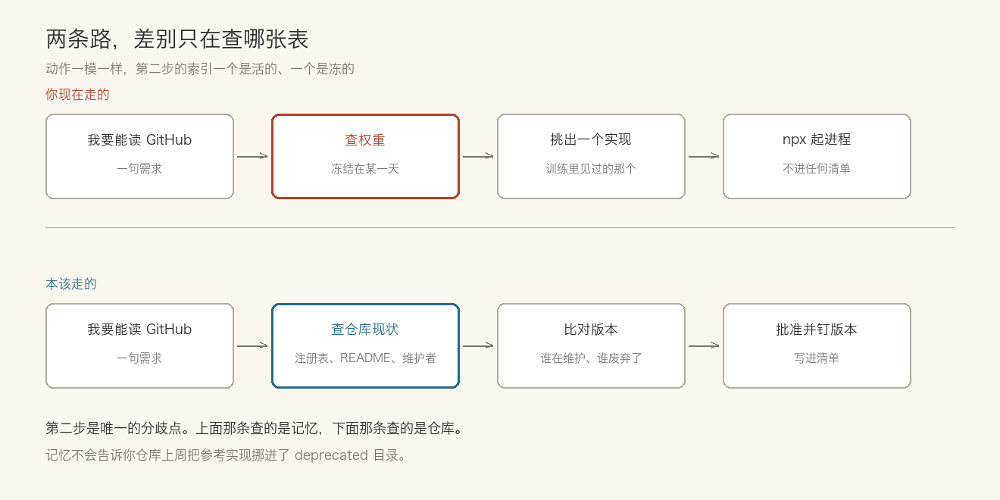
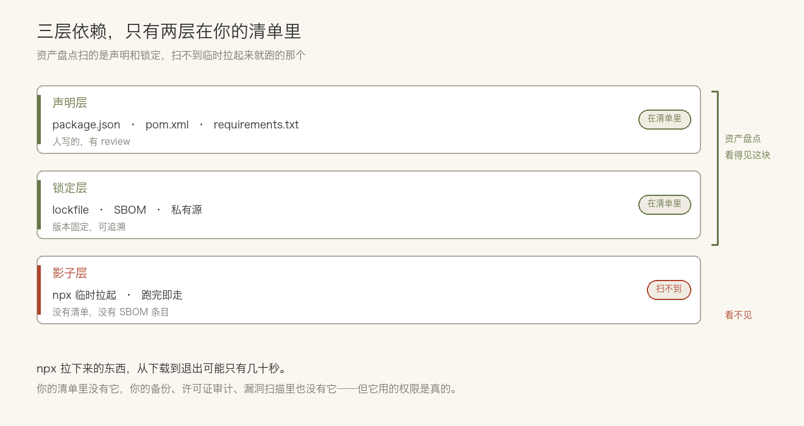

> **摘要**：你让 agent 接个 GitHub，它没问你用哪个实现，直接挑了一个装上。依据不是仓库现状，是训练记忆。安全公司看到，这类决定在 98% 的会话里没回到人手上；有的案例里，它挑的就是早就弃用的参考实现。

你让 agent 帮忙接一下 GitHub。它回一句「好的」，然后跑了一条 `npx`，起了一个 server，通了。

全程没问你用哪个实现，也没问版本。

这件事单看没什么。你本来就想省掉这个决定。**但它替你做的这个决定，依据不是仓库现在有什么，是它训练时见过什么。**

## 它不问，是因为它觉得不用问

安全公司 Glow 做过一组观察，结论被行业媒体反复引用：开发者提出一个能力需求，比如「要能读 GitHub」，在观察到的会话里有 98% 的比例，agent 自己就把包选定了，没有回头确认。

这个 98% 容易被读错。它不是「98% 的会话装错了包」。它说的是**这个决定几乎从不回到人手上**。

至于选得对不对，是另一个发现。同一组观察里有个案例：agent 从训练数据里翻出一个 Anthropic 的参考实现装了上去，而那个实现早就弃用了，官方维护的版本就在同一个仓库里。

## 索引是旧的，因为索引是记忆

为什么放着新的不用，去拿旧的？

把它想成查表就清楚了。你问它「装哪个」，它去查表。表在哪？在权重里。

权重是某一天冻结的。那天之后，仓库改了名字、换了维护者、把参考实现挪进 `deprecated/` 目录、README 顶上加了警告——这些它都不知道。

所以这不是判断力问题。它记得的那个版本，在它学习的时候是对的。

**你让一个只能回忆、不能检索的东西，去做一个必须看现状才能做对的判断。**

有人会说，它不是能联网搜吗？能。但那是另一条路径，要它主动想起来去搜，而「装个包」这个动作太熟练了，熟练到它不觉得需要查。

就算它真去搜了，也补不上这个洞。搜出来的第一个结果不是「最正确的那个」，是「最像那么回事的那个」——名字可以像，README 可以像，星标数也能像。把依据从权重换成搜索结果，只是换了一张别人也写得出来的表。

## 那批旧包上挂着四个高危漏洞

Glow 在那批弃用的参考实现里翻到四个高危漏洞。哪四个、什么类型、有没有编号，我手上的转述都没写，原始报告也没拿到——这一条只能按「有人数过」记，不能拿来推严重到什么程度。

能拿来说事的是下载量：更宽的那一批弃用参考实现，月下载量大约 165 万次。

这个数字同样得打折。它是厂商自己发布的研究，我只能按二手转述引；165 万次里多少是 agent 装的、多少是人手敲的，报告也没拆开。**但方向是清楚的：有人在持续安装一批明确标了弃用的东西。**

这也解释了一个反常现象。你在代码仓库里很少见到有人主动 `npm i` 一个 README 写着「本仓库已废弃」的包——装的时候会看见。而 agent 不装给你看。

## 最麻烦的是，它不在你的清单里

`npx` 这东西的工作方式是：临时拉下来，跑起来，不留痕。

它不进 `package.json`，不进 `lockfile`，不进 `node_modules` 的长期列表。你的 SBOM 里没有它。你公司每季度做的那次软件资产盘点，也扫不到它。

问一句：**你的资产清单上一次更新是什么时候？**

很多团队的答案是「上季度」。而 agent 昨天已经在你机器上装过三个包了。

这条缝在两个方向上被撑大。一头是它不属于任何项目的依赖树，所以没人负责；另一头是它一旦跑起来，拿的就是你 agent 手上的权限。

OpenCode 那个缺陷是个具体例子。在 Windows 和 WSL 上，一个恶意或被劫持的 MCP server 可以把命令塞进 OAuth 授权 URL，在你走登录授权那一步，这个 URL 被原样拼进了一条 PowerShell 命令。Pillar Security 提出按 9.8 计。

修得不算慢：8 月底私下报告，9 月 28 日的 1.18.33 就改掉了，10 月中才由研究者公开。

难受的地方在后面。**1.0.137 到 1.18.32 这些版本没有 CVE，也没有安全公告。**没编号，扫描器就不报。你跑的版本可能在受影响区间里，而你的漏洞扫描结果是干净的。

为什么没编号？厂商给的理由是：恶意 MCP server 不在他们的威胁模型里。

这句话值得停一下。它不是说「我们忘了发」，是说「我们认为这不该算我们的漏洞」。一台装着 agent 的机器，被一个你不认识的服务端拿走了命令执行权——在威胁模型那张表格上，这一格是空的。

## 批准一次，不代表下次还是那个东西

还有一种情况比装错包更隐蔽。

你装了一个 server，看过它的工具列表，点了同意。这一步在你的心理账户里是一次性的：这个 server 我审核过了。

那你当时批准的到底是什么？是那个名字，还是那一刻的清单？

可工具列表不是常量。它在你每次连上去的时候重新拉取，而工具的描述文字会进入模型的上下文——也就是说，**描述本身是提示的一部分**。

于是就有了那种叫 rug pull 的做法：先上架一个规矩的工具，等你批准，之后某次 `tools/list` 换成带指令的版本。多数客户端是按工具名缓存授权的，名字没变，它就不会再问你。

这条不是某个产品的漏洞，是这套机制的自然结果。你批准的对象是「名字」，实际在跑的是「内容」。

## 有人已经在补了

那有没有人在管这件事？有，但补的位置跟你以为的不一样，有的补在分发端，有的补在运行时。

分发端做得比较完整的是 Adyen 的 Agent Marketplace。一份配置能生成八种客户端认的资源——Claude Code、Codex、Cursor、Devin CLI、Factory Droid、Gemini CLI、OpenCode、Windsurf。它做的事很实在：钉死版本、校验下载摘要、扫描隐藏内容与可执行脚本与远程 URL 与能力声明，遇到本地已有冲突文件就拒绝覆盖。

不过他们自己写了一句，我觉得比功能列表更值得记：「这些检查降低风险，但不能证明一个 hook 或 MCP server 是安全的。」

运行时那头在收的是工具厂商自己，动静集中在十月这一个月。Claude Code 2.1.307 在权限规则、hook、沙箱或任何一种安全机制打断工具调用时，会发一条 OpenTelemetry 事件——**安全机制出手这件事，本身变得可观测了**。同一个版本还把掉线的 HTTP MCP 调用限制成只在只读或幂等时才重试。Codex 那边收紧的是把宿主密钥代入代理流量的目标与请求条件。

这些都不解决「agent 该装哪个包」。它们解决的是装完之后，出事能不能看见。

## 先把它当依赖管，别当配置管

如果你的团队已经在用 agent 跑真实仓库，有三件事现在就能做，都不难。

**把 MCP server 当依赖，不当配置。**配置可以随手改，依赖要有人批。给每个要用的服务定一个批准过的实现，写死版本，记下来源。别让「随手 `npx` 一下」成为默认路径。

**让它进清单。**不管你的清单是 SBOM、是资产库、还是一个 Markdown 表格，先有个地方能查到「这台机器上跑过哪些 server、谁装的、什么时候」。这一步不做，后面所有讨论都是空的。

**盯住能力，不只是盯住包名。**包名不变，能力可以变。至少要能回答：这个 server 现在能读什么、能写什么、能往外发什么。Adyen 那套扫描里最值钱的一项就是能力声明扫描，不是摘要校验。

## 最后

依赖可信这件事，工程界做了二十年。锁版本、校验摘要、SBOM、私有源、准入清单——该有的都有。

Agent 没有推翻这些做法，它只是把那个做选择的人换掉了。

以前是你在写 `import` 那一行时做的决定，现在是一个只能回忆的东西替你做的。而它做这个决定的时候，不会告诉你它记的是哪一年的仓库。

## 参考资料

- [AI-Native Engineering Insights：The coding agent control plane gets concrete](https://ainativeengineering.net/article/ea469d87-20b8-450f-9666-c845851a3255)
- [MCP Defense：MCP 漏洞类型参考](https://defensemcp.com/mcp-vulnerabilities)

> 作者：[唐悦玮](https://tangyuewei.com)  |  从后端出发，用 AI 拓展到全栈的工程师。
