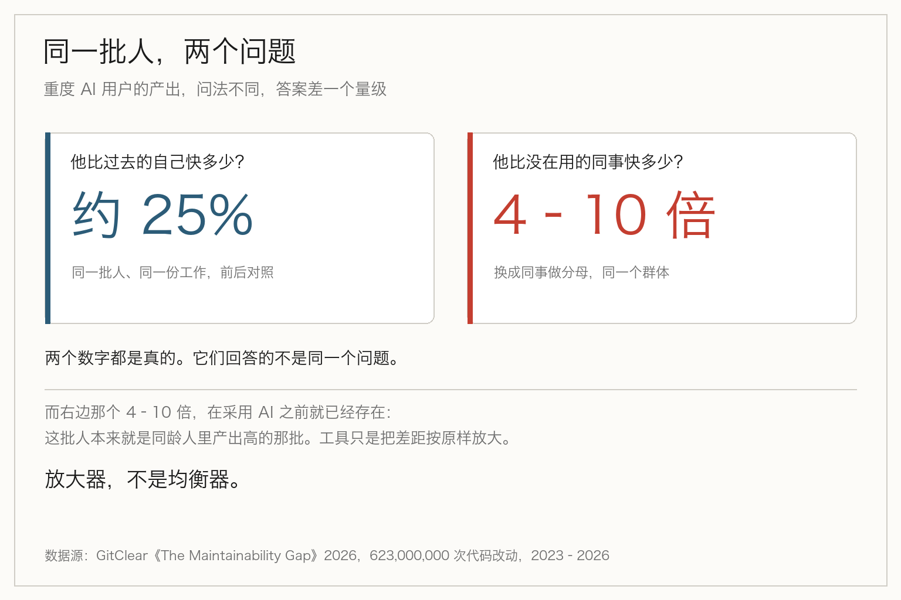
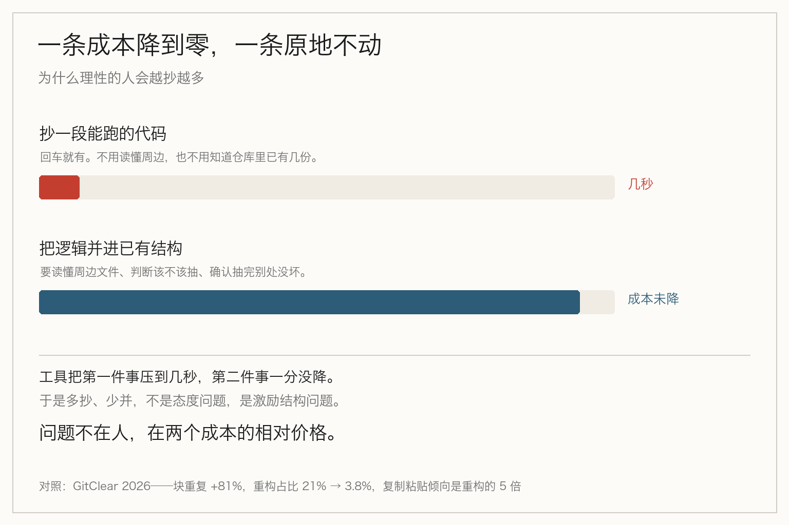

> **摘要**：AI 对新人帮助更大，这句话流传很广，原始论文里被省掉的一句是：子组差异统计上不显著，也没拿到代码评估质量。另一份 6.23 亿次改动的研究补上另一半：差距在 AI 之前就存在。它是放大器，不是均衡器。

过去两个月，「AI 对新人帮助更大」这句话，流传很广。

## 那组数字长什么样

先说清楚它到底是什么。

2026 年，MIT 斯隆的 Mert Demirer 和五位合作者（普林斯顿、宾大、微软）分析了三家公司的 Copilot 上线实验：微软、埃森哲，以及一家匿名的财富 100 电子制造企业，覆盖近 5000 名开发者。

方式是随机分组：一组先拿到工具，一组暂时没有。微软的分组持续七个月，埃森哲四个月。

结果是这样的：拿到 Copilot 之后，开发者每周完成的任务数平均多了 26%。

再按经验拆开：任期短的、职级低的，产出涨 27% 到 39%；资深的，涨 8% 到 13%。

数字很漂亮，故事也很顺——工具把门槛降低了，新人受益最大。

到这一步，它就可以被引用了。很多文章就引到这一步。那句括号呢？

## 原文里那句被省掉的括号

但论文自己写了一句话，大意是：这些分组的估计噪声比较大，各组之间的差异通常**没有统计显著性**。

同一位作者在接受 MIT 斯隆的访谈时又补了一句：他们拿不到这些开发者产出的代码，所以只测了产出，**没法评估质量**。

这两句话决定了这组数字的用法边界。它能支撑的是：经验水平可能影响你从 AI 里获益多少，值得在自己公司里测一测。它不能支撑的是：AI 让新人追平了资深。

一个说的是「可能有关」，一个说的是「已经追平」。中间隔着一次统计检验，和一个没人做过的质量评估。

还有一层。GitHub 自己在 2023 年那份大样本分析里也说过「经验较少的开发者获益更多」，样本 93 万。但那份研究看的是**代码建议接受率**和开发者自报的生产力，不是产出质量，也不是能力增长。

方向是一致的。证据强度不是一回事。

## 一个方向，是怎么变成一条定论的

我不觉得有谁在故意夸大。传播链上每一步都很自然。

论文写「差异不显著」，摘要里简化成「新人获益更多」，到了报道里变成「新人提速 39%」，再到汇报 PPT 上就剩一行：AI 对新人效果最好。

中间没有人撒谎。只是每一层都在做减法，减掉的恰好是限定条件。

而这条结论现在很好卖。行业正在集体算 AI 的账：Rippling 上线了专门盯 token 消耗的控制台，IBM 的副董事长 Gary Cohn 公开说投资回报「没有人们想的那么高」。在这个气氛里，「新人受益最大」是个让人松一口气的说法——它意味着这笔钱花得值，意味着人手可以重新算。

越是被需要的结论，越容易省略那句括号。

## 另一半数据：差距在 AI 之前就已经在

如果说上面那份研究测的是「AI 带来了什么」，GitClear 那份报告测的是另一件事：用了 AI 之后，代码变成了什么样。

2026 年 6 月发布的《The Maintainability Gap》，分析了 2023 到 2026 年间 6.23 亿次代码改动。它翻了两个旧结论：

- 重度 AI 用户的产出是非用户的 4 到 10 倍；
- 但这批人**在采用 AI 之前就已经是高产者**；
- 和自己过去比，他们的提速大约 25%。

4 到 10 倍听起来像奇迹，25% 听起来像正常工程改进。两个数字说的是同一批人，差别只在分母是「别人」还是「过去的自己」。

这就是「放大器」的意思。它不改变排序，只改变幅度。原本产出多的人，用了之后产出更多；原本判断力薄的人呢？这个后面说。

## 放大器放大的不只是产出

同一份报告里还有一组更难受的数字。全部以 2023 年为基准：

**代码块重复率**（连续五行以上的重复片段，每百万改动行）从 40.3 涨到 73.0，四年涨了 81%，是有记录以来最高。

**重构比例**（被移动的代码占改动行的比例）从 2022 年的 21%，掉到 2023 年的 13%，2026 年只剩 3.8%。

**复制粘贴**则从 9.4% 升到 15.7%。两者一升一降，结果是：开发者现在选择「复制一份」而不是「重构」的倾向，是反过来的五倍。而在 AI 之前的 2022 年，这个比例是反的——重构的倾向是复制的两倍。

还有三条，方向一致：

- 新写的代码调用到别处函数的比例，下降 35%；
- 改动「一年以上没碰过的旧代码」的比例，从 1.7% 掉到 0.46%，降了 74%；
- 掩盖错误的写法（空 catch、兜底默认值一类）上升 47%。

报告里有一句话，比所有数字都硬：这些债**集中在那些还没识别出失败模式的人身上**。

不是所有人平均摊。是集中。

需要说清楚一点：这是趋势对照，不是因果实验。三年里 AI 采用率上升、重构率下降，两件事同时发生，报告没有做因果识别，也没排除同期的交付压力与裁员。它证明的是同向变化，不是谁导致了谁。

## 为什么偏偏是判断力薄的人欠得多

这里要小心，容易写成「新人不行」。不是这个意思。

那到底是什么？看成本结构就清楚了。

「抄一段能跑的代码」，现在的成本是几秒。回车，它给你。你不用读懂周边，不用知道这段逻辑在仓库里是不是已经存在第三份。

「把这段逻辑并进已有的结构」，成本一分没变。要读懂周边五个文件，要判断它该不该抽成函数，要确认抽完之后别处没坏。

工具把第一件事的边际成本压到接近零，第二件事的边际成本原地不动。

于是任何一个理性的人，都会做更多第一件事，更少第二件事。这不是态度问题，也不是能力问题，是激励结构。

区别在于：一个写了十年的人，抄的时候心里会响一下——「这个我好像在哪写过」。这一下不是道德感，是他在过去十年里因为重复代码付过账，形成了直觉。

而一个入行半年的人，那一下不会响。他不是不想重构，是**根本没看见有东西需要重构**。

所以「判断力薄」在这件事上的具体含义，不是「写不出来」，是「识别不出自己刚刚制造了一份重复」。

而这种识别力，恰好只能靠被重复代码咬过几次长出来。

## 「够用」这条线，正在往下走

把这些拼起来，会看到一个正在发生的决策。

如果一家公司相信「AI 让新人够用」，它接下来的动作是可预测的：少招初级，多招能定方向的，把执行层压薄。

省下来的是人头成本，欠下去的是三年后的账。这笔账怎么算？

重复代码的账，落在传播税上。改一处逻辑，你得找齐所有副本，而副本散在你可能不熟的模块里。漏掉一个，就是一个只在特定路径下复现的 bug。这笔税不在当期发生，它在你最想改的时候发生。

GitClear 那句总结写得很准：最大的风险不是 AI 写了你维护不了的代码，而是它写得比以往任何时候都快，而账单会在你最付不起的时候送到。

## 如果你在带人

GitClear 给了五条建议，其中第四条是：**在判断力最薄的地方做教练。**

这条比前面四条都难执行，因为它要求你知道谁薄在哪。但有三件事现在就能做，不用等度量体系建起来。

**让新人做一次「改造」，而不是一直做「新增」。** 新增功能天然是抄，改造旧代码天然是提炼。给一个「把这三处重复合并掉」的活，比给三个新需求有用得多。

**评审时换一个问法。** 「这能跑吗」得到的是执行层答案；「这段和仓库里哪段像」得到的是结构层答案。后一个问题新人第一次会答不上来，答不上来就是教学的开始。

**给重复设一条绊线。** CI 里加一条规则：连续五行以上重复就报警。不用一开始就拦死，先让它可见。看不见的东西，教练也教不了。

## 最后

那组数字没有错，写它的人也没有错。

错的是它离开原文之后，那句括号被留在了原地，而结论自己走遍了整个行业。

一个真实的方向，被当成一个确定的结论，然后被用来决定招不招人——这条路上没有坏人，只有一层层的减法。

所以下次再看到「某类人用 AI 效果最好」，不妨先问一句：那句话的原文里，是不是也有一句括号。

## 参考资料

- [How generative AI affects highly skilled workers](https://mitsloan.mit.edu/ideas-made-to-matter/how-generative-ai-affects-highly-skilled-workers)：Demirer 等六人对微软、埃森哲与一家财富 100 企业的 Copilot 实验分析，含 26% 整体提升、分组差异与「统计不显著」「未取得代码」两条局限
- [The Maintainability Gap](https://www.gitclear.com/the_ai_code_quality_maintainability_gap)：GitClear 2026 年 6 月报告，6.23 亿次改动，块重复、重构、复制粘贴、函数连通性、长期维护五组信号
- [The economic impact of the AI-powered developer lifecycle](https://github.blog/news-insights/research/the-economic-impact-of-the-ai-powered-developer-lifecycle-and-lessons-from-github-copilot/)：GitHub 2023 年大样本分析，93 万用户、约 30% 建议接受率、经验较少者获益更多

