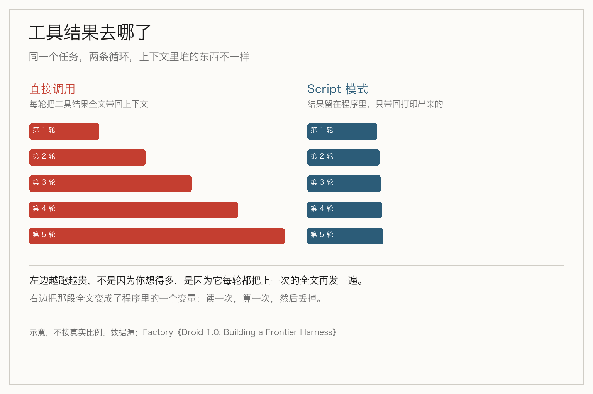
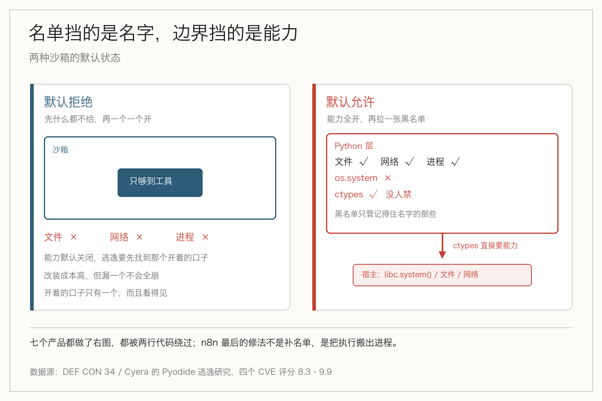

> **摘要**：Droid 1.0 让模型写一段脚本，在沙箱里跑几百次工具调用，只有打印输出回到上下文。它的沙箱没有文件、网络、系统访问权限。而另七个同样跑模型代码的沙箱禁掉了危险函数，却被两行 ctypes 绕过。

十月二十九日，Factory 给自家的编码 agent 发了个大版本，把「编程化工具调用」设成了默认。

意思很直白：模型别再一个一个调工具了，直接写一段 JavaScript，在沙箱里把活儿跑完。

这不是新想法。CodeAct 在 2024 年就论证过：让模型用代码表达动作，比让它吐 JSON 调工具更准。Cloudflare、Anthropic、Codex 都做过后来的变体。Factory 做的事是把它设成默认，并且给它配了一个边界画得很死的沙箱。

## 一个请求，几百次工具调用

机制不复杂。Droid 把这条路做成一个叫 Script 的工具：模型写 JavaScript，跑在沙箱里，脚本里可以调它的工具。

关键在于**什么东西回到模型**。原始文件、搜索结果、日志，全都留在程序里当变量。只有脚本打印出来的东西，才会回到上下文。

配套的两个数字很能说明意图：基础提示词从 20,887 tokens 降到 13,055，少了 37%；开头只发两个工具定义，原来是十一个。

于是同一件事的耗时就变了。修一个失败的单测，同样是 15 次工具调用：

- 直接调用：10 个模型回合，约 56.8 秒
- Script 模式：5 个模型回合，约 41.6 秒

批量越大，差距越明显。Factory 自己给的例子是清理 151 个 Linear issue：312 次工具调用，2 次模型请求，约 6.1 万 tokens。同样的活儿按直接调用估算，要 36 次请求、310 万 tokens。

还有个 CI 的例子：547 次运行里 5,384 个 job，2 次请求跑完，官方说不到 0.1% 的工具结果进入过模型上下文。

## 省下来的不是钱，是每回合重发的东西

这件事容易被讲成「省 token」。省 token 只是结果。那机制在哪？

Agent 跑长任务时，每一回合都要把系统提示、工具定义、历史记录再发一遍。工具越多、跑得越久，这部分固定开销越大。你把工具结果塞进上下文，它还会一直待在那儿，后面每一次请求都跟着重发。

改成程序调用之后，工具结果不再是「上下文里的一段文本」，而是「程序里的一个变量」。它被读一次、算一次，然后丢掉。回到模型的只有结论。

这就是为什么基础提示词能砍掉 37%、工具定义能从 11 个减到 2 个——因为工具不再需要描述给模型看那么细，模型是拿代码在调它们。

还有一层不在账面上：确定性。直接调用时，第几步该重试、循环什么时候停，靠模型每个回合重新判断；写成脚本之后，这些就是代码里的 if 和 for，跑一万次都一样。批量任务里，这一条比省下的 token 更值钱。

## 但这些数字，都是厂商自己量的

得说清楚：上面每一个数都来自 Factory 自己的测试，三次试验，10 月 23 日到 28 日。目前没有独立复现。

他们的方法论里还写了两条注记，我觉得比结论更值得看：Devin 没法关掉「问用户」那个工具，所以有些任务在 Codex 通过时被记为通过；Anthropic 的审核拦截，是在另一个 Claude 快照上重跑的。

愿意把这些写出来，说明量的人知道自己在做什么。但尺子仍在厂商手里。同一份测试里，Droid 在 GPT-6.1 Sol 上是 57.6%，Codex 54.0%；在 Claude Opus 5.5 上是 65.2%，Cursor 与 OpenCode 都是 62.1%，Claude Code 57.6%。方向上它确实领先，幅度是三到七个点，不是量级。

## 同一个动作，另一头出了事

有意思的地方在这里：就在 Droid 把「模型写程序」设成默认的这段时间，另一批同样跑模型代码的沙箱，被人在 DEF CON 34 上当场拆了。

Cyera 的研究者 Vladimir Tokarev 和 Saar Pearl 拿 Pyodide 开刀——那是把 CPython 编译成 WebAssembly、好让 Python 跑在 JavaScript 运行时里的东西。他们一共在七个产品上复现了同类逃逸，落了四个 CVE，评分从 8.3 到 9.9：

- n8n 的 Code 节点，9.9；低权限用户能借此执行系统命令，读到容器里的 SQLite，把自己改成管理员，然后拿到所有已连接集成的凭据
- Cohere 的 Terrarium，9.3，那本来就是个专门跑 AI 生成代码的沙箱
- Grist，9.1
- Hugging Face 的 smolagents，8.3

外加 langchain-sandbox、stlite、cibuildwheel，一共七个。

## 它们都做对了同一件事，然后漏了同一个洞

这七个产品的防护思路是一致的：在 Python 层做黑名单。

禁掉 `os.system`，给 JavaScript 桥打补丁，锁住通往 `Object` 构造器的明显路径。听起来合理，也确实是大多数人会做的第一件事。可它为什么没拦住？

问题是它们都没管 `ctypes`——Python 用来直接调本地代码的接口。攻击者不需要碰黑名单上的任何东西：通过 FFI 把 `libc.system()` 解析出来，直接从 Python 调用，绕开那个被包装过、被禁掉的 `os.system`。按研究者的说法，两行代码就够。

还有第二条路：直接调 `_pyodide._base.eval_code`。那个入口跑在一个**从来没打过补丁**的执行上下文里，别处的限制在它身上不生效。

根子在架构上。WebAssembly 保护的是它自己的线性内存，它不阻止代码去够宿主环境**主动暴露**出来的能力。而 Pyodide 的底子是 Emscripten，暴露得不少。你在 Python 层列一张黑名单，没办法覆盖下一层能摸到的东西。

那要挡住，靠什么？

## 默认拒绝，和默认允许

把两件事并排放，差别就出来了。

Droid 的沙箱是这么描述的：**它自己没有文件、网络、系统访问权限，只够得到 Droid 的工具**。需要并发的独立调用一起跑，一批的耗时约等于最慢那一次。

这是「默认拒绝」：先什么都不给，再一个一个开。

出事的那些沙箱是「默认允许」：宿主先把能力全打开，再在 Python 层拉一张黑名单，指望把危险的那几个名字堵住。

黑名单这条路的问题不在于列得够不够全，而在于**它假设你知道所有危险的名字**。而底层暴露出来的入口，往往没有名字，或者有很多名字。

n8n 后来的修法很说明问题：它没有继续在沙箱里补洞，而是把 Python 执行搬出了那个进程，放进一个真正隔离的外部 runner。补洞补的是名单，搬家改的是边界。

## 如果你也在搭这种沙箱

三件事，按顺序问自己。

**第一，默认给了什么。** 不是「我禁了什么」，是「如果什么都不写，它能做什么」。默认能读文件、能连网、能起进程，那后面列的每一张黑名单都只是补丁。

**第二，有没有一道进程或容器边界。** 同进程里的 Python 补丁，挡不住 C 层和 FFI。要挡，得让代码跑在另一条进程、另一个文件系统、另一套凭据里。这不是性能问题，是边界问题。

**第三，模型写的代码，能摸到宿主暴露的哪些接口。** JavaScript 桥、`ctypes`、各种 `eval` 入口——这些不需要你主动给，往往是运行时自带的。它们才是逃逸的常用通道。

## 最后

工具调用正在从「模型说出来」变成「模型写程序」。这个转向是合理的：上下文干净了，循环确定了，成本下来了。

但它同时把一件事推到了台前——你交给模型的，不再是一段会被解析的文本，而是一段**会跑起来的东西**。

文本错了，你能看见。程序错了，它在你的权限里跑完了才告诉你。

所以「沙箱」这两个字，接下来会从安全团队的词，变成每个搭 agent 的人都要会写的代码。而写它的第一课不是学会禁什么，是学会默认什么都不给。

## 参考资料

- [Droid 1.0: Building a Frontier Harness](https://factory.com/news/frontier-harness)：编程化工具调用的设计、脚本沙箱的权限边界、Terminal-Bench 4 对比与试验条件
- [DEF CON 34: One Pyodide Flaw Exposed Seven Products](https://www.esecurityplanet.com/threats/def-con-34-one-pyodide-flaw-exposed-seven-products/)：Cyera 对七个产品的 Pyodide 逃逸复现、四个 CVE 与评分
- [The Pyodide Sandbox Escape That Hit Cohere, Hugging Face, and n8n](https://aisecuritywire.com/vulnerabilities/pyodide-sandbox-escape-cohere-terrarium-huggingface-smolagents-defcon-2026)：ctypes 与 eval_code 两条绕过路径的技术细节，以及 n8n 改为进程外执行的处置
- [Generative UI - FastMCP](https://gofastmcp.com/apps/generative)：MCP 侧同样跑模型代码的 Pyodide 沙箱说明，可用于对照

> 作者：[唐悦玮](https://tangyuewei.com)  |  从后端出发，用 AI 拓展到全栈的工程师。
