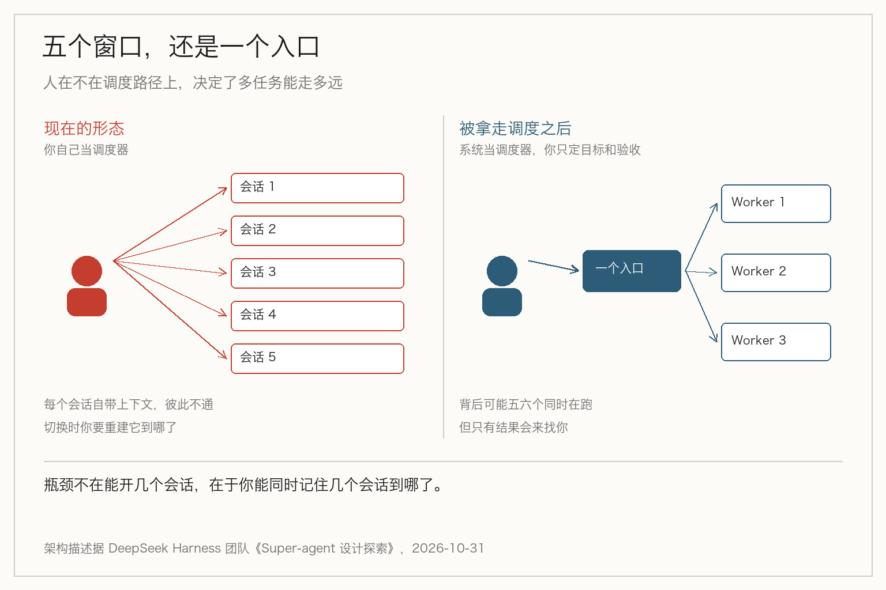
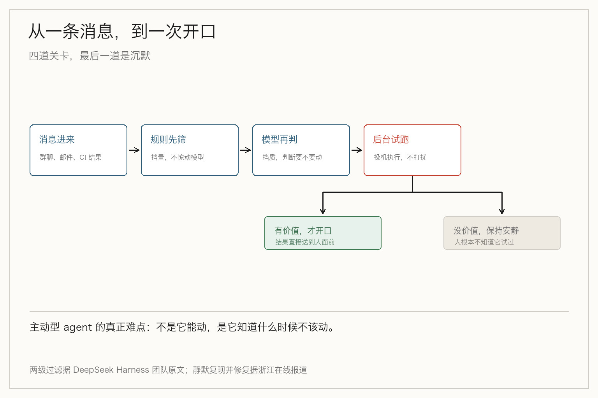

> **摘要**：DeepSeek 在设计 agent 架构时写下一句判断：单任务的上限取决于模型能力，多任务的上限取决于人的注意力。他们的观察是一个人只能同时跟进 3 到 5 个会话。所以问题不是让模型更强，是把调度从人手里拿走。

先说一个你大概经历过的下午。

三个窗口开着：一个在跑重构，一个在等 review 回复，一个在查线上那条慢查询。你在它们之间来回切，每次切过去，前三十秒都在重建「它刚才到哪了」。

下班时你觉得忙了一整天，但三个任务里没有一个真正推进。

这不是效率问题。**你付的不是干活的钱，是切换的钱。**

## 那句话

DeepSeek 的 Harness 团队在十月三十一日发了一篇架构文章，讲他们内部的 Super-agent 是怎么设计的。文章里有一句话，我认为是这一年关于 agent 最值得记的判断之一：

> 单任务的上限取决于模型能力，多任务的上限取决于人的注意力。

配套的观察是：一个人通常只能同时跟进 3 到 5 个活跃会话，再多就只能当上下文搬运工。

这句话之所以重要，是因为它把两个一直被混在一起的上限拆开了。

我们过去一年看到的进步，几乎全在第一个上限上：模型能一次读更多文件、一次调更多工具、一次跑更长的循环。单任务的池子在变大。

但第二个上限没动过。人的脑袋还是那颗脑袋。

## 为什么卡在三到五个

这个数字不是实验测出来的，是工程观察。那它为什么成立？

每多一个并行任务，你就多维护一份心智状态：它现在做到哪一步、卡在哪、下一步该谁动。这份状态不在任何文档里，只在你脑子里。

而每次切换，这份状态都要重新装载一次。装载是有成本的，而且成本随任务复杂度上升，不是固定的。

于是并行数涨到某个点之后，边际收益转负：多开一个窗口带来的推进，抵不过你在所有窗口之间来回装载的损耗。

三到五这个量级，就是那个拐点大概的位置。它因人而异，因任务而异，但不会因为模型变强而变大。

这一点很反直觉。我们习惯了「工具变强，我就能干更多」，但在这件事上，工具变强只是让每个任务跑得更快，**并没有让你同时装下更多任务**。

## 现在的 agent，全都假设你只有一个任务

问题在于，几乎所有的 agent 产品都是按「一个会话等于一个工作单元」设计的。

每个会话自成一体：自己的上下文、自己的历史、自己的执行状态。会话之间不通气。

这个设计在单任务时很干净。一旦你并行推进几件事，它就逼着你当调度器：手动切窗口、手动同步上下文、手动记住谁在等谁。

那为什么并行起来还是这么累？因为架构上是并行的，体验上是串行的——瓶颈被人接住了。

DeepSeek 的解法很直接：把会话管理这件事，从人手上移到系统里。

## 从五个窗口，到一个入口

他们的架构分两层。

Router 是常驻的全局协调节点，统一接收群聊、GitHub、邮件这些渠道来的消息，判断该不该干活、该派给谁。

Worker 各自持有独立上下文，并行执行具体任务：复现问题、审代码、写功能，必要时还能再叫 Subagent。

用户看到的始终是同一个助手。背后可能同时有五六个东西在跑，但你只需要面对一个入口。

这个设计里，真正被拿走的不是「多开几个 agent」的能力——那个本来就有。被拿走的是**调度权**。

以前调度在你脑子里：谁先谁后、谁在等我。现在调度在系统里，你只在两个时刻出现——定目标，和验收结果。

## 三个配套设计，各解决一个问题

光有分层不够。这套架构里还有三个细节，我觉得比 Router 和 Worker 本身更值得看，因为它们各自回答了一个具体问题。

**什么时候该动。** 群聊、邮件、CI 结果都能当触发器，但绝大多数消息不需要 agent 介入。所以他们做了两级过滤：先用程序规则快速筛掉无关的，再让模型判断剩下的是否需要行动。规则挡量，模型挡质。

**不确定该不该动的时候怎么办。** 这里借了计算机体系结构里的投机执行：先在后台试，有价值再提交，没价值就闭嘴。

他们内部有个策略叫「静默复现并修复」——有人反馈 bug，agent 先在后台复现、定位，确认问题真实存在、且找到简单修法之后，才开口；否则什么都不说。

这条设计很关键。它把「主动」和「打扰」分开了：主动是在后台做的，打扰是要付代价的。

**人走了它还活着吗。** 执行循环放云端，会话状态进数据库，本地只留一个轻量 daemon，电脑合上任务照样跑。再加一个 Watchdog 盯着有没有陷进无效循环。

## 最难的不是并行，是安静

把这几个设计放在一起看，会发现它们指向同一个目标：**减少人被打断的次数**。

这一点容易被忽略。大家讨论多 agent，注意力都在「同时能跑多少个」。但真到了用的时候，决定体验的不是并发数，是噪音量。

一个每秒都在汇报进度的 agent，比一个不说话但把事情做完的 agent 难用得多。前者把它的工作量转成了你的工作量。

可为什么大多数 agent 还是停不下来地报进度？因为「我在干活」和「你能看见我在干活」是两件事，而做产品的人容易只优化前一件。

所以那两级过滤和静默策略，做的是减法：让系统承担「判断要不要说话」的成本，而不是把这个成本丢给人。

## 但它自己列了三件还没解决的事

这篇文章是架构探讨，不是产品发布。团队自己在开头就写了这句，也在别处承认了短板。

跨会话的记忆还没打通——五个 Worker 各记各的，遇到需要共享前情的任务就露怯。

权限与安全没定论——主动型 agent 能在没人 @ 的情况下动手，那它到底能动到什么范围？

还有一个细节我觉得挺诚实：异步的 ReAct Loop 做出来了，但**没有默认开启**。也就是说，连设计它的人也不敢一上来就把「前台聊天」和「后台干活」彻底解耦。

这三条摆在一起，说明这套东西现在还是「能跑通」，不是「能放心用」。

## 对你意味着什么

如果你在搭 agent，或者只是在带一个用 agent 的团队，有三件事可以现在就改。

**先算人的带宽，再算并发。** 别按「系统能同时跑 20 个」来设计流程，按「人一天能认真验收几个」来设计。后面那个数字小一个量级。

**把调度写进系统，别留在人脑里。** 哪怕只是加一个共享的任务列表，让每个任务的状态对外可见，也比让人靠记忆维护五个心智能省。

**给打扰分级。** 不是所有进展都值得汇报。定义清楚哪几种情况必须叫人（结果出来了、卡住了、要授权），其余的一律静默。这一条改起来最便宜，收益最直接。

## 最后

过去两年，我们一直在给模型加能力：更长的上下文、更多的工具、更久的自主时间。

很少有人给人减负担。

但瓶颈已经换位置了。单任务那头，模型还在往前跑；多任务这头，卡着的是一颗装不下第六个窗口的脑袋。

所以下一个阶段的竞争，可能不是谁家的 agent 更聪明，而是谁家的 agent 更懂得**什么时候不说话**。

## 参考资料

- [Super-agent 设计探索：迈向更自主的 Agent 系统](https://mp.weixin.qq.com/s?__biz=Mzg2NzU3MDgwNg==&mid=2247548272&idx=3&sn=e9e029f0dddd33c382b7e51e545b82d5)（DeepSeek Harness 团队，2026-10-31）：3 到 5 个活跃会话的观察、Router 与 Worker 双层架构、两级过滤、投机执行与存算分离
- [DeepSeek 发布最新 Agent 架构 让 AI 指挥 AI](https://zjnews.zjol.com.cn/zjnews/202611/t20261101_32001328.shtml)（浙江在线）：静默复现并修复、Watchdog、异步 ReAct Loop 尚未默认开启等实现细节
- [DeepSeek 发布全新 Agent 架构：Super-agent](https://www.sctv.com/news/2116552553092603906)（四川网络广播电视台）：单任务上限与多任务上限的原始表述
