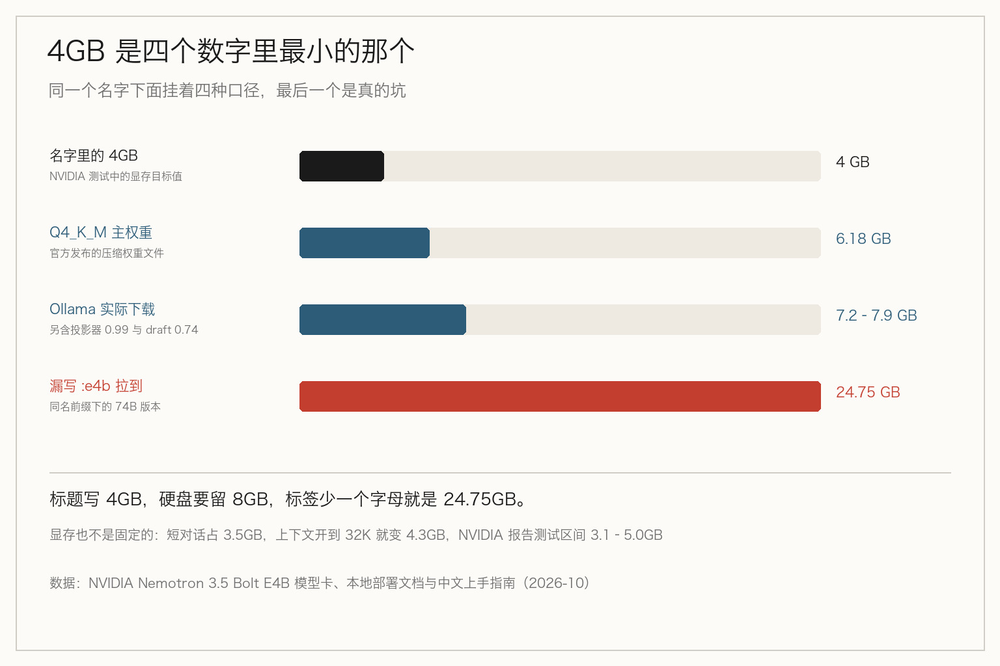
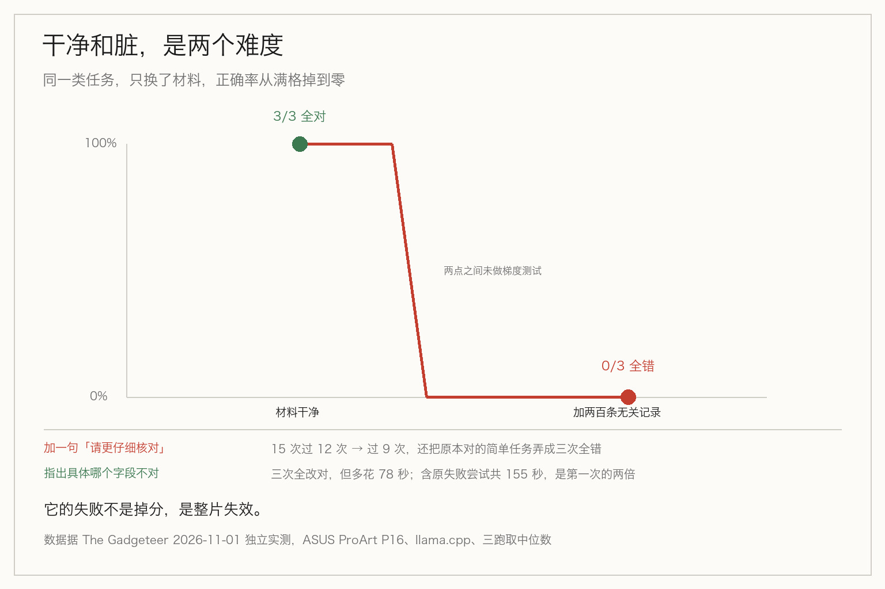

> **摘要**：NVIDIA 的 4GB 小模型被传成能在笔记本上跑 agent。一手实测里，材料干净时它全对，加两百条无关记录就全错。够不够当手脚，不看跑分高低，看它在哪里整片地输。

先说一个我差点踩进去的坑。

看到 4GB、能在笔记本上跑、开源、不要 API 费这几个词摆在一起，第一反应是：终于可以在自己机器上跑一段 agent 了。

这个反应对了一半。它确实能跑，确实免费，确实不联网。但「能跑」和「能当手脚」之间隔着的不是一张显卡，是一整套关于它会在哪里出错的知识——这套知识，跑分表上没有任何一栏。

之前文章里我说过，小模型省钱的正确姿势不是替大模型，是当大模型的手脚。那什么样的手脚才算合格。

## 4GB 是四个数字里最小的那个

NVIDIA 十月二十三日发布的 Nemotron 3.5 Bolt E4B，名字里的 4GB 指的是它在自家测试里占用的显存目标值。

官方 Q4_K_M 格式的权重文件是 6.18GB。走 Ollama 的 e4b 标签下载，大约 7.2 到 7.9GB。硬盘先留 8GB。

显存也不是恒定的。NVIDIA 自己测的：RTX 5070 上短对话占 3.5GB，上下文开到 32K 就变成 4.3GB。也就是说 4GB 是起点，不是天花板——运行时还得给上下文、工具定义、工作记忆留地方。

一个数字被印在标题上，通常因为它是四个数字里最小的那个。那另外三个为什么不印？

还有一个更贵的坑。`ollama run nemotron-3.5-bolt` 如果不带冒号后面的 `e4b`，默认拉的是同一个名字下的 74B 版本，二十四五 GB，普通显卡跑不动。家族式命名把一堆尺寸不同的东西挂在同一个前缀下面，省事的是厂商，买单的是下载那一下。

## 那个 40%，是跟谁比

传播最广的一组数字是：对话式智能体基准上平均质量高出约 40%，输出 token 最多比同类少约 80%。

这两句挨着读，很像「它比同类强四成，还省八成 token」。真是这样吗？回到 NVIDIA 的表上，两个百分比挂的是两个不同的基准。

40% 是比它自己的上一代 Nemotron 3 Nano 4B。80% 才是比同类。

一件产品比自己的上一代替换品强四成，这是正常迭代；比同类强四成，那是代差。同一段话里两个百分比用了两个比较对象，读起来却像同一个。没有人造假，是排版把它们并排放了。

## 它赢的地方，恰好没人能替你验证

NVIDIA 这张表列了三个对手：上一代 Nano 4B、Qwen 3.5 4B、Gemma 4 E4B。逐项看，它不是完胜。

赢的是角色身份与说话风格、指令优先级、输出约束、结构化输出的有效性。

输的是：工具调用四项测试里 Qwen 3.5 4B 赢三项，包括多轮客服任务；长提示理解与上下文检索，Qwen 3.5 4B 更高；角色共情比基座 Gemma 4 E4B 还略低一点。

而在工具调用那一组里，Bolt 唯一赢下的那项很关键——判断该不该调工具。这是 agent 循环里最先要做对的一步，这一步错了后面全废。

问题来了：这项成绩来自 When2Call-MT，是 NVIDIA 自研的基准，发布时没有公开，外部无法核查。表里另一项 Brevity Bench 同样自研。它最擅长的能力，恰好落在唯一没人能替你复核的那一格。这要怎么信？

## 材料一脏，它就从全对掉到全错

跑分表告诉你它能赢多少，不告诉你它怎么输。这部分只能靠独立实测。

十一月一日，The Gadgeteer 在一台 ASUS ProArt P16 上做了一组三跑取中位数的测试，用 llama.cpp，让一个叫 assa 的 agent 跑几类真实活儿。

干净的活儿结果很好。给它一份短产品资料，让它抽指定字段、比两个型号的规格、去掉重复记录，三次重复全部正确。它还完成了一次带监督的文件读取，资料里没写的细节就留空，没有编。这正是本地小助手该有的样子。

同类型的任务加上干扰，形状就变了：在前面塞两百条无关记录，三次尝试，型号和 Wi-Fi 值全选错。

同一件事，材料干净时百分之百对，材料脏了百分之百错。

这个形状跟大模型不一样。大模型是这次差一点、下次好一点，你在一条斜线上找及格线。这类小模型是成片地失效——它不是在某个难度上慢慢掉分，而是一整类活儿它根本干不了，而分界线不在任务类型上，在材料的干净程度上。

## 让它再仔细一点，会更差

发现它错了，人的本能是加一句：请更仔细地核对。

实测里这么做的结果是负的。五个留出案例重复跑，基线版本十五次里过十二次；加了通用指令的版本过九次，还把一个原本三次全对的简单任务弄成了三次全错。

有效的做法是另一种：把上一轮的答案连同具体哪个字段不对一起给它，但不告诉它正确值。三次干扰重的都改对了。

代价也清楚。这三次修正合计用掉 78 秒；把原来失败的尝试算进去，三个任务一共 155 秒。修正一次的时间，是第一次做的两倍。

「再仔细一点」是给人说的话。对人有效，是因为人会重新分配注意力；对这类模型，泛泛的要求只会挤掉它本来就不多的那点余量。它需要的是可定位的错误，不是更重的语气。

## 时间账比分数账更早否掉它

还有一组数，比准确率更早决定它能不能用。

短的结构化抽取，首字中位 0.476 秒，生成速度 24 个 token 每秒；256 token 的生成，首字 0.326 秒。这些快到可以塞进对话里。

输入一长就变脸：5,863 token 的输入，第一个有效内容字要等 20 秒；11,863 token，等 33 秒。另外从进程启动到模型就绪，8K 上下文下要 9 秒多。

所以它不是对话里的手脚，是后台的手脚。你能接受它在夜里跑一批，不能接受用户在那儿等半分钟。

这条边界不在任何一张跑分表上，但它比任何一项分数都硬。

## 还有个变量，比对手更影响分数

llm-bench 上有一批第三方跑分，机器是 RTX 4060 Laptop 8GB。同一个 Bolt E4B，Q6_K 配 DFlash 和 NVFP4 的那个配置，Agent 分在不同运行里出现过 89.2 和 71.6 两个值；换成 UD-Q4_K_XL 又是 89.8。作为对照，Qwen3.8-9B 是 84.6，Gemma 4 E4B 是 85.3。

同一个模型换个量化配置，Agent 分的波动比它跟对手之间的差距还大。

你在表上比的常常不是模型，是配置。而厂商的对比表里，一般不写它用的是哪一档量化、跑在什么卡上、上下文开多大。

## 那它够不够？

够的活儿：材料短、输出契约明确、可以等、结果会有人复核。抽字段、分类、短回复、语音助手前端的意图判断、游戏 NPC 的对话、给旧机器找个轻量大脑。这些它做得住。

不够的活儿：长材料里的检索与比对、多轮工具编排、任何需要它再想想的任务。这些不是它慢，是它错的形状不适合被修正——一次修正的时间是第一次的两倍，而干扰材料下它第一次的正确率是零。

真要给一条能立刻用的判据，就一条：拿你自己最脏的那份材料去试，别拿干净的试。干净材料上它对不对说明不了什么，脏材料上它错不错才决定你能不能上。

这也顺带说明一件事：模型分档不该按任务类型分，该按任务的可干扰程度分。同样叫抽取，材料干净和材料带噪，是两个难度。

## 最后

4GB 这个数字之所以动人，是因为它许诺了一件事：把 agent 从云上搬回你自己的机器，代价只是一张入门显卡。

这个许诺有一半是真的。它确实能跑，确实免费，确实不联网。

但「能跑」和「能当手脚」之间隔着的不是 4GB 显存，是你得先知道它会在什么时候整片地输。前半句厂商写在标题上，后半句只能自己量。

## 参考资料

- [NVIDIA Nemotron 3.5 Bolt E4B 模型卡](https://huggingface.co/nvidia/NVIDIA-Nemotron-3.5-Bolt-E4B-4GB)（NVIDIA，2026-10-23）：8B 总参、4B 有效参数，上下文 65,536 token，OpenMDW-1.1 许可
- [Nvidia's Nemotron 3.5 Bolt E4B fits in 4GB](https://www.runagentrun.co.uk/articles/try-nvidias-4gb-agent-this-afternoon)（RunAgentRun）：跑分表逐项拆解——40% 的比较对象是 Nemotron 3 Nano 4B；Qwen 3.5 4B 在四项工具调用中赢三项；Brevity Bench 与 When2Call-MT 为自研且未公开
- [Local AI on the ASUS ProArt P16 gets useful when the job is specific](https://the-gadgeteer.com/2026/11/01/local-ai-on-the-asus-proart-p16-gets-useful-when-the-job-is-specific)（The Gadgeteer，2026-11-01）：独立实测，llama.cpp 三跑中位数；干扰材料下的失败、通用指令的反效果、首内容延迟
- [NVIDIA Nemotron 3.5 Locally: Which Model Fits Your GPU](https://www.bestfreewebresources.com/nemotron-3-5-local-guide)：4GB 是显存目标而非文件大小，NVIDIA 报告测试中占用 3.1–5.0GB；Ollama 裸标签会拉 74B；许可为 OpenMDW-1.1
- [Nemotron 3.5 Bolt E4B requirements](https://localmodel.run/model/nemotron-3.5-bolt-e4b)：Q4_K_M 权重 7.9GB、Q8_0 9.76GB、BF16 16.78GB；含视觉音频投影器与 draft 体积
- [RTX 4060 Laptop 本地模型跑分记录](https://llm-bench.io/hardware/rtx-4060-laptop)（llm-bench，2026-10-30/31）：同一模型不同量化配置的 Agent 分波动，及 Qwen3.8-9B、Gemma 4 E4B 对照
- [4GB 显存就能跑的 AI 模型：NVIDIA Bolt E4B 本地上手教程](http://mp.weixin.qq.com/s?__biz=MzY5ODQ5MjUwMg==&mid=2247483668&idx=1&sn=d845157bfff3afeb732087605f7ef512)（煮茶人，2026-10-29）：Ollama 版本要求 0.40.10、裸标签拉到 74B、RTX 5070 上 3.5GB 与 32K 上下文 4.3GB 的实测

