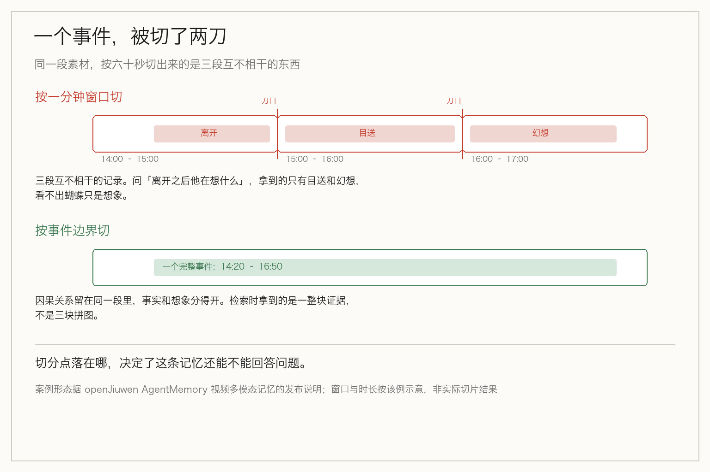
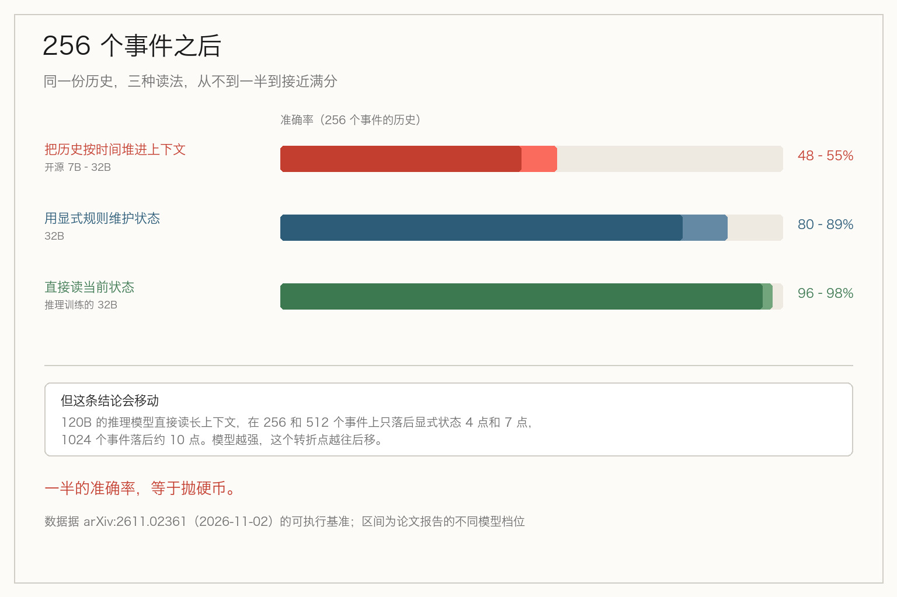

> **摘要**：记忆按秒切还是按事件切，方向对，但那个 45.7% 没有官方出处。一篇 arXiv 论文给出了更硬的答案：赢的不是事件，是按状态的依赖关系选；而且这个结论有适用区间。

三小时的发布会录像，一整天的监控，一场两小时的评审会。要让 agent 记住这些东西，第一个决定不是用哪个模型，是**你打算按什么单位切它**。

这段时间被传播最广的答案是「按事件切」。我把这套说法的出处翻了一遍，情况比宣传语复杂。

## 那个 45.7%，官方仓库里查不到

openJiuwen 的 AgentMemory 0.2.0 上线视频多模态记忆，被报道成「按秒盲切是记忆碎片化的元凶，按真实事件记忆才是正解」，配两个数字：召回精度最高提升 45.7%，在线问答时延最高降低 97%。

去翻官方仓库，会发现三处对不上。

**第一，「OmniMem-Lens」这个名字在官方仓库里找不到。** 官方对这块能力的正式叫法是「视频多模态记忆」，特性文档编号 F05，状态标注为已落地；媒体说的「视听双流」，对应的官方机制名是「自适应双流事件边界分割」。

**第二，那两个百分比没有官方出处。** 官方发布说明里没有这组基准。仓库 `evaluation/` 目录下放的是 LoCoMo 与 LongMemEval，都是文本端到端问答基准、由 LLM 当评委，不覆盖视频多模态这两个指标；视频侧目前没有官方公开基准可跑。

**第三，45.7% 只出现在一个评测集上。** 三个集子里，Video-MME-L 提升 8%，LVbench 提升 6.4%，45.7% 来自 EgoLife-QA——那个集子是第一人称记录一整天生活，事件密集、细节琐碎。取最高值当标题是通行的做法，但它不是普遍水平。

方向可以信，数字要打折。这是看任何一篇带百分比的发布稿时，成本最低的一次核对。

## 它的机制里，有一条自陈的退路

抛开命名争议，这套设计本身值得看。

它把视频记忆分两级：**片段级**记「那一瞬间画面里发生了什么、说了什么」，能定位到第几秒到第几秒并回指原始文件；**事件级**记「这件事从头到尾是怎么回事」，由多个片段组成，并且保留「事件 → 片段」的从属关系。切边界靠两路交叉——语音转写判断话题变化，视觉判断场景切换。

必须两路，因为单独一路都会失灵。一场两小时的评审会，屏幕上始终是同一张架构图，四十分钟没有变化，但讲者先后讲了架构设计、性能压测、下季度排期三个议题。只看画面的方案会把四十分钟判成同一段内容，把三个议题打包进一条记忆，等你去问「性能压测那部分的 QPS」，关键数字埋在噪音里。反过来，没有台词的镜头切换，听觉什么也听不到。

这套逻辑站得住。但官方特性文档里还写了一条退路，值得单独拎出来。

**视频没有音轨、或者语音转写没产出有效文本时，流水线不判失败，而是跳过音频切分、按固定窗口和视觉流继续构建。**

也就是说，「按事件切」有一个前提：得有可用的语音。静音视频会退回它要批判的那种做法。这不是缺陷，能在文档里写出来是诚实；只是宣传语不会提这一句。

## 分层存的不是更多，是更省

三层结构里，原始视频留在底层，事件级存大纲，片段级存秒级细节。在线检索先跟上面两层做语义匹配，只有需要核对视觉细节时才回取原始帧。

但更关键的一句在官方愿景文档里：整个系统只有一个真源——原始数据，其余所有分层记忆和索引，都能从原始数据重建。

这句话比「三层结构」重要得多。它意味着冲突消解、遗忘降权这类自我演化的动作是可以后悔的——演进搞坏了，回源重放一遍就能复原。

能被重建的东西，才敢让它自己长。这是分层记忆真正的价值，不在容量，在可回退。

## 但真正的问题不在时间还是事件

到这里都是某一家产品的设计。要回答「该按什么切」，得看更独立的证据。

十一月二日，arXiv 上有一篇论文把这件事做成了可执行基准。它构造的场景是权限系统：grants、withdrawals、reinstatements、expiries、change windows，任务是根据完整历史判断「这个服务现在能不能动」。打分方式很苛刻——用**只在事件顺序或某一个字段上不同的历史对**来考，答对一个不算数，得两只都对。

结果是这样：

- 开源 7B 到 32B 的模型，历史有 8 或 16 个事件时，准确率 72% 到 86%；**事件涨到 256 个，掉到 48% 到 55%**。
- 推理训练过的 32B 模型，直接读当前状态，答对 **96% 和 98%**。
- 论文里有一句更狠的：**不管时间顺序地保留日志行，出错概率接近二分之一**。

一半。这个数字说明，把历史按时间堆在上下文里、指望模型自己找，在长历史上不是效果差一点，是接近抛硬币。

## 赢的不是事件，是状态

那什么赢了？论文把 agent memory 当成递归过滤：决策只通过一个状态依赖历史，而**状态的大小由你跟踪了多少个键决定**。

具体做法是：模型解析每一行，显式规则施加更新。这个组合在 256 个事件时答对 **80% 到 89%**，打败了相关性检索、模型自己记账、StateMem 的复现以及 Mem0 库。有意思的是，一个在查询时选择「所查询状态依赖的那几行」的检索器，在第一个领域的 256 事件上跟它打平——说明**决定胜负的是「按状态的依赖关系选」，而过滤器只是把这件事挪到了写入时做**，不需要等查询。

还有一处反面证据：让模型直接自己施加解析出的更新、不靠显式规则，准确率掉到 58% 和 59%。模型能读懂每一行，不代表它能可靠地维护状态。

所以「按事件切」比「按时间切」好，原因不是事件更自然，是**「事件」这个先验比「60 秒」更接近「有意义的变化」**。但它仍然是猜的——猜什么东西大概齐是一件事。按状态依赖切不是猜，是从「我要回答什么」倒推「必须跟踪哪几个键」。

## 这个结论有适用区间

论文没有一边倒。一个 120B 的推理模型读长上下文，在 256 和 512 个事件上只落后显式状态 4 点和 7 点，到 1024 事件落后约 10 点。

它自己的表述是：显式状态在哪个长度之后胜过长上下文，**取决于读者模型有多强**——模型越强，这个转折点越往后移。

这条比「应该做结构化记忆」有用得多，因为它告诉你在哪里停手。如果你的历史还在几百条以内，用的又是会推理的模型，那这套结构化就是过度设计，收益抵不上你为它写的状态机。

## 记忆最后是被「该不该开口」检验的

还有一组实验，把记忆的用途从「答得上」推到了「什么时候答」。

Meta 参与的 MemoProAgent 用第一人称视频配约一年的合成个人历史，主指标叫 Perfect：内容对、时机对，而且**整段对话只提醒一次**。在一百五十段视频的受控实验里：

- 直接把正确的证据给模型，并且只在标注的触发窗口内提供，Perfect 是 **96%**；
- 同样的证据一直可见、让模型自己选时机，降到 **38%**；
- 换成标准检索增强，即使证据仍在窗口内，只有 **15.3%**。

那个基准里，目标证据平均只占约 61.8 万 token 历史的 **0.19%**。

从 96 掉到 15.3，差的不在检索质量——证据一直是对的、一直拿得到。差的是**它出现在哪个窗口里**。上一篇讲主动型 agent 时说过策略层（什么时候不该动），这里看的是数据层：如果记忆是按时间窗口存的，门控模型手里就是一堆没有边界的东西，它判断不了「这条是不是已经处理完了」。

记忆存得好不好，最后不是用「召回率」检验的，是用「它有没有在该开口的时候开口」检验的。

## 所以该怎么选

把这几条放在一起，顺序其实很清楚，三个问题依次问：

**你要回答的问题依赖哪些键？** 先列键，再决定存什么。这一条定的是结构，不是存储引擎。

**你的历史会涨到多少条？** 几百条以内、模型够强，就别做结构化，把状态机省下来。超过几百条，显式状态的收益才开始盖过维护成本。

**你需要在什么时候开口？** 这决定检索是「有问必答」还是「到点才说」。前者按事件切够用，后者必须把时机本身存进结构里。

还有一条判据更直接：**如果你的查询总是带着明确的时间点，按时间切就够；如果查询是「这件事后来怎么样了」，按时间或事件切都不够，你得按状态切。**

最后说一个容易被忽略的前提。视频之所以需要做事件分割，是因为原始信号是连续流，本身没有边界，必须造一个。可大多数 agent 的历史不是视频——是对话和工具调用，一次用户发言、一次工具返回，天然就是边界。**这些场景里「按事件切」是免费的，你已经在这么干了；真正缺的是「按状态选」。**

## 最后

记忆的切分单位看着是个存储格式问题，其实是**你对「什么算一件事」的定义**。

按秒切，是把定义外包给钟表。按事件切，是把定义交给一个模型去猜。按状态依赖切，是把定义交回给「我要回答什么」。

三种都在猜，只是猜的依据不同。而能说清「我要回答什么」的那一刻，记忆的结构其实已经定下来了。

## 参考资料

- [openJiuwen AgentMemory 0.2.0 视频多模态记忆](http://mp.weixin.qq.com/s?__biz=MzYzMjM3MjgyOQ==&mid=2247487564&idx=1&sn=3a6162b442f804f8703bc6453d4e321e)（官方发布稿，2026-11-04）：三级记忆结构、自适应双流事件边界分割、三个评测集的精度与时延对比
- [把一个 Agent 记忆系统的仓库翻了一遍](http://mp.weixin.qq.com/s?__biz=MzY4MzI4NTU2NQ==&mid=2247489607&idx=1&sn=5dd260053995930e347ccd634e2ca979)（仓库核查）：官方无 OmniMem-Lens 之名、45.7% 与 97% 无官方出处、F05 能力边界、无音轨时的降级路径
- [Agent Memory as Rate-Limited Filtering: Explicit State Outlasts Long Context Beyond a Reader-Dependent Horizon](https://arxiv.org/abs/2611.02361v1)（Tianhao Guo、Chongyao Guo，arXiv:2611.02361，2026-11-02）：递归过滤框架、256 事件下的准确率、与检索及 Mem0 的对照、随读者模型变强的转折点
- [AI 助手也要学会闭嘴？Meta 让 Agent 判断什么时候该提醒](https://www.yeyulingfeng.com/a/1292100.html)（MemoProAgent 与 MemoProBench）：Perfect 指标定义、96%/38%/15.3% 三组对照、目标证据占比 0.19%

