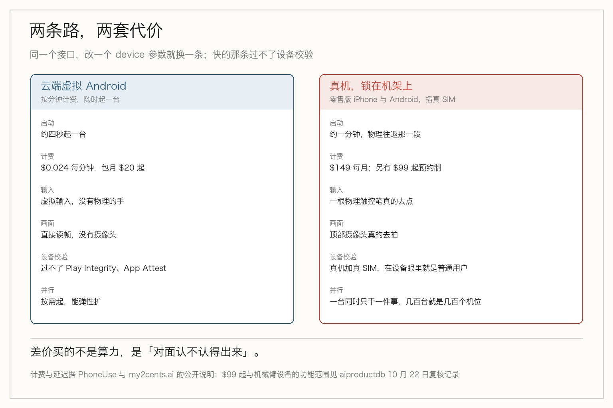
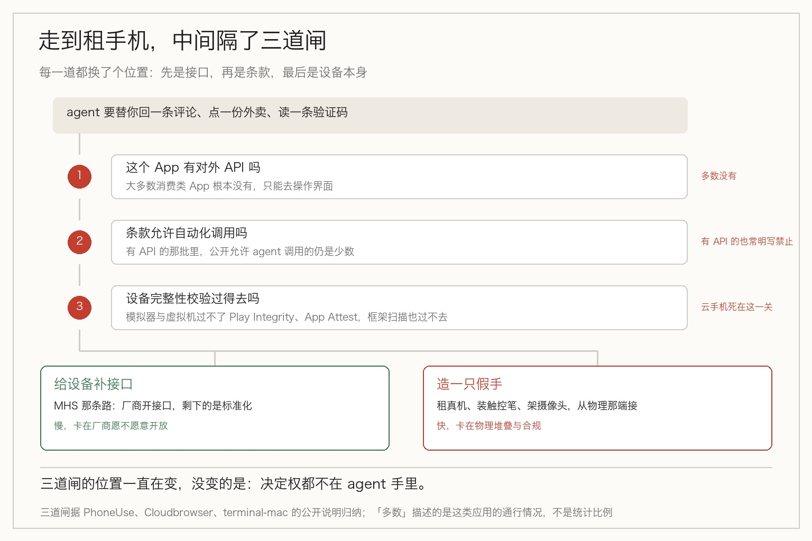

> **摘要**：agent 操作真实 App，往往不是不会用，是被平台认出不是人。有人拿硬件解决：旧金山机架上的真 iPhone、一根触控笔、一个顶部摄像头，$149 一个月。这笔钱买的不是算力，是「通过检测」。

你想让 agent 帮你回一条评论。它打开 App，两秒后收到一条提示：检测到异常环境，账号受限。

它没做错任何事。它只是被认出来了。

问题出在哪？不在它的判断，在它跑在什么设备上。

这类卡点，现在开始有人拿硬件解决——不是把 agent 调得更聪明，而是给它配一部真手机、一根机械臂、一个摄像头，让对面相信用户是个活人。

## 它租的不是算力，是一部真手机

十一月三日，Hacker News 上出现一个叫 PhoneUse 的项目。它给 agent 的不是 API，是十二个操作手机的工具，走 MCP 接进去。

`phone.acquire` 拿一部手机、`screen.read` 读屏、`tap` 点、`type` 打字、`swipe` 滑动、`app.open` 开应用、`sms.read` 读短信，还有五个没在首页列出来。

接进 Claude Code、Codex、Cursor 或 Windsurf 就能用，不用装 SDK。

背后是两条路，差别比名字大得多。

## 四秒，和一分钟

两条路差在哪？先看便宜的那条。

云端那条是虚拟 Android，启动约四秒，按 **$0.024 每分钟**计费，包月二十美元起。

真机那条在旧金山的机架上，零售版 iPhone 和 Android，插着真实运营商的 SIM 卡。**不越狱，也不装任何辅助 App。** 输入靠一根物理触控笔真的去点，画面靠顶部摄像头真的去拍。

这么做不是为了好看。App 会检查自己跑在什么设备上，模拟器和虚拟机过不了 Play Integrity、App Attest 这类完整性校验，一串自动化框架扫描也都过不去。真机加真 SIM 加真触控，在设备眼里它就是一个普通用户。

切换两条路只改一个参数：`device="cloud"` 还是 `device="real"`，同一个接口。

差别最后落在延迟上。MCP server 往返是「低三十毫秒级」，但物理世界那一段——真的伸出一根笔去点、真的拍一张照片回来——**大约一分钟**。

官方举过一个例子：一部 iPhone 15 Pro 读到 Instagram Reel 的三十八条评论，逐条回复，2.8 秒跑完。这个 2.8 秒是工具层的账，物理世界那本账另算。

## 为什么不直接调 API

这里得停一下。既然只是回评论、点外卖、读验证码，为什么不调 API？

因为大部分 App 没有对外 API。有 API 的那些，条款里通常也明写禁止自动化调用。剩下唯一的路，是像人一样去操作界面。

而界面这条路，现在被反欺诈守着。

于是整件事变成了一个奇怪的循环：为了让 agent 用上 App，你得先让它**在设备层面装成一个人**。这不是模型能力的问题，是准入的问题。

## 同一招，也用在浏览器和整台电脑上

手机不是孤例。十一月初还有两个项目，思路一模一样，只是租的东西不同。

Cloudbrowser 给每个 agent 一个**持久化的 Chrome 身份**——Cookie、localStorage、下载记录都存在里面，暂停再恢复还在。

人可以先用 live view 登录自己的账号，然后把同一个浏览器交出去，agent 接手时登录态是现成的。agent 通过一个受限的 CDP 地址接 Playwright 或 Puppeteer，暂停中的浏览器还能 fork 成独立副本去跑并行任务。

terminal-mac 更狠一点：它在 Apple 芯片的 Mac 上用 Apple Virtualization 起一台**独立的 macOS 虚拟机**，把画面流进 Kitty、Ghostty 或 iTerm2。

agent 在这台虚拟机里截图、点击、拖拽、输入，宿主机上的应用、登录态、剪贴板一概不碰。

三个项目租的东西不一样——一部手机、一个浏览器身份、一整台电脑——但卖的是同一件东西：**一个专属的、隔离的、在对方看来正常的执行环境。**

## 连「我是不是虚拟机」都要自证

terminal-mac 里有个细节，我看了两遍。

虚拟机里的 helper 会检查硬件型号是不是以 `VirtualMac` 开头。如果对不上，操作就不往那台虚拟机上发。

这个检查不是给 App 看的，是给你自己看的——防的是 agent 的操作意外落到真实的 Mac 上，动了你的鼠标和剪贴板。

但你反过来想：一台机器需要主动确认自己「是不是虚拟机」，说明在被识别这件事上，它没有把握。

## 这笔账怎么算

这钱到底买了什么？先说价格，因为这里有个不一致。

多个二手报道写的是**真机 $149 一个月**。但有一份十月二十二日的产品复核记的是官网标 **$99 起、预约制**，而且加了一句更要紧的：当前设备文档显示，机械臂那批 iPhone **仅支持通话，不在 API、MCP 和 CLI 的覆盖范围内**。

如果这句成立，那 Show HN 上「把 Claude Code 接上一部真 iPhone」的演示，和实际能买到的东西之间，还隔着一层说明。

再看规模。一台设备同一时刻只能干一件事，那么「几百台并行」就只能是几百个机位、几百根笔、几百个摄像头。这不是软件弹性，是物理堆叠。云端 Android 那边才谈得上弹性——四秒起一台，按分钟计费。

还有一处容易忽略：Cloudbrowser 说得很清楚，暂停再恢复能保住 Cookie 和存储，但**内存里的页面状态不保证能活下来**。也就是说，恢复之后的 agent 面对的是一个登录着的、但可能已经翻篇的页面。

## 和九月那篇不冲突，是接上

九月我写过 Anthropic 的 MHS，给显微镜、机械臂、移液机器人定一套统一的驱动规范，让 AI 能指挥实验室设备。那篇的结论是：协议本身不是瓶颈，真正卡住的是厂商愿不愿意开放接口。

这一篇是同一个问题的另一半，但走向相反。那为什么还要单独写？

MHS 的前提是**设备有编程接口**——有了接口，剩下的是标准化。PhoneUse 面对的是**没有接口、而且明确不欢迎你自动化**的 App。没有接口可接，就只能从物理那一端硬接上去：一根笔、一个摄像头、一部真手机。

一边是把有接口的东西连起来，一边是给没接口的东西造一只假手。这两件事放在一起，才看得清 agent 到真实世界的路有多长。

## 说句不好听的

这套设计的目标写得很坦白：让 App 认不出对面是机器。而 App 做设备完整性校验的目的，恰恰是把机器挡在外面。

两边的目标正好相反。

大多数 App 的用户协议里都写着禁止自动化访问。租一部真手机、装一只机械臂去点它，算不算绕过了对方的技术措施？这个问题我没有一个干净的答案。

工具本身是中性的，卖手机的服务也不为你的用途负责——但签下那份使用条款的时候，你其实已经默认了一件事：**你打算让对面不知道它是机器。**

这笔钱里有一半，是「通过检测」的费用。

## 最后

把这一圈看下来，形状是这样：agent 卡住的地方，往往不在它会不会，而在对面允不允许。允许的方式有两种——给你接口，或者识别不出你。

给接口那条路（MHS 那种）走得慢，卡在厂商激励上。识别不出那条路走得快，代价是硬件和月租：$0.024 一分钟的云端 Android，或者报价从 $99 到 $149 不等的真机加机械臂。

三个项目值得记住的也不是具体产品，是它们共同的定义方式：**给 agent 一台设备，说到底是给它一个身份**。这个身份要能登录、要有历史、要骗得过检查，还得关起门来别碰到你自己的东西。

terminal-mac 那句「不是现成的沙箱安全方案」写得很实在——默认网络还能通外网和局域网，快照回滚也还没做。这些坑现在都敞着。

那这条路能走多远？租得来硬件，租不来允许。平台换一种检测方式，这批设备就得重新证明自己一次。

至于值不值，取决于你要干的事有多绕不开那个 App。

## 参考资料

- [PhoneUse – Phones for AI Agents（Show HN，2026-11-03）](https://news.ycombinator.com/show)：十二个 MCP 工具、云端 Android 约四秒启动与 $0.024 每分钟、真机机架与物理触控笔加顶部摄像头、通过 Play Integrity 与 App Attest、单一参数切换两条路
- [Commercial Agent Tools: November 3, 2026（my2cents.ai）](https://www.my2cents.ai/news/2026-11-03-commercial-agents)：PhoneUse 与 Cloudbrowser 的同期记录，含真机 $149 每月、Cloudbrowser 的暂停、恢复与 fork 行为及定价
- [PhoneUse 产品复核（aiproductdb，复核日 2026-10-22）](https://aiproductdb.com/products/phoneuse)：官网标 $99 起预约制，以及「机械臂 iPhone 仅支持通话、不在 API/MCP/CLI 覆盖范围」的记录
- [terminal-mac（govijr/terminal-mac）](https://github.com/govijr/terminal-mac)：Apple Virtualization 启动独立 macOS guest、guest 内 helper 检查硬件型号 `VirtualMac` 前缀、早期候选版本与非沙箱的自陈限制
- [MHS：给 AI 一张硬件驾照（本站，2026-09-01）](/2026/09/01/mhs-physical-ai/)：MHS 的驱动层设计、只支持有编程接口的设备、以及「协议不是瓶颈」的判断

