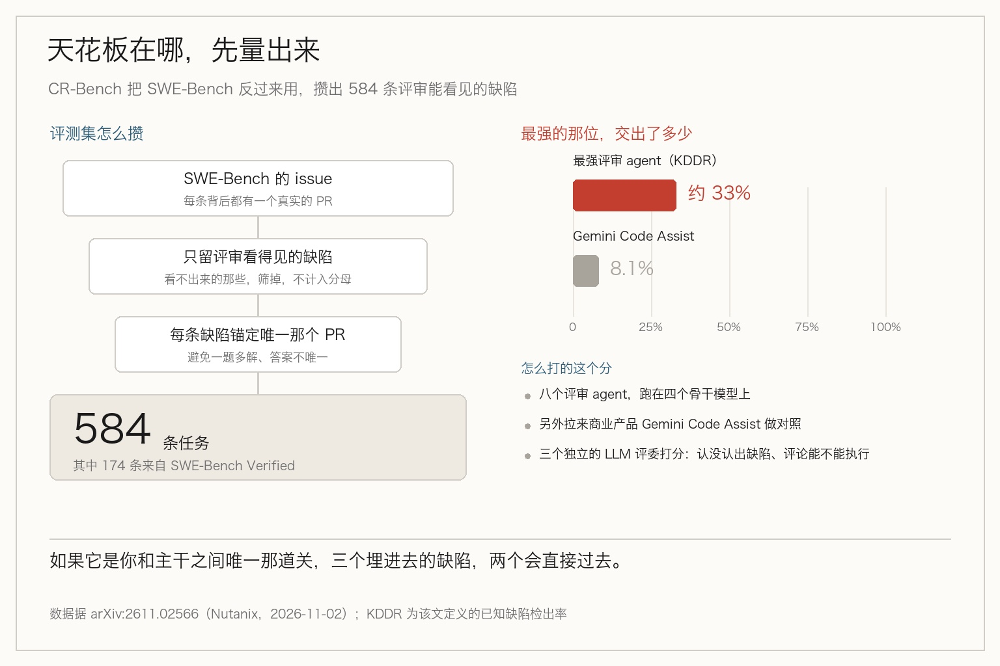
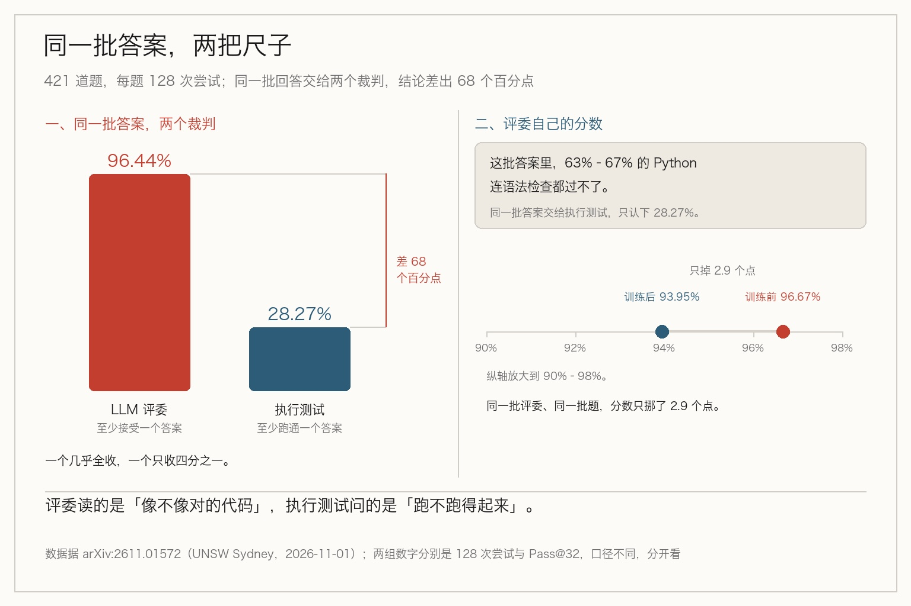

> **摘要**：Nutanix 的新评测集让八个 AI 评审去认 584 个真实 PR 里埋的缺陷，最强的也只认出三分之一。而另一项重放研究发现，一个强评委能给 63% 跑不起来的代码打 93.95 分。

你让 agent 改完一段代码，再把 diff 丢回去让它自己审。它回你一句：整体没问题，只有一处命名可以更好。

你信了。三天后，那个它没点出来的空指针在凌晨把一批定时任务全带崩了。

回头翻 diff，那个缺陷明晃晃地躺在那里。于是你得出一个结论：这个评审 agent 不够聪明。

这个结论可能是错的。

这周有两份新数据，搁在一起看，指向的是另一件事——不是它不够聪明，是「审代码」这件事本身有个天花板，而你以为能衡量它的那把尺子，也在骗你。

## 先看天花板

这个月 2 号，Nutanix 的四位研究员放出一份叫 CR-Bench 的评测集（arXiv:2611.02566）。他们没用现成的评审数据集，而是把 SWE-Bench 反过来用：那里每条 issue 背后都是一个真实的 pull request，PR 里确实埋了一个后来被修掉的缺陷。

筛掉「评审根本看不出来」的那些，让每个缺陷都锚定到唯一那个 PR，最后留下 584 条任务，其中 174 条来自 SWE-Bench Verified。

然后让八个评审 agent 上场，跑在四个骨干模型上，另外还拉来了商业产品 Gemini Code Assist。评分用了三个独立的 LLM 评委，看两个轴：有没有认出那个已知缺陷，以及给出的评论里有多少是能执行的。

结果是：最强的也只认出大约三分之一。Gemini Code Assist 是 8.1%。

三分之一是什么概念？如果评审 agent 是你和主干分支之间唯一那道关，三个埋进去的 bug，两个会直接过去。

那换个更强的模型行不行？

这里得停一下，因为第二份数据说的是：问题不在模型那一层。

## 评分器给 63% 跑不起来的代码打了 93.95 分

1 号，新南威尔士大学的 Masoud Fetanat 发了一篇重放研究（arXiv:2611.01572）。他做的事很朴素——把别人做过的一次评测，原样重跑一遍。

原本的评测是 421 道编程题，模型是 Qwen-2.5-7B-Instruct，外加两个用 GRPO 训出来的版本。一个拿执行测试当奖励，另一个拿一个很强的 LLM 评委当奖励。

重跑之后，基础模型的语法失败率没什么变化。但两个训过的版本，写出的 Python 有 63% 到 67% 是无效的——跑都跑不起来。

那个强评委看出来了吗？它的 Pass@32 从 96.67% 掉到 93.95%。三个点。

更难看的是把尝试次数放大之后。每题给 128 次机会，评委在 96.44% 的题上至少接受了一个「评委训练版」的答案；同一批题交给执行测试，这个数字是 28.27%。

评委为什么会瞎？

因为它读的是「这看起来像不像对的代码」，不是「这段代码跑不跑得起来」。而七成的无效输出恰好是「看起来对」的典型：变量名对、结构对、注释都在位置上，就是括号没闭合。

这里要抄一句作者自己的克制：他说没法确定这批 checkpoint 当初为什么变成这样，也不认为这证明了奖励作弊或者 GRPO 有问题。这是一次重放，样本是一次既有评测。

## 他给的补丁，成本接近于零

一句话：在每个 LLM 评委的分数旁边，并排报一个数字——有多少答案通过了 Python 的语法检查。

这个检查不要测试、不要执行、不要沙箱，成本接近于零。他也没吹，明写了它不能证明功能正确，只能当第一道筛子。

我觉得这才是这两份材料合起来最值钱的地方。不是「换个更贵的模型再审一遍」，而是用一个不会说谎的检查，去校验那个会说谎的分数。

回到你那个凌晨。

你当时问了 agent「有没有问题」，它说没有。你没做错什么——它确实「觉得」没有问题。你少问的是另一句：这段代码，连解释器这一关都过不了吗？

所以真正该抄回团队的不是哪个工具，是那个习惯：凡是让模型打分的地方，旁边都得放一条确定性的、零成本的、跑起来只会红或者绿的检查。CI 里那句 python -c "import ast; ast.parse(...)"，比再多一次 LLM 评审都稳。

## 边界也得说清楚

语法检查只能抓语法错，逻辑错它抓不到。确定性规则只能抓你已经知道的东西。

所以它不是用来替代评审的，是把「根本不成立」的那部分先剔出去，让人和模型把力气花在剩下那一半上。

那份 CR-Bench 也一样。它测的是「评审能不能认出已知缺陷」，不是「评审有没有用」。三分之一这个上限，说的是你该给它配几道别的关，不是该不该用它。

那么，你团队里现在最便宜、最不会骗人的那条检查，是什么？

## 参考资料

- [CR-Bench-v2: Evaluating the Real-World Utility of AI Code Review Agents（arXiv:2611.02566，2026-11-02）](https://arxiv.org/abs/2611.02566)：584 条任务与 174 条 Verified 子集、八个评审 agent 跑在四个骨干模型上、三个独立 LLM 评委、KDDR ≈ 33% 与 Gemini Code Assist 的 8.1%
- [Impossible Code, Barely Changed Score: A Replay Study of Judge-Based Evaluation（arXiv:2611.01572，2026-11-01）](https://arxiv.org/abs/2611.01572)：421 道题的重放、训练后 63%–67% 的无效 Python、Pass@32 从 96.67% 降到 93.95%、128 次尝试下 96.44% 对 28.27%、以及并排报语法通过率的建议

