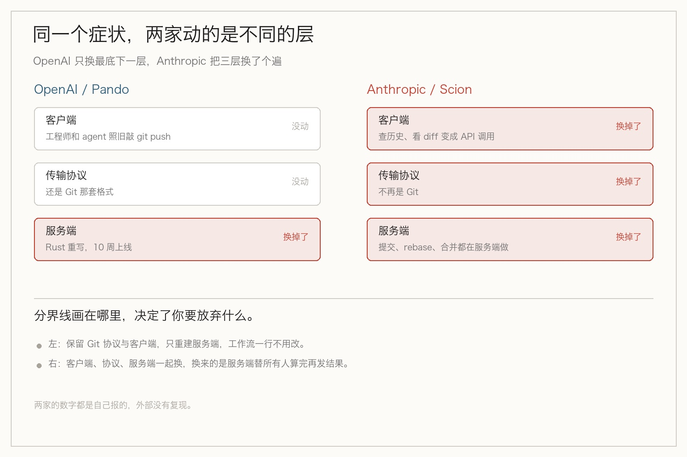
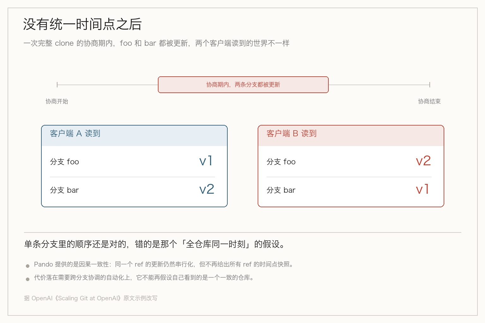

> **摘要**：OpenAI 把中位推送延迟压到原来的五分之一，代价是仓库不再有一个统一时间点；Anthropic 干脆换掉了 Git，换来的是取消合并队列的全局锁。同一个症状，两家给出了相反的诊断。

下午四点，你在等 CI。三个分支挂着，push 上去要等十几秒，fetch 卡在 resolving deltas 上转圈。

你骂了一句：Git 真慢。

把这个量级放大到几千倍，就是 OpenAI 去年年底的状态。而他们给出的结论，跟你的第一反应正好相反。

## 先看两家被压成什么样

两个月前，OpenAI 工程博客发了一篇《Scaling Git at OpenAI》。11 月 2 日，作者是 Aaron Friel、Taylor Blau 和 Ted Nyman 三个人。

起因写得很平实：Codex 普及之后，一个工程师手头同时挂着好几个改动等 CI，而每次 push 又会触发多个任务去拉同一个 commit。去年年底开始，拉取和推送变慢，合并开始失败，可靠性一度掉到 90% 以下。

Anthropic 那边的数字更狠。他们 10 月 13 日发的那篇里写，2026 年 5 月平均每天合并 2500 个改动，到 9 月超过 3 万个。主分支历史近 100 GB，压缩之后的工作副本还有 25 GB 以上。

光 CI 每天就要检出 2500 万次，这还没算开发环境和 agent 沙箱。峰值时他们维护着几百个内部 Git 镜像。

这里得拆一个在中文圈传得很广的数字。有个说法是一天 600 PB 的 Git 流量。原文那句是「如果用最朴素的方式拉」，意思是把 2500 万次检出乘上每次拉完整仓库，属于算术推演，不是实测流量。他们自己在前面加了 Fetched naively 这个前提。

所以症状是同一个：机器写代码的速度，超过了版本控制系统被设计时预期的读者和写者数量。

那病因呢？

## OpenAI 只动了最底下一层

他们的诊断可以拆成一句话：这是 Git 的极限，还是我们托管单一大仓库的方式到了极限？

选了后者之后，改法就很清楚了——**只换服务端，Git 的命令、协议、客户端原样不动**。

Git 扩容其实只有两个维度：很多人往不同分支写，很多人读同一段历史。Pando 对这两个方向各做了一个选择。

写的方向，按分支独立协调。推 foo 的人不用等推 bar 的人，不相关的分支并行推进。读的方向，不再给每个客户端单独打一个包，而是复用同一批 packfile——客户端可能多下一点自己已经有的对象，但服务器算一次，同样的字节能发给成千上万个客户端。

效果按官方说法：中位推送延迟降到原来的五分之一，每天要发近 1 PB 的 Git 数据。还有个更具体的数，一小时发过 57 TB 的 packfile，其中 99% 以上来自本地磁盘缓存，几十个 CPU 核就够。



真正有意思的是他们否掉的两条路。这两条恰好是大部分团队会先想到的：

| 方案 | 写这条路 | 读这条路 | 仓库级一致性 |
|---|---|---|---|
| 三阶段提交 | 推送要把包复制到所有副本，还得等多数派点头 | 本地有完整副本，快 | 有 |
| 共享 WAL + manifest | 连推不相关分支也要改同一个 manifest | 要从日志里追，慢 | 有 |
| Pando | 按分支独立协调，不同分支并行 | 复用 packfile，99% 命中本地缓存 | 放弃，改因果一致 |

三阶段提交死在「等多数派」上。原文那句话点得很准：等待多数派，等于把副本的磁盘性能和网络延迟放进了推送路径。

共享 WAL 死在「同一个 manifest」上。compare-and-swap 的往返时间，直接卡住了发布新 manifest 的频率——推不相关的分支也要排队。

两条路栽在同一个地方：所有写操作都得抢同一个协调点。

## 代价是仓库不再有一个统一时间点

这是整件事里最容易被忽略的一段，也是我最想让你看清楚的一段。

Pando 放弃的第一样东西，是仓库级一致性。它提供的是因果一致性。

翻成人话：同一条分支上的更新还是严格有序的，但你的仓库不再有一个「此刻所有分支都长这样」的快照。

原文举了个例子。一次完整 clone 的协商期间，假设 foo 和 bar 都被更新了。协商结束时，一个客户端可能看到 foo 是 v1、bar 是 v2；另一个客户端看到的正好相反，foo 是 v2、bar 是 v1。



听着像学术细节，落到实处是这样的。

任何需要「同时读多个分支、并且假设它们属于同一个时刻」的脚本，都可能读到一个现实中从未存在过的组合。CI 里那种拿 A 分支的配置去跑 B 分支测试的活儿，就是典型。

OpenAI 的辩护是：实际上人和 agent 都不在意 ref 的全局顺序，他们在意的是单条 ref 上的顺序。这个辩护站得住。

它不站得住的地方，是自动化开始跨分支做判断的时候。比如判断「主干和发布分支是不是指向同一批改动」，比如把三个分支的依赖版本对齐。这类逻辑过去靠的是一个隐式假设，现在得自己写显式检查。

顺带说一句，单条 ref 内的更新仍然是串行化的。所以日常用 git push、git merge、git log 的体验，一点没变——这也是他们敢只换后端的原因之一。

## Anthropic 把三层都换了

Scion 走的是另一条路，而且走得彻底。

客户端不再持有完整仓库。提交、rebase、合并都在服务端做，查历史、看 diff 是 API 调用，工作副本是可选的、虚拟的，文件被读到时才出现。

7 个人，5 个月，做出 Scion、一个叫 Antique 的代码评审工具，还有半打配套系统，把整个主干迁了过去。

按他们的说法，基础设施占用小了 200 倍（CPU 和内存），CI 检出从分钟级降到秒级，光 CI 就省出 25% 的 CPU 容量。

这三层里，最上面那层原本是 Git 二十年攒下来的资产：完整的本地副本、离线也能提交、任何工具都能直接读 .git 目录。Scion 把这份资产换成了另一份——服务端算完再发结果。

## 他们的代价在合并队列

这里有个反问，我觉得是全文最狠的一句：

当成百上千个改动能在测试还在跑的时候合并，CI 到底意味着什么？

（那他们怎么保住主干的绿？）

答案是不保了。

行业标准的合并队列会给仓库上一把全局锁，一个一个来，每个改动都对着最新的主干加上前面排队的那些跑一遍。Anthropic 说自己没能把这件事在 agent 规模下复刻出来，于是把门挪到了后面——投在合并后、部署前的自动测试上。

代价是主干可能一段时间是坏的。并发改动会冲突，他们的应对是让 Claude 去修，官方说通常比人发现得还快。这句话我信一半：修得快是真的，但「主干坏着的时候有人在往里合」这个窗口，不会因为修得快就消失。

他们还自己划了边界，原话是：Scion 绝不是 git 的通用替代品。紧跟着的限定是，只有「几万个工程师，或者成群 agent 猛写代码」的超大仓库，这套东西才说得通。

## 为什么结论会反着来

到这儿你可能会问：都是第一手的监控数据，凭什么一个说 Git 没问题，一个说 Git 不行。

Pando 那篇的三个作者里，有一位叫 Taylor Blau。这个名字在 Git 邮件列表里出现很多年了，发的补丁集中在几何重打包、多包索引、可达性位图这几块——恰好是大仓库能变快的那几个底层特性。

今年 9 月 30 日，他还用 `@openai.com` 的邮箱往 git 邮件列表发 repack 的补丁，改的是几何重打包时 cruft pack 怎么进多包索引。也就是说，他一边在 OpenAI 重写 Git 后端，一边还在往上游交代码。

让一个长年在 Git 存储层动手的人去诊断「仓库为什么变慢」，他很难得出「把这东西扔了」的结论。他更可能去看：协议里是不是早就留了口子，只是没人真正用起来。

（这算不算屁股决定脑袋？）

某种程度算。但反过来看，这件事比「谁对谁错」有用得多：**同一个技术问题，你请谁来看，决定了你拿到什么答案**。

请一个 Git 存储层的维护者，他会还你一个兼容 Git 的后端。请一个习惯服务端集中式方案的人，他会还你一套新系统。两家都没错，只是擅长的地方不一样。

Anthropic 那篇没有公开署名，作者背景我不猜。但从方案形态看，那种「客户端不该持有状态、都交给服务端算」的思路，不太像从 Git 这条线长出来的。这一步是推测，我没找到公开材料。

## 你的团队要不要动

（那我们是不是也该重写一个？）

不用。

Pando 至今没有代码、没有 API、没有部署指南，能拿到的只有客户端的 Git 分支 `openai/git` 和一批已经进上游的补丁。Scion 更直接，官方说不适合通用场景。

（那看这两篇有什么用？）

三个信号现在就能量：push 的中位延迟、单次 checkout 的耗时、同一条分支上同时 push 的次数。前两个开始变差、第三个经常超过一两个，说明你也快撞上了。

在撞上之前，有三件事不用重写就能做。

```bash
# 给 agent 的沙箱用稀疏检出，别每次全量拉
git clone --filter=blob:none --sparse https://git.example.com/app.git
cd app && git sparse-checkout set services/payments

# 每个 agent 一个独立 worktree，别在一个检出里互相踩
git worktree add ../agent-42 feature/agent-42
```

第三件是把合并队列配上必需检查，让「谁先合」这件事显式化，而不是靠谁手快。

代价也都有。稀疏检出会让依赖全量目录的构建直接失败，worktree 开多了磁盘占用翻倍，合并队列会拉长单次交付的感知时间。它们买的是撞墙时不至于手忙脚乱，不是更快。

## 最后

把这两篇合起来看，真正值得带走的不是哪个方案。

同一个症状，可能对应完全不同的病因，而病因取决于谁在诊断。

OpenAI 放弃了全仓库的时间点快照，换到了五倍的推送速度。Anthropic 放弃了全局锁的合并队列，换到了秒级的检出和 200 倍小的基础设施。

两家都不是给普通团队准备的。能抄的只有那几个可以量的信号，和那句反问：你流水线里哪一步，是必须一个一个来的？

那个「必须一个一个来」的地方，就是 agent 压过来时最先响的地方。

## 参考资料

- [Scaling Git at OpenAI（OpenAI Engineering，2026-11-02）](https://openai.com/index/scaling-git-at-openai)：Pando 的设计、按分支独立协调与 packfile 复用、中位推送延迟降至原五分之一、每天近 1 PB、一小时 57 TB 且 99% 来自本地磁盘缓存、被否决的 3PC 与 WAL 两条路径、因果一致性的定义与 foo/bar 示例、10 周从立项到生产、Rust 实现
- [Redesigning source control at Anthropic（Anthropic Engineering，2026-10-13，10-15 更新）](https://www.anthropic.com/engineering/redesigning-source-control)：合并量从每天约 2500 到超过 3 万、主分支历史近 100 GB、压缩工作副本超 25 GB、每天约 2500 万次 CI 检出、峰值数百个 Git 镜像、7 人 5 个月、基础设施占用小 200 倍、检出快两个数量级、CI 省出 25% CPU、取消全局锁改投合并后与部署前测试、以及「Scion 绝不是 git 的通用替代品」的原话
- [git 邮件列表：repack 系列补丁（Taylor Blau，2026-09-30）](https://marc.info/?m=179073158065799)：几何重打包下 cruft pack 与多包索引的处理，署名邮箱为 openai.com 域
