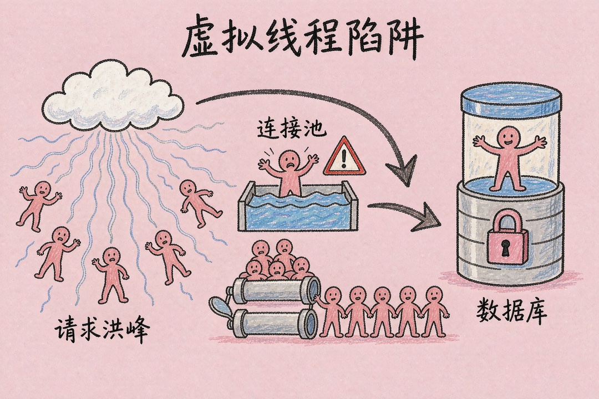
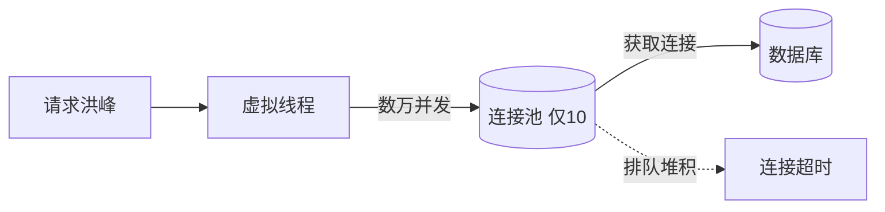

> **摘要**：升到 Spring Boot 4.1，虚拟线程自动开启，CI 全绿，你以为高并发稳了。结果压测第一轮连接池就打满、请求超时。这篇讲清楚：为什么虚拟线程会反手拖垮 HikariCP，以及三招把它救回来。

你照着官方文档把项目升到 Spring Boot 4.1，CI 跑绿，部署上去，满心欢喜压一轮。结果第一轮就卡死——接口大面积超时，监控面板上 HikariCP 的 pending 连接数飙到几千。你什么业务代码都没改，性能不升反降。

你大概会想：虚拟线程不是提并发的吗，怎么反而把连接池搞爆了？其实这不是 Spring Boot 的 bug，是两套设计假设撞了车。虚拟线程假设“线程很便宜”，HikariCP 假设“连接越少越好”。两个各自都对，搁一块就出事。

## 两套假设撞了车

先搞懂虚拟线程动了什么。传统平台线程和操作系统线程 1:1 绑定，每个默认栈 512KB 到 1MB，一台 8G 的机器撑死几千个。Tomcat 默认 maxThreads 200，再往上上下文切换比 IO 等待还费。虚拟线程是 Java 21 的 Project Loom 产物，活在 JVM 层面、不绑内核。它一阻塞——查库、调接口、sleep——JVM 就把它从载体线程上卸下来，等 IO 好了再挂回去。代码不用动，synchronized、Thread.currentThread() 照样写。同一台机器，虚拟线程能轻松扛几万并发，因为大部分时间在等 IO，不占 CPU。

Spring Boot 4.1 在 Java 21+ 上会自动把 Tomcat 的工作线程换成虚拟线程，spring.threads.virtual.enabled=true 默认就是开的，零改动。这正是麻烦的起点。

HikariCP 的哲学刚好相反：连接越少越好。数据库连接是昂贵资源，它默认 maximumPoolSize=10，官方建议单服务别超过 20 到 30。传统架构下完全合理：Tomcat 最多 200 线程，不可能 200 个同时查库，十来个连接够用。

虚拟线程把这前提拆了。Tomcat 现在能接几万个请求，假设五千个同时打到数据库，连接池却只有 10 个。剩下四千九百多个全挂起等连接，等 connection-timeout 到了（默认 30 秒），一波 SQLTimeoutException 砸下来。虚拟线程把 IO 并发提了上百倍，连接池容量没跟上——这就是压测第一轮就炸的根因。



## 怎么把它救回来

最该先动的，是把连接池调大。maximumPoolSize 先设 50，connection-timeout 缩到 3000 毫秒，快速失败而不是傻等，max-lifetime 设 1800000 防数据库侧会话超时断连。

```yaml
spring:
  datasource:
    hikari:
      maximum-pool-size: 50
      connection-timeout: 3000
      max-lifetime: 1800000
```

另一招是开惰性连接。Spring Boot 4.1 内置了 LazyConnectionDataSourceProxy 的自动集成，加一行 spring.datasource.connection-fetch=lazy 就行。意思是：开事务时先不占连接，等到真正执行第一条 SQL 才去池子里拿。那些先查缓存、命中就返回的路径，传统模式下事务一开始就占住一个连接，lazy 模式下这段根本不占。配合虚拟线程，lazy 能把真实占用的连接数明显压下来——社区复盘里常看到所需连接降到原先的几分之一（属社区经验、非统一实测，实际幅度取决于缓存命中率）。

```yaml
spring:
  datasource:
    connection-fetch: lazy
```

两招一起上，是社区里最稳的组合。

等等，池子是不是越大越好？不是。数据库端的连接是硬上限，MySQL 默认 max_connections=151，你这一个服务不能独吞。多个服务共享一个库，所有服务的连接池加起来别超过库 max_connections 的 70%。池子调太大，数据库 CPU 也可能先被打满。所以先设 50，压测盯着 pending 指标再调，别拍脑袋拉到 200+。

lazy 有副作用吗？几乎没有。唯一注意点是极少数直接拿物理连接做特殊操作的代码路径，正常用 JdbcTemplate、MyBatis 碰不到。

## 还有个更隐蔽的坑

synchronized 锁钉死（pinning）比连接池更难排查。虚拟线程有个已知限制——在持有 synchronized 锁的情况下遇到阻塞，JVM 没法把它卸载，它会直接占住载体线程，那段时间内这个载体线程彻底堵死，别的虚拟线程也跑不了。Java 21 里这是个真问题，Java 24 已经修掉了 synchronized 的 pinning。你还在 21 的话，启动加 -Djdk.tracePinnedThreads=full，日志里搜 “pinned” 就能定位，把热点锁从 synchronized 换成 ReentrantLock，后者不会 pinning。有些老版本 JDBC 驱动爱用 synchronized，在虚拟线程下表现尤其拉胯，值得排查。

如果你用的是 WebFlux，就别凑虚拟线程的热闹。WebFlux 本就是响应式、不阻塞线程，虚拟线程是给传统 Servlet 架构用的，让阻塞代码也能高并发。两者选一个，别混。

下面是请求到数据库的连接竞争时序——数万虚拟线程挤在只有 10 个连接的池子前，排队的就会超时：



## 升级完，先确认这几件事

升级完第一件事，先确认虚拟线程真的开了。写个接口返回 Thread.currentThread().isVirtual()，是 true 才算数；要是 false，检查 Java 是不是 21+，以及有没有手滑关掉 spring.threads.virtual.enabled。

调连接池、开 lazy，要在开虚拟线程之前想清楚，否则性能不升反降。上线后盯两个指标：hikaricp.connections.pending 和 hikaricp.connections.timeout，pending 一直涨就说明池不够，timeout 在涨说明超时太短或池严重不足。动手调池子之前，先排除数据库本身是慢的那一腿——慢 SQL、缺索引会让连接久占不释放，调大池子只是掩盖问题。确认 pending 在涨、且 DB 端单条 query 耗时正常，才算真的是连接池容量不够。验收也别含糊：稳态压测下 pending 应趋近 0、timeout 计数应为 0，达不到就继续往上微调 maximumPoolSize，别停在 50 不动。

最后一句：虚拟线程是好事，但它改的是“能接多少请求”，改不了“能扛多少连接”。连接池这道闸，得你自己去拧。

**参考资料**

- Spring Boot 4.1 虚拟线程默认开启与 HikariCP 调优（besthub.dev 技术解读）
- 掘金 / SegmentFault 社区同主题实战复盘：虚拟线程默认开启后连接池耗尽
- HikariCP 官方池大小指南：maximumPoolSize、connectionTimeout 取值建议
- Spring 官方文档：spring.threads.virtual.enabled、spring.datasource.connection-fetch

