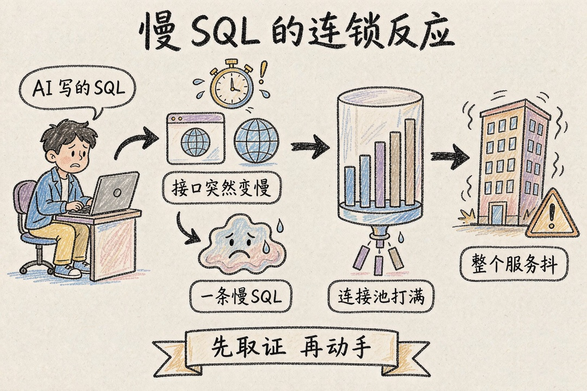
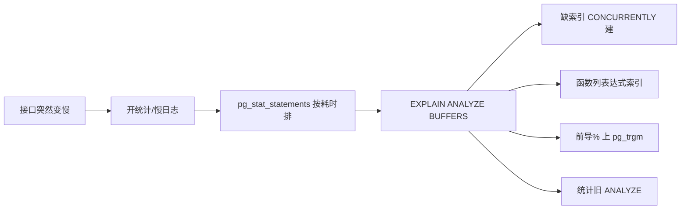

> **摘要**：AI 帮你写的 SQL 跑得飞起，某天接口却突然变慢超时。这篇讲清：为什么"直接加索引"在 Postgres 上反而危险，以及用 pg_stat_statements 和 EXPLAIN ANALYZE 把慢查询揪出来的固定路线。

你没改过业务代码。那条列表查询平时几十毫秒，某天突然三秒，接口开始超时，PgBouncer 后面的 Postgres 连接被占满，整个服务跟着抖。SQL 甚至不是你写的——是 AI 帮写的。

你盯着监控，第一反应大概是：加个索引吧。

先别急。为什么加索引这件天经地义的事，在 Postgres 上会翻车？Postgres 刻意不提供查询 hint，你没法强制它用某个索引；更隐蔽的是，当一条查询要返回表里三成以上的数据时，全表扫描本来就比走索引快——你加了索引，优化器照样不理你，白加，写入反而变慢。那正确的起点是什么？不是"加索引"，是"先拿到证据"。

为什么这几年 Postgres 越来越常见？AI 应用栈把它推成了新项目的默认库之一：pgvector 把向量检索塞进了数据库，Supabase、Neon 这类托管默认就是它，RAG、语义搜索不用再起一套专门的向量库。但它和老牌的 MySQL，底牌其实不一样：

| 维度 | PostgreSQL 强在哪 | PostgreSQL 弱在哪 |
| --- | --- | --- |
| 扩展与生态 | 扩展即能力：pgvector 向量检索、PostGIS 地理、pg_trgm 模糊、TimescaleDB 时序、FDW 外部表 | 配置面大（postgresql.conf 数百参数、默认保守），要调 shared_buffers / work_mem |
| 查询能力 | 复杂查询优化器强，CTE / 窗口函数 / 递归成熟；索引类型丰富（B-tree / GIN / GiST / BRIN，支持表达式、部分、覆盖索引） | 无查询 hint，低选择性查询优化器认为全表扫描更便宜时就不用索引 |
| 数据与约束 | JSONB 原生 + GIN 可索引；CHECK 约束、更接近标准的 NULL 处理、事务性 DDL 可回滚；原生行级安全 RLS | MVCC 死元组依赖 autovacuum，高写入表配不好会表膨胀 |
| 运维 | 逻辑复制（PG10 起）、Patroni / pg_auto_failover 成熟 | 每连接一个进程（约 10MB），高并发短连接必须前面架 PgBouncer；逻辑复制生态比 MySQL binlog 年轻 |

| 维度 | MySQL 强在哪 | MySQL 弱在哪 |
| --- | --- | --- |
| 连接与吞吐 | 线程模型连接开销小，原生扛上万连接；简单只读 CRUD 高 QPS 更轻 | InnoDB 旧版本存于 undo log，有长事务长 undo 段问题 |
| 复制与生态 | 复制生态最成熟（binlog、GTID、Orchestrator、Group Replication、ProxySQL），pt-tools 丰富 | SQL 特性曾落后（窗口函数 / CTE 到 8.0 才完善），复杂查询优化器弱于 PG |
| 易用 | 上手简单、默认配置即可跑；托管便宜档多（WordPress / PHP 生态默认） | 扩展能力弱，不能写自定义类型 / 操作符 / 扩展；JSON 支持弱于 JSONB+GIN；无原生向量检索（8.4 才加） |

归结一句：多数公开基准里，两者差距多在 10% 到 20%，真正拉开性能的是索引、连接池、副本、分区这些运维活——而本篇讲的，就是最关键的一环：抓慢查询。新项目要复杂查询、AI 特性、扩展能力，Postgres 是默认；老 MySQL 代码库、PHP 或 WordPress、极简高 QPS 主键读，MySQL 仍是好选择。

出了事，按这条路线走，大部分问题半小时能定位。

开统计和日志，先拿到证据。Postgres 不像 MySQL 有独立的慢查询日志开关，它靠一个扩展：pg_stat_statements。先建扩展，再把它加进 shared_preload_libraries 重启；或者直接用 log_min_duration_statement 设个阈值，超过一秒的语句全记下来，改完配置 pg_reload_conf 不用重启。线上想自动抓计划，把 auto_explain 也加进去，慢查询的执行计划会自己写进日志：

```sql
-- 开统计扩展（需 shared_preload_libraries 含 pg_stat_statements 后重启）
CREATE EXTENSION IF NOT EXISTS pg_stat_statements;

-- 慢查询日志阈值：超过 1000 毫秒的语句全记
ALTER SYSTEM SET log_min_duration_statement = '1000ms';
SELECT pg_reload_conf();
```

按累积耗时排，找出元凶。别凭感觉。查 pg_stat_statements，按累积耗时排：

```sql
SELECT query, calls, total_exec_time, mean_exec_time
FROM pg_stat_statements
ORDER BY total_exec_time DESC
LIMIT 10;
```

这里有个反直觉的点——一个平均八毫秒、但跑了一百万次的查询，往往比一个偶尔三秒的报表更该优化。历史日志可以用 pgBadger 出 HTML 报告，看清哪个查询在拖库。

EXPLAIN 出来的一大串，到底看哪几行？拿到嫌疑 SQL，跑这个：

```sql
EXPLAIN (ANALYZE, BUFFERS)
SELECT id, total, created_at
FROM orders
WHERE customer_id = 42
ORDER BY created_at DESC
LIMIT 20;
```

ANALYZE 是真执行，给你真实耗时；BUFFERS 告诉你数据是命中缓存还是从磁盘读。重点看几个地方：大表上的 Seq Scan，多半是缺索引；estimated rows 和 actual rows 差出几个数量级，说明统计信息陈旧，先 ANALYZE 这张表；Rows Removed by Filter 数值很大，说明读了大量根本用不上的行；Sort 节点出现 external merge Disk，是 work_mem 不够、排序溢到了磁盘。对 UPDATE、DELETE 这种会改数据的，用 BEGIN 包住 EXPLAIN ANALYZE，看完 ROLLBACK。

怎么判断优化器看不看得上你的索引？看上面那几个信号就够了，但真没用上，八成是下面这几类写法。缺索引就 CONCURRENTLY 建，函数列建表达式索引。最常用的是建索引，但务必加 CONCURRENTLY——没有它就锁表，生产上直接卡死写入。复合索引记住一条：等值条件的列放前面，范围或排序列放后面。在列上套了函数的，比如 WHERE lower(email) = ...，普通索引用不上，得建表达式索引；LIKE '%关键词%' 这种前导通配也废掉 B-tree，得上 pg_trgm 加 GIN 索引。统计信息陈旧了怎么办？先 ANALYZE。ORM 常见的 N+1，是把一次查询拆成一堆循环查询，合并成 JOIN 或用 IN 批量查。还有人爱写 SELECT *，只取要的字段，网络和内存都省。



下面这张图是上面四步的压缩版，存手机里也看得清：



顺带把索引"失效"和"用不上"两件容易混的事列清楚——前者是你写错了，后者是优化器故意的：

| 现象 | 典型写法 | 修法 |
| --- | --- | --- |
| 列上套函数 | WHERE lower(email) = 'A'、WHERE date(created_at) = '2026-01-01' | 改范围查询，或建表达式索引 |
| 隐式类型转换 | email 是 text，却用 WHERE email = 123 | 类型对齐，别让优化器替你转 |
| 前导通配 | LIKE '%john%' | 建 pg_trgm + GIN 索引；前缀 'john%' 才用 B-tree |
| 违反最左前缀 | 索引 (status, created_at)，却只查 created_at | 调整列顺序，或单列建索引 |
| 统计信息陈旧 | 大表批量导入后没 ANALYZE | 跑 ANALYZE，确认 autovacuum 正常 |
| 低选择性 | 查 status='active' 命中八成数据 | 接受 Seq Scan，别硬加索引 |

几个容易忽略的点。索引不是越多越好，每多一个，写入就多更新一遍，表也更大。Postgres 没有 hint，返回数据量大的查询，全表扫描就是对的，别硬加索引。work_mem 太小，排序和哈希会溢到磁盘，必要时调大或加索引把排序消掉。连接模型上，Postgres 一个连接一个进程，高并发短连接必须前面架 PgBouncer。大表超过上亿行，考虑按时间分区。

出事别慌，路线记牢：开统计和日志，拿证据；按累积耗时排，找元凶；EXPLAIN ANALYZE BUFFERS 读计划；缺索引就 CONCURRENTLY 建、函数列建表达式索引、前导%上 pg_trgm。代价也记牢：建索引要 CONCURRENTLY 才不锁表，索引变更当一次发布，压测通过再上线，持续监控一周。AI 能帮你写 SQL，但它不会替你 profile 慢查询——这条路线，得自己攥在手里。

**参考资料**

- PostgreSQL 官方文档：pg_stat_statements、EXPLAIN、auto_explain、CREATE INDEX
- pgBadger 官方文档：PostgreSQL 日志分析与慢查询 HTML 报告

