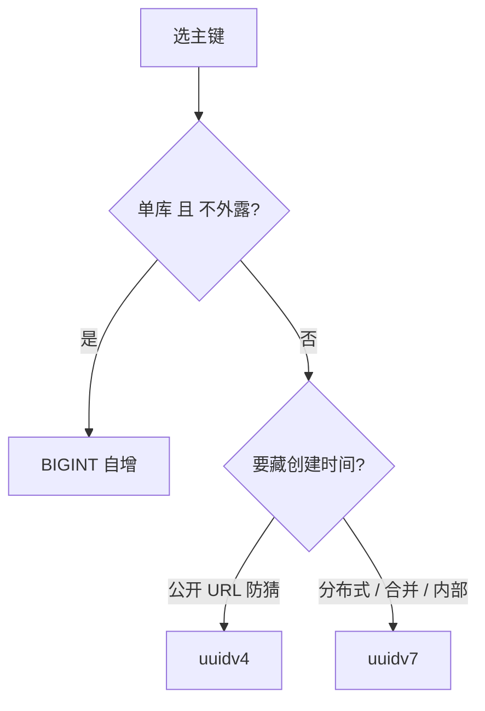

> **摘要**：你用 UUID.randomUUID() 当主键，前三个月写入正常，之后却越跑越慢，慢 SQL 日志却一片空白。问题不在 SQL——随机主键把 InnoDB 聚簇 B+ 树敲得满是碎片，页分裂、缓冲池失守、WAL 暴涨。

你建表时顺手把主键设成了 UUID.randomUUID()，前三个月风平浪静，写入、查询都正常。可三个月后，插入越来越慢，监控里磁盘 IO 悄悄往上爬，你翻遍慢 SQL 日志却一片空白——没有一条语句超时，CPU 也不高。你大概会想：主键不就是个 ID 吗，还能影响写入速度？

这事儿看着离谱，根子却在 InnoDB 的存储结构里。UUID 当主键不是不能用，但它和数据库的聚簇索引是两套心思，搁一块就把性能慢慢磨没了。

## 主键不是"随便一个不重复的值"

先说清楚 InnoDB 怎么存数据。它的主键索引是聚簇索引——数据行本身就按主键的顺序，排进 16KB 一页的 B+ 树叶子节点里。新插入的一行，会被放到"主键该在的位置"。主键要是自增 BIGINT，新行永远落在树的右边缘，这一页写满就开新页，几乎是纯追加。可 UUID 当主键时，这个"该在的位置"又在哪儿？

UUID v4 呢？它是 122 位纯随机，每次生成的值彼此毫无顺序。新行的"该在的位置"是树里随便一个角落，那一页大概率已经写满，数据库只好把页劈开——分裂成两页，各搬一半数据过去。这叫页分裂。


页分裂的代价是什么？一是填充率掉下来，随机写入的页平均只用到 50% 到 60% 的空间，有序写入能到 90% 以上，同样的数据你要多存近一倍。二是缓冲池被冷页冲刷——新行散落各处，读进来的页用一次就被挤出去，命中率直降。三是 WAL 放大，PostgreSQL 开启全页写时，分裂页产生的全页镜像能让 WAL 体积涨到 20GB 往上。三个月后表一大，这些症状就全显出来了。

等等，那为什么前三个月没事？因为表小的时候，整棵 B+ 树都能塞进内存，页分裂的开销被缓冲池盖住了。等数据量越过那个临界点，分裂和冷页的代价才开始肉眼可见地拖慢写入。

## uuidv7 凭什么能救

问题不在"用 UUID"，在"用随机的 UUID"。RFC 9562（2024 年 5 月定稿）里定义的 UUID v7，把 48 位 Unix 毫秒时间戳放在高位，剩下 74 位随机。也就是说，v7 的值大体上随时间递增——新生成的 ID 天然比旧的大。

同样是 UUID，v7 比 v4 到底多了什么？就是把时间戳放到了高位，让值随时间大致递增。插回 InnoDB 的聚簇索引，v7 的新行就又落回树的右边缘，变成追加写，页分裂几乎消失，填充率回到 90% 以上。公开基准里，v7 的写入吞吐能到 BIGINT 自增的 85% 到 89%；而 v4 在 MySQL 上会掉到 36% 上下。Shopify 在真实生产里把主键从随机 UUID 换成有序 UUID 后，插入耗时直接砍掉一半。

下面是按时间戳排序带来的连锁改善——一个时间前缀，把"随机散落"变成"顺序追加"：



## 两个数据库怎么落地

PostgreSQL 18（2025 年 9 月发布）直接内置了 uuidv7()，不用自己造轮子，连反解时间戳的函数都备好了：

```sql
-- PostgreSQL 18：原生 uuidv7()，还能从 ID 反查出创建时间
CREATE TABLE orders (
  id   uuid PRIMARY KEY DEFAULT uuidv7(),
  customer text NOT NULL
);

SELECT uuid_extract_timestamp(id) AS created_at
FROM orders
LIMIT 1;
```

MySQL 这边为什么不能像 PostgreSQL 那样直接甩个 uuidv7()？因为它 8.4 没有原生实现，只有 UUID()（v1，带 MAC 和时间）和 gen_random_uuid()（v4，纯随机）。想用 v7，得在应用层生成、再存成 BINARY(16)，而不是 CHAR(36) 的文本——文本多占一倍空间还带字符集开销：

```sql
-- MySQL 8.4：没有原生 uuidv7()，应用层生成后存成定长二进制
CREATE TABLE orders (
  id BINARY(16) PRIMARY KEY,
  customer VARCHAR(255) NOT NULL
);
-- 应用层用 uuidv7 库生成，转成 16 字节二进制写入即可。
-- 若暂时只能用 v1，UUID_TO_BIN(UUID(), 1) 会把时间字段换位，
-- 让 v1 也能按时间有序存放（本质是 ordered-UUID 套路，并非 v7）。
```

补充一句：Percona Server 8.4 提供了 UUID_VX 组件，原生实现 v1 到 v7，如果你用的是 Percona 分支，可以直接拿 uuid_v7() 用。

## 换 uuidv7 的代价，得算清楚

别一看快就无脑切。最显眼的一处代价是暴露创建时间：v7 把毫秒写在了 ID 高位，等于把"这条记录什么时候产生的"直接摊开——如果你的 ID 要出现在公开 URL 或对外接口，用户能靠顺序猜出你每天的注册量、订单量。这种场景宁愿用 v4，或者把 ID 做一次不可逆向的编码再外露。

同一毫秒内生成的多个 v7 也不保证严格有序，靠的是尾部随机位，高并发下偶尔"后来者排前面"属于正常，你别拿它当精确的时间序。

老表更不能盲目迁移。把一张已经用 v4 当主键、还被一堆外键引用的表改成 v7，意味着重建整张聚簇索引、顺带重建所有外键，大表上这是按小时计的锁表操作，你得挑低峰、用在线 DDL 或灰度双写去迁，不能拍脑袋 ALTER。

还得和 BIGINT 比一比账：uuidv7 占 16 字节，是 8 字节的两倍。单库、ID 不外露、不在乎被遍历，BIGINT 自增依然是最省、最快的那一个。v7 的价值落在"分布式、多服务、要合并、又不想用自增"的那类场景。

## 举一反三：这几个坑是同一个

踩过随机主键的，多半也踩过它的近亲。拿 MD5 或别的随机哈希当主键，后果一模一样——还是随机散落、还是页分裂。还有人图省事用 VARCHAR(36) 存 UUID 文本，比 BINARY(16) 多一倍空间还带字符集转换，纯属自找。

外键也会跟着膨胀。主键 16 字节，每张引用它的表的外键字段也跟着 16 字节，索引也跟着变大。表多、外键密的系统，主键选型直接影响整体存储和缓存命中，不是一张表的事。这张连锁账，你以前算过吗？

## 回顾一下

UUID 当主键本身没错，错在用了完全随机的 v4。InnoDB 的聚簇索引要求数据按主键有序落页，随机主键逼出大量页分裂、拉低填充率、冲刷缓冲池、放大 WAL，写入就慢慢垮了。uuidv7 用时间戳前缀把"随机"变成"大致有序"，把追加写还给数据库；PostgreSQL 18 原生支持，MySQL 8.4 要靠应用层生成加 BINARY(16) 落地。选型上：单库不外露用 BIGINT，分布式或要合并用 v7，要藏时间的公开 ID 才用 v4。换老表之前，先把迁移代价算进账。

**参考资料**

- RFC 9562（2024-05）：UUID 版本 1/6/7 的时间有序定义，uuidv7 的 48 位时间戳 + 74 位随机结构
- PostgreSQL 18 官方文档：uuidv7()、uuid_extract_timestamp()、uuid_extract_version() 函数说明
- MySQL 8.4 官方文档：UUID() 与 gen_random_uuid()；UUID_TO_BIN() 时间字段换位用法
- Percona Server 8.4 技术文档：UUID_VX 组件对 v1–v7 的原生支持
- 公开基准与 Shopify 工程实践：有序 UUID 相对随机 UUID 的写入吞吐对比

> 作者：[唐悦玮](https://tangyuewei.com)  |  从后端出发，用 AI 拓展到全栈的工程师。
