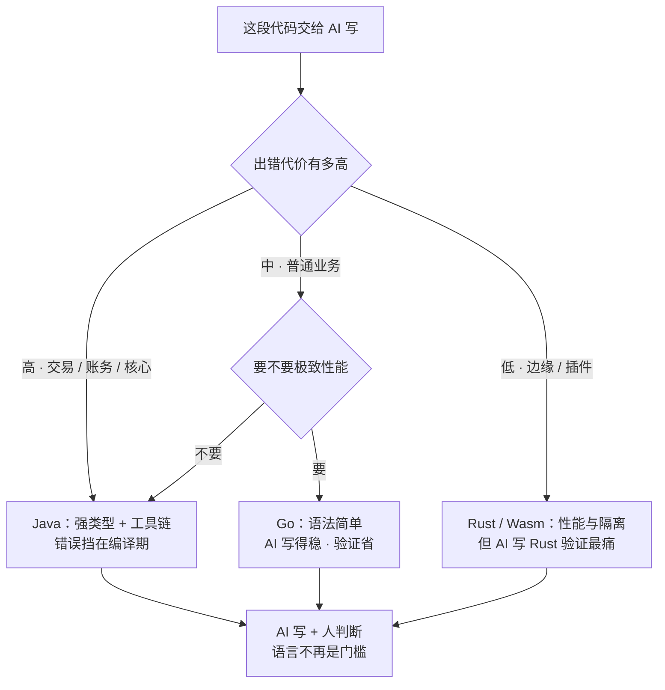
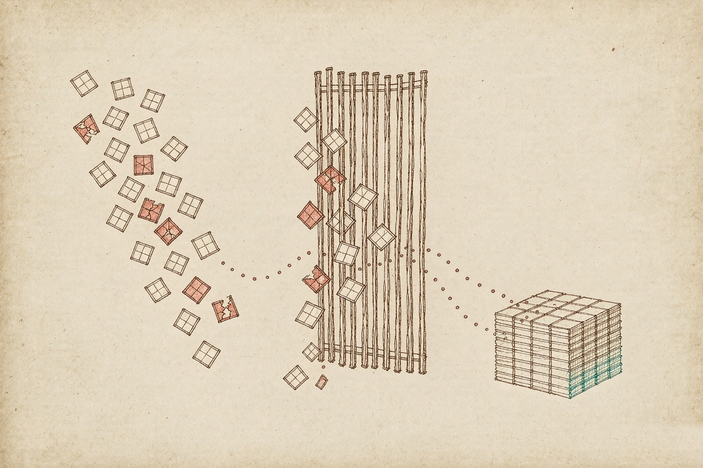

> **摘要**：AI 写代码又快又好，Java 真要被挤走了？先看数据：AI 生成的代码按语言出错率差到十几倍，胜负手已从「谁写得快」变成「谁更容易验证对」。

「你们后端还在写 Java？」

以前听到这句，我会有点奇怪。今年再听到，我反而想问一句：那你这行代码，是你写的，还是 AI 写的？

说得再直白点，现在那些吵「Rust 会不会取代 Java」的人，自己写 Rust，可能连 for 循环都要 AI 补全。

语言地盘确实在动。CNCF 2025 的调查里，新写的后端服务有 23% 落到 Rust 头上，2023 年这个数字才 8%；Go 在云原生基础设施的采用率超过 65%——Docker、Kubernetes、Terraform 本来就是它写的。

但这些已经不是今年最大的变量了。

真正的变量是 AI。它会写代码，哪个语言都写，写得又快又像样。于是老问题被架空了一半——以前你担心「学不动 Rust」，现在 AI 替你学；以前「换语言要养一个新团队」，现在一个人加一个 AI 就能试。

那语言之争，是该就此结束了吗？

问题没那么简单。如果 AI 写哪个语言都行，Java 还剩下什么意义？它会不会因为「迁移成本被 AI 拉低」，反而更快出局？

先泼一盆冷水：AI 并不是「哪个语言都写得一样好」。

AWS 拿 150 万次真实 AI 编码对话做过统计，按语言看静态错误率——JavaScript 1.6%、Python 4.0%、Go 8.0%、C++ 12.2%、Rust 15.1%、Java 26.7%，最高和最低差了十几倍。

另一份发在《Empirical Software Engineering》上的 PROBE 基准，测的是「编译并通过测试」的通过率：Python 最高，Java 和 C++ 次之，Rust 最难，而且 Rust「编译不过」的比例是所有语言里最高的。

看到 Java 26.7% 先别急着下结论。AWS 自己写得很清楚——这只统计了静态分析能看见的问题，而各语言的静态检查强度天差地别。JavaScript 那 1.6% 低，不是它写得对，是它几乎不检查。诊断干净，不等于代码正确。

但另一个信号是真的：Rust 是 AI 最写不好的语言。

原因不神秘。借用检查器和所有权规则，要求跨作用域的严格推理；而大模型是逐 token 猜下一个词。两者天生对不上。AI 写 Rust 的典型画面是：生成、报借用错误、无脑 clone、再报错，来回打转。

这两组数据合起来，指向一个比「谁取代谁」更实际的问题。

AI 把「写」的成本压到接近零之后，瓶颈就转移到了「验证」——你总得有人确认这段 AI 代码是对的、敢上线。语言之争的胜负手，也就从「谁写得快、谁跑得快」，变成了「谁更容易验证对」。

那是不是该立刻把项目全迁回 Java？也别急。

在这条新赛道上，强类型、工具链成熟的语言，确实占便宜。Java 恰好站在这。它啰嗦、有检查异常、泛型绕——这些常年被吐槽的「笨」，在 AI 时代翻了个面：错误被挡在编译期，而不是留到线上。

再加上三十年的生态：企业集成库覆盖率 98%，Rust 只有 41%；三年 TCO，Java 41.2 万美元，Rust 89.2 万，是它的两倍多。Azul 2026 的调查里，99% 的组织还在用 Java，七成应用跑在 JVM 上。

这些数字不是被 AI 削弱了，而是被 AI 放大了——AI 生成的代码越多，「能兜住错误的生态」就越值钱。

Java 自己也没躺着。Java 27 今年九月 GA，G1 成了全环境默认回收器，紧凑对象头默认打开；Spring Boot 4 把虚拟线程设成默认执行模型，配上 GraalVM 原生镜像，首请求从 2.34 秒压到 78 毫秒。

「Java 慢」这顶戴了二十年的帽子，在冷启动这一项上基本摘掉了。

当然，热路径上 Rust 和 Go 依旧。日均五亿条消息的 Kafka 消费，Go 版常驻 280MB、P99 十二毫秒，Rust 版 65MB、四毫秒；同一台机器，Axum 比 Gin 的 QPS 高约 45%。性能敏感的边角，该用谁还用谁。

只是这个「该用谁」的判断，现在不取决于你团队会不会写，而取决于这个模块出错代价多高、你验证得起多少。

下面这张图，按「AI 产出可信度 + 验证成本」帮你定位：

所以「Java 何去何从」，我的答案是：它不会出局，AI 时代不会淘汰 Java，因为 Java 的生态相对是很强很完善。

被压缩的从来不是 Java，是「只会手写 Java 语法」的人。

当 AI 都能写，Java 工程师值钱的部分就不再是「我会写 Spring」，而是——我知道这段 AI 代码哪里会炸、该用什么兜住、值不值得为那点性能换成 Rust。

语言正在变成 AI 的事，判断仍然是你的。

