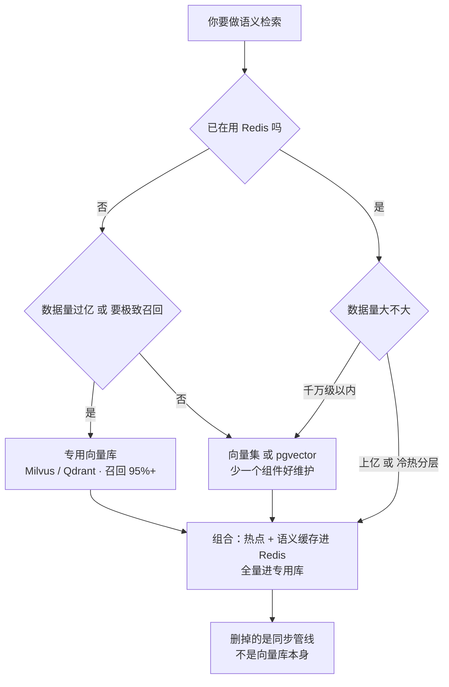
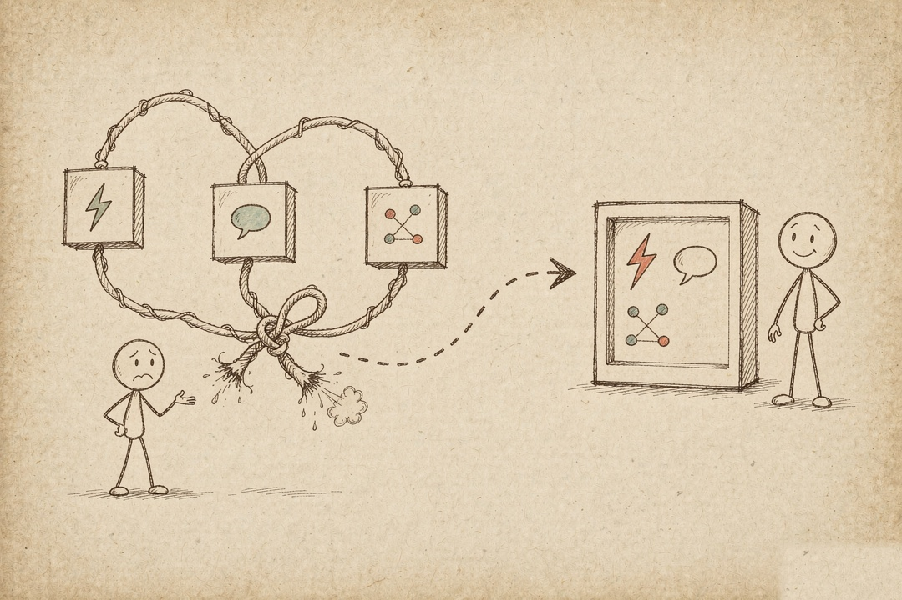

> **摘要**：别急着删向量库：Redis 8 能替你删掉同步管线和语义缓存，但全量向量和极致召回还得留给专用库。看清哪半能删、哪半不能，再决定动不动手。

## 一个进程，想装下四套东西

「你们 RAG 上线三个月，现在维护几套东西？」

被人这么一问，我数了数：一个缓存、一个会话库、一个向量库，还有把它们串起来的那条同步管线。四套。

Redis 8 给的答案很直接：这些，我一个进程就能干。

它不是说说。向量集、查询引擎、语义缓存，全塞进了同一个 Redis。官方那句最诱人的话是——语义缓存能在高重复负载下，把大模型的调用成本砍到七成以下。

于是「删掉向量库」的口号就喊出来了。可你真敢删吗？

先别急。这句话对了一半，也错了一半。今天把两半拆开看。

先把 Redis 能干的活摆清楚。它有两条向量路线，很多人上来就选错。

一条叫向量集（Vector Set），8.0 才进 beta。它像有序集合，只不过每个元素绑的不是分数，是一个向量。加数据用 VADD，查相似用 VSIM，不用建索引，属性直接塞 JSON。

另一条是老的查询引擎（Query Engine），向量存在 hash 或 JSON 里，要先 FT.CREATE 建索引，再用 FT.SEARCH 查。它能同时按全文、标签、数值、地理过滤。

区别很实在：前一条路轻，适合快速上线和实时推荐；后一条路重，适合向量加复杂筛选。选错了要重写——不是改几行，是推倒。

动手前先问自己一句：你要的是「轻量相似搜索」，还是「向量加一堆结构化过滤」？

## 它真正想删的，是那条同步管线

那「删掉向量库」到底指什么？

我原先以为是「Redis 的性能追上了专用向量库」。翻完官方文档才发现，不是。

Redis 真正想替你删的，是那条没人愿意维护的同步管线——业务库写完，还得把向量再同步一份给向量库；中间一断，就出现「订单写进去了、向量还没更新」的分裂脑。

还有一块更值钱：语义缓存。用户换个说法问同一件事，它认得出意思一样，直接返回缓存答案，不再调一次大模型。官方说高重复场景能省七成 LLM 成本；有个医疗语音助手，命中率做到 70%，账单跟着降，响应快四倍。

这块，专用向量库为什么给不了？因为那些库的本事只在「查得准」，不在「认出重复提问」。它们的对比表里，Pinecone、Milvus、Qdrant、pgvector，语义缓存那一列全是叉。

这才是 Redis 8 的杀招：不是把向量查得更快，是把「向量 + 缓存 + 会话」关进一个进程，省掉中间那层胶水。

## 全量向量接不住，那就删一半

那全量向量也交给它，行不行？

这里就得泼冷水了。向量集有三个坎，官方文档自己写着，绕不过去。

头一个坎，它还是 beta。官方原话是「API 和行为在后续版本可能变化」。你要拿它扛生产主链路，等于把架构押在一个可能改接口的东西上。

再一个是分片——它压根没有内置的。官方的扩展方案是「手动把数据切到多个 key 和节点，把 VSIM 扇到每个分片，客户端自己合并」。写能线性扩，读不能。数据一上亿，这条就卡脖子。

还有召回率，得打个折。第三方对比说 Redis 大约 92%，专用向量库能到 95 到 98%。猜你喜欢这种场景无所谓，法律、医疗检索漏一条都算事故。

那个「十亿向量」的基准，也得看清口径：90% 精度、中位 200 毫秒、50 并发、top-100。而且 Redis 自己在博客里提醒——多数基准是厂商自发布，请用自己的数据验证。这话挺诚实，也说明别拿宣传数字当承诺。

所以全量、冷数据、极致召回，别指望它一个人扛。

把上面的判断画成一张图，大概是这样：

所以回到开头那四套东西。我的答案是：删，但删对一半。

能删的，是那条同步管线，和「每次重复提问都要再付一次钱」的语义缓存账单。这两块，Redis 8 确实接得住，而且专用向量库接不了。

不能删的，是全量向量和极致召回。数据上亿、要求 95% 以上召回、还要 GPU 加速索引或私有化部署，专用库仍然是更稳的那一个——Redis 自己都承认，需要专门调优时它可能更合适。

成熟的做法不是二选一，是组合：冷数据、全量进专用库或 pgvector；热点查询和语义缓存留在 Redis。用一个进程接下高频的那部分，把贵的那部分省下来。

Redis 8 喊「删掉向量库」，其实喊错了一个字。它想让你删的，是向量库背后那条没人想维护的同步管线，和那张不断重复付费的账单。

真正该问的不是「要不要删向量库」，是「我的数据，冷的那部分到底有多少」。

## 参考资料

- Redis 8.0 What's New（向量集进入 Beta、Redis Open Source 合并、Query Engine 改动）：https://redis.io/docs/staging/DOC-5680/develop/whats-new/8-0

- Redis 官方博客《Top vector database alternatives for RAG pipelines》（语义缓存最多降 73%、十亿向量基准口径、厂商基准提醒）：https://redis.io/blog/vector-database-alternatives-rag-pipelines

- Redis 官方教程《Getting started with vector sets》（VADD/VSIM、命令、与 Query Engine 的差异）：https://redis.io/learn/howtos/vector-sets-basics

- 第三方实战笔记（向量集量化档位、无内置分片、字节序与过滤静默排除等边界）：https://www.thakurcoder.com/blog/redis-8-cache-vector-search-semantic-caching

- 第三方评测观点（Redis 召回率约 92% 对专用库 95%–98%、"不取代专用库"的定位）：https://www.cnblogs.com/gloamfox/p/21893909

- Valkey 与 Redis 现状（Valkey 9.1 性能、AWS 默认引擎与定价差异、许可分歧）：https://devops-daily.com/posts/is-valkey-ready-to-replace-redis-2026

> 作者：[唐悦玮](https://tangyuewei.com)  |  从后端出发，用 AI 拓展到全栈的工程师。
