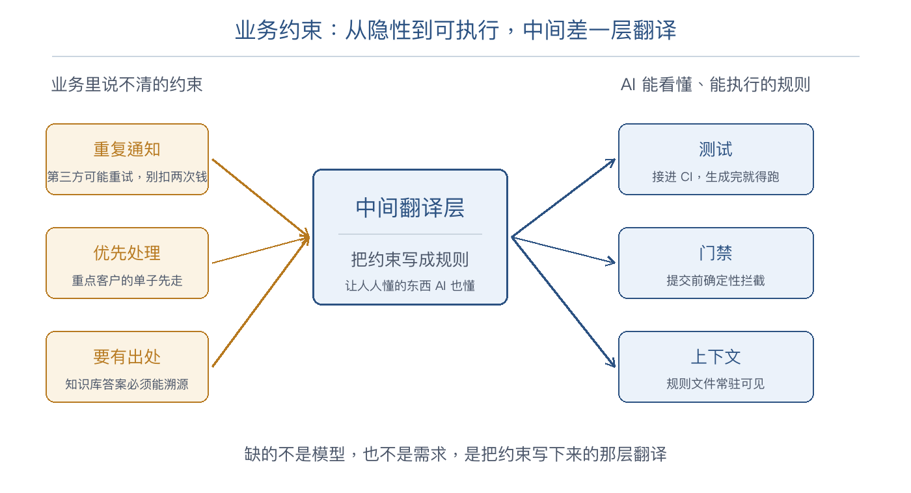
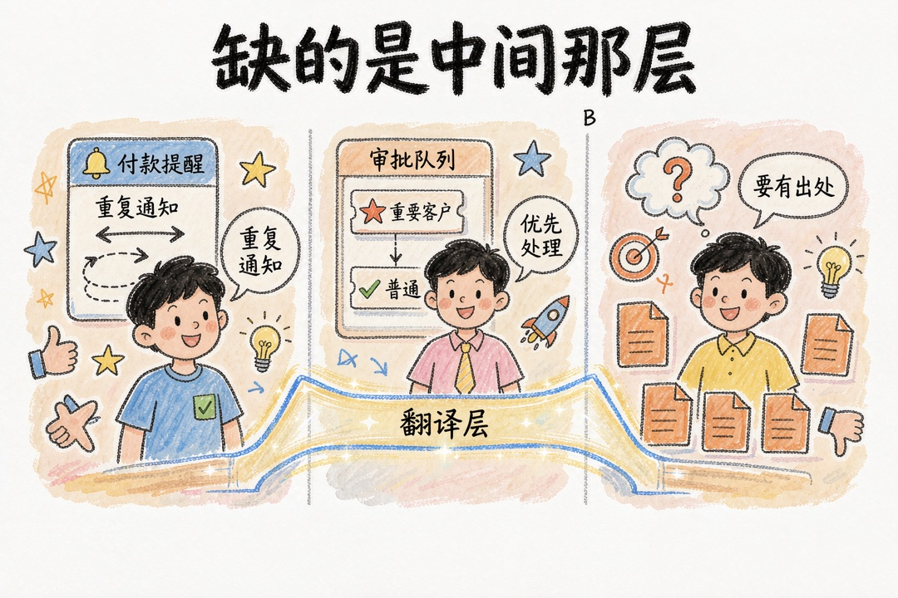

> **摘要**：AI 落不了地，先别甩锅给技术或业务。卡住的是中间那层翻译：把说不清的业务约束，变成 AI 能执行的规则。德勤报告里 71% 的企业部署了 AI，只有 7% 进领先组，差的就是它。

你大概开过这样的评审会。

AI 写的 demo 特别惊艳，一放到真实业务里就翻车。

会上分成两派：一派说模型不够强，换个更贵的；一派说业务没讲清，需求写得太粗。两派都能举出例子，可换完模型、补完文档，同样的坑还会再踩一遍。

锅到底在谁头上？都不在。

真正卡住落地的，是技术和业务中间那层翻译——把那些说不清、但人人都懂的约束，变成 AI 能看懂、能执行的规则。这层没人做，再强的模型也只是把错误执行得更快。

这就是那组让 CEO 们焦虑的数字背后的事。

## 那组数字，把锅分成了两半

2026 年 11 月，德勤在深圳的 APEC 工商领导人峰会上抛了一组数。它刚做完一份亚太 CEO 的 AI 调查：71% 的受访企业已大范围部署 AI，只有 7% 进入它定义的转型领先组。

进了领先组的，64% 说 AI 带来了显著价值；没进的普通组，这个数字是 13%。

数字一出来，最常见的两个反应是：技术还不够，或者业务太保守。

德勤全球 CEO 乔德明在会上的原话，把这两种反应都堵了回去。他说问题不在技术本身，真正的挑战在于「把用例嵌入大型复杂组织的心脏」。

谈到应用层谁来负责，他反问：谁来拥有应用层、开发可规模化的用例？「不能简单交给技术人员。」

这句话在程序员群里被转成了另一种味道：看，AI 落地失败，怪我们技术？

其实他批评的也不是技术能力。他后面补的那句才是重点：技术人员闭门造车，做出来的东西「POC 阶段很漂亮、但过于简单、没考虑真实世界复杂性」。

真实世界复杂性。这几个字，说的就是那层翻译没做。

## 换模型没用，因为约束不在模型里

先说换模型这条路为什么走不通。

我第一次让 AI 生成一个支付回调的处理逻辑，它写得干净利落：收到通知，更新状态，返回成功。我盯着看了半天，挑不出毛病。直到测试同学问了一句：第三方重复通知怎么办？

那一刻我发现，AI 不是写得不好，是它根本不知道有重复通知这回事。

这条约束不在它拿到的需求里，也不在任何一份文档里。它在风控同事的脑子里，在他讲过的那句「第三方可能重试，你别扣两次钱」里。

你让 AI 通读需求文档，它能读到什么？读到的是「收到支付通知后更新订单状态」。读不到的是「同一次支付可能通知三次，第三次不能重复入账」。

前者是需求，后者是约束，而需求文档天然只写前者。

补文档补不上，换模型也换不出来。因为约束从来就不在那两层里。

## 那就让业务方把约束写清楚？

有人说，那让业务方把规则写详细点，写成一份完整的业务规则清单。

这条路听着靠谱，做起来会散架。业务方能告诉你「重点客户的审批要优先处理」，但他没法告诉你这条规则落到代码里，是加一个优先级字段，还是要单独排一条队列。

更不会告诉你，加了优先级之后，普通客户的单子会不会被饿死。

这就是「都重要」这句话最滑头的地方。它把问题说成技术和业务各占一半，然后各打五十大板。但真实情况不是五五开，是中间缺了一层，两边都够不着。

技术这边看不到业务约束，业务那边说不出技术后果。

中间这层，得有人把「优先处理」翻译成「带权重的队列加一条饥饿阈值」，并且能回头告诉业务方：这么改之后，普通单子最多等多久。

不是把技术和业务两个人拉来合影，是一个人脑子里同时装得下两边。

## 那层翻译长什么样：先写进测试

它是三件事。最要紧的一件：把约束写成测试，别写成注释。

注释是写给人看的，AI 读不读全看它状态。测试是能跑的，你把它接进 CI，AI 每次生成完代码都得过这一关。

我在做智能审批那套东西时，把「同一条审批不能重复通过」「撤回之后不能再审批」这类规则，全写成了用例。后面不管谁来生成代码，跑一遍测试就知道有没有踩线。

等等，写这些测试不是又多了一道活吗？

是，而且这道活短期不产生任何业务价值。你的排期里不会有一项叫「把隐性约束显性化」。

所以它被跳过的概率极高——直到某次翻车之后，才有人想起来补。这笔账得算进交付速度里，我不能只讲收益不讲代价。

## 把规则做成确定性门禁

还有一件常被忽略的：把领域规则做成门禁，而不是提示词里的一句叮嘱。

你在 Prompt 里写「注意幂等」，模型可能听，可能不听。

你把规则做成一个确定性检查——提交前扫一遍，发现扣款逻辑没挂幂等键就直接拦下——它就一定会生效。

这不是信不信 AI 的问题，是把不确定的东西，换成确定的东西。

最后一件容易漏的：让约束进上下文，别让它留在人脑子里。

AI 读不到你的生产事故记录，也读不到老员工离职时带走的那句「这个接口不能并发调」。这些得由你写进它每次都能看到的地方。

你给仓库写的那些规则文件、Agent 的边界说明，本质都在干这件事。

## 换个场景，还是这层活

这套东西不只用在 AI 落地。

你带过新人吧。你跟他说「把审批状态改一下」，他改完，线上出问题——因为「改一下」里藏着十几个你没说的约束。

你说的是动作，他要的是边界。新人会回头问你，AI 不会，它直接照着字面执行。

所以这层翻译从来都在，只是以前由人在口头补齐。AI 把执行速度提上去之后，补不齐的代价被放大了：以前一个新人一天犯一个错，现在一个 Agent 一分钟能犯一百个。

这也是为什么德勤开的药方是配对——让有工程能力的人和懂业务的人坐在一起。

配对能补一部分，但它有个隐含前提：两个人得有一门共同语言，能把「优先处理」翻译成可执行的规则。这门语言，就是那层翻译。

## 最后

回到开头那场评审会。

锅不在技术，模型够强了。锅不在业务，需求也写得很厚了。锅在中间那层：那些人人以为对方知道、结果谁都没写下来的约束。

懂 AI 和懂业务都重要，这话没错。但更准确的说法是：你得能把业务里说不清的东西，翻成 AI 能执行的规则。这个能力不会因为模型升级而过时，只会越来越值钱。

下次 demo 又翻车，先别急着换模型。翻出那条被省掉的约束，写成测试，跑一遍。

## 参考资料

1. [71% 的受访企业已广泛部署 AI，德勤全球 CEO：真正获得财务回报的仍很少](https://news.qq.com/rain/a/20261117A0CT7H00)：腾讯新闻，2026-11-17，APEC 工商领导人峰会现场报道，含 71%、7%、64%、13% 等数据，源自德勤《2026 年亚太 CEO 人工智能领导力报告》（2026-11-16 发布）
2. [德勤全球首席执行官乔德明：CEO 们几乎都在用 AI，但很少有人真正赚到钱](https://finance.sina.com.cn/hy/hyjz/2026-11-17/doc-iniyzswf2185918.shtml)：新浪财经转载睿见 Economy，2026-11-17，含「把用例嵌入大型复杂组织的心脏」「不能简单交给技术人员」「POC 阶段很漂亮、但过于简单、没考虑真实世界复杂性」等原话

> 作者：[唐悦玮](https://tangyuewei.com)  |  从后端出发，用 AI 拓展到全栈的工程师。
