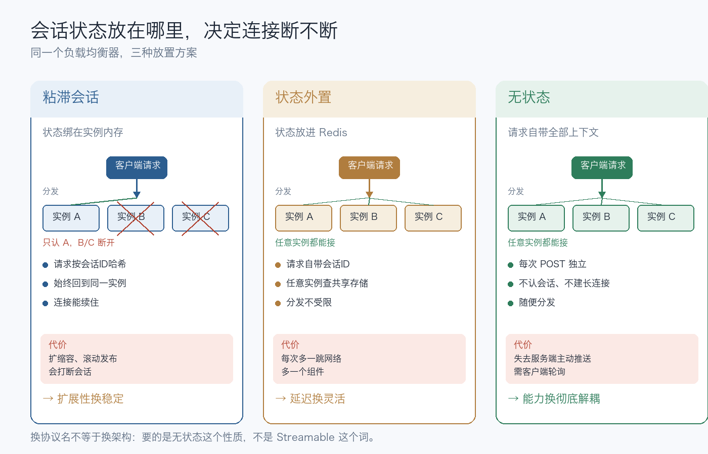

> **摘要**：MCP 服务一挂到 ALB 后面就断连，多数人先调超时、加心跳，没用。问题不在配置：SSE 把会话绑在一条长连接上，负载均衡器却天生要把请求分到不同实例。得换传输模型。

你大概也遇到过这个场景。

MCP Server 本地跑得好好的，客户端一连就上。

一部署到 K8s，前面挂个 ALB，怪事来了：连上几分钟，工具调用到一半，连接悄悄断了。

客户端以为活干完了，服务端还在等一个永远不会来的请求。

翻日志，ALB 那边是 60 秒空闲超时。

## 先说结论

调超时没用，加心跳也没用。至少在"多个副本"的场景下没用。

问题不在 ALB 的配置。ALB 只是照规矩办事：一条连接闲够 60 秒，它就掐掉。你把它调到 300 秒，只是把断的时间点往后推，断还是会断。

真正在作怪的是 SSE 这个传输模型本身。它要求客户端和服务端之间维持一条长连接，会话状态就挂在这条连接上。

而负载均衡器的天性，是把请求分散到后端不同实例。一个要粘，一个要散，这俩从根上就对不上。

## 天线和开关

把这套东西想成一个老式对讲机。

SSE 是天线。你喊第一句话的时候接通了一个人，后面所有话都得顺着这条天线传。中间换个接线员，这条线就断了，对方不知道你说到哪。

负载均衡器是个总机。它的工作就是把打进来的电话转给空闲的分机。它不知道哪通电话该转给哪个接线员，于是随机分配。

于是事故是这样发生的：客户端的初始化请求落到实例 A，会话建在 A 的内存里。下一次工具请求被总机转到了实例 B。B 翻遍自己的内存，没有这个会话。

日志里那句 `Could not find session for ID` 就是这么来的。

我在一个开源项目的踩坑记录里看到过一模一样的报错，多 gunicorn worker、多 Pod 的场景下反复出现。

到这一步你就明白了：这不是配置问题，是架构和基础设施的日常行为对撞。

多副本、自动扩缩容、滚动发布——这三件事任一发生，有状态的长连接就会被打断。心跳只能保住连接别闲着，保不住它落到哪个实例。

## 出路一：粘住它

最直接的办法，是让总机记住：这通电话以后都转给 A。

这就是粘滞会话。ALB 上叫 stickiness，Nginx 上叫 ip_hash。按客户端 IP 或者 session ID 做哈希，保证同一个会话的请求都落到同一个实例。

配置不难，代价在后面。

第一个代价是扩缩容。实例一缩，钉在它上面的所有会话全部重连。你的自动扩缩容会变得束手束脚：每个实例都有活会话，谁也不敢先走。

第二个代价是滚动发布。发布时旧实例被摘掉，长在它上面的 SSE 连接被强制中断。客户端得自己学会重连，不然用户就看到一个断掉的画面。

第三个代价更隐蔽：如果你按客户端 IP 做哈希，而你的客户端都躲在同一个 NAT 或 API 网关后面，它们会被算成同一个人，全挤到一个实例上。哈希等于没做。

粘滞会话能用，但它是拿扩展性换稳定。你得清楚自己换出去了什么。

## 出路二：把状态搬走

第二个办法，是别把会话存在实例内存里，存到一个大家都够得着的地方。Redis 是常见选择。

这样每个请求自带会话 ID，哪个实例拿到都能去共享存储里查到状态。总机随便转，转给谁都行。

代价是多一跳网络。每次工具调用都要先去 Redis 取一次会话状态，请求延迟涨一点。你还得维护一套 Redis，多一个可能故障的组件。

对大多数内网里的 MCP 服务，这一跳可以接受。真正要想清楚的是会话里存什么：如果只是几个参数，搬走很轻；如果存了工具注册表的上下文，搬的就是一份不小的状态。

## 出路三：不要会话

第三个办法最狠：干脆取消会话。

MCP 在 2025 年的规范修订里，把 Streamable HTTP 定为标准传输，用来替代早期的 HTTP+SSE。官方规范里的说法是，它"replaces the HTTP+SSE transport from protocol version 2024-11-05"。

做法很朴素。客户端每次发消息，都是一次独立的新 HTTP POST。

服务端可以把它当成普通的请求-响应处理，也可以在这个 POST 上升级成 SSE 流做进度推送。总之不再需要一条常驻的双向通道。

没有常驻通道，就没有必须粘住的会话。请求散给谁都行，负载均衡器终于能做它擅长的事。

## 坑：换了名字，没换状态

这里有个坑要提醒你。

规范里的 Streamable HTTP 仍然允许带 `Mcp-Session-Id`，它本身不等于无状态。

要做到真正随意分发，你得在实现层面选无状态模式——社区里的做法是起服务时打开无状态开关，或者关掉 SSE 响应，让每个 POST 自成一体。

换了协议名不等于换了架构。你要的是"无状态"这个性质，不是"Streamable"这个词。

## 别急着拆天线

写到这里，我得给 SSE 说句公道话。

如果你的服务只有一个实例，跑在内网，客户端数量可控，SSE 用得好好的，那就别动它。引入 Redis 或者改无状态，都是有成本的。为不存在的问题付成本，不划算。

决定要不要换的，不是"新协议更时髦"，是三个具体问题：你会不会扩到多个副本？会不会用自动扩缩容？会不会频繁滚动发布？

三个里有一个答案是"会"，你就该认真考虑让会话别待在实例内存里。三个都是"不会"，SSE 没什么不好。

## 回到配置这件事

所以，SSE 老在 ALB 上断，问题真不在配置。

调超时、加心跳，能缓解，但都是在跟基础设施的日常行为对抗。只要你的会话还绑在一条长连接、一个实例的内存上，多副本和滚动发布就会一次次把它打断。

真正的解法是换个思路：要么把会话粘住并接受扩展性的损失，要么把状态搬出去，要么让请求彻底无状态。三条路没有高下，取决于你的规模和对延迟的容忍度。

下次看到 `Could not find session for ID`，先别去翻 ALB 的超时参数。问自己一个问题：这个会话，现在存在哪台机器的内存里？

答案出来，路线也就定了。

## 参考资料

1. [Transports - Model Context Protocol 官方规范](https://modelcontextprotocol.io/specification/2025-06-18/basic/transports)
2. [MCP SSE session lost across workers/pods](https://github.com/laozhangzzz/agent-pitbook/blob/main/pits/mcp/mcp-sse-session-lost-multi-worker.md)
3. [MCP server load balancing](https://alivemcp.com/seo/mcp-server-load-balancing)
4. [Deployment and Hosting - MCP in Production](https://yaw.sh/mcp-in-production/mcp-server-hosting)

