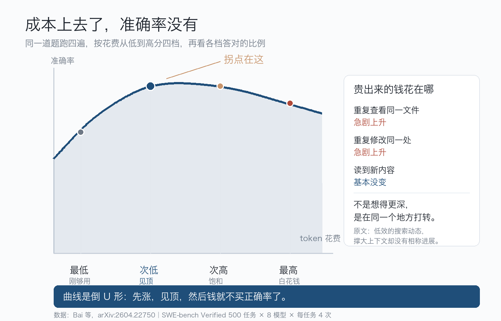
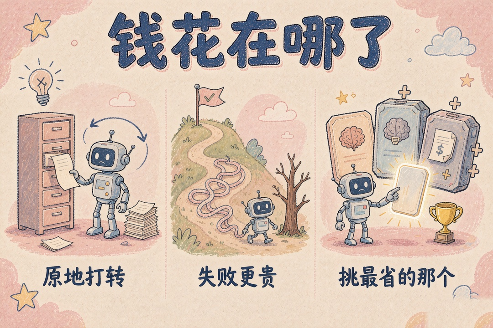

> **摘要**：效果不达标，第一反应是调高推理档位、加预算。几份实测研究给出同一个反证：同一道题跑四遍，最贵那次准确率并不更高，钱花在了反复读同一个文件上。

前几天有个读者问我，说他给 agent 加了预算、把推理档位调到最高，活还是没干好。

我问他，你怎么判断是"没想够"？他说账单涨了三倍。

这个对话很典型。加钱加大推理，是这几年最像物理定律的一条经验。想不出来？让它多想一会儿。还不行？再想久一点。

但有一批实测数据，把这个直觉按住了。

## 那张倒 U 形图

密歇根、斯坦福、微软的一批研究者，用 OpenHands 跑了 SWE-bench Verified 全部 500 个真实 GitHub issue。

8 个前沿模型，每个任务独立跑 4 次。同一道题，四次成本最多差 30 倍。平均下来，最贵那次约是最便宜的两倍。

更关键的是他们怎么分组。把同一道题的四次运行按 token 花费从低到高排，分成最低、次低、次高、最高四档，再看各档的准确率。

从最低到次低，准确率小幅上升。再往上，平了。最贵那档，没有更高。

论文摘要写得很克制：准确率常常在中等成本处见顶，更高成本处饱和。引言里说得更直白——在最贵的成本档位会退化。

这不是"贵一点更稳"。是过了某个点之后，钱不买正确率。

## 钱花在哪了

如果多花的钱不是买推理，那买的是什么？

那篇算钱的论文里，有张行为分布图。它统计每个 run 里"重复查看文件"和"重复修改同一文件"的次数。贵的 run，这两个数字急剧上升。

换成话讲：模型在同一个文件上反复来回，改了又看，看了又改，上下文越来越长，进展没有。

论文的原话是，这反映低效的搜索动态，把上下文和 token 撑大，却没有相称的进展。

这个场景做后端的人应该很熟。线上任务卡住，你不停重启、加日志、再试一次，日志越堆越高，问题还在原地。这不是想得更深，是在同一个地方打转。

## 想太多，动太少

另一组研究把这个结论推得更远。伯克利、UIUC、ETH 的一批人分析了 4018 条 SWE-bench 轨迹，同样是 OpenHands。

他们给每条轨迹打一个"过度思考分"：模型是在跟环境交互，还是在脑子里空想。分数越高，解决的问题越少。

他们把这种打转归成三类：分析瘫痪、越界行动、过早退出。

分析瘫痪，是反复推演而不去跑一下测试。越界行动，是不等反馈连着做几步。过早退出，是凭想象中的结果就收工。

三条都不是"想得不够"，是"想得太多、动得太少"。

## 失败反而更贵

回到那篇算钱的论文。还有一组更扎人的数字：模型在"全部模型都失败"和"全部模型都成功"这两个子集上的花费差多少？

GPT-5 差不到 50 万 token，Kimi-K2 差约 200 万。

失败本该更便宜——没解决就该早停。实际是更贵，而且贵得很有规律。

论文的推断是：模型缺少识别"这题解不了"并及早停下的可靠机制。它会继续探索、重试、重读上下文，把成本堆上去，进度不涨。

## 它其实早就答对了

推理模型那边还有一批更早的研究，把事情说得更清楚。

有个叫 ThinkBrake 的实验做得挺狠：拿模型的推理轨迹，在每一个句子边界试着插入停止信号，事后挑最好的那个。

结果平均准确率提升 8%，思考 token 砍掉 72%。

也就是说，模型在轨迹中途就已经到了正确答案，后面那一大段全是白走。原文的说法是，模型常常到达一个正确的中间解，继续推理，然后把它覆盖成一个错误答案。

还有一篇论文标题就叫《别为 2+3 想那么多了》。在答对的那些样本里，第一轮就已经正确的超过 92%。

同一个"2+3"，o1 类模型比传统模型多花了约 19.5 倍的 token。

## 你看到的提升可能是假象

还有一篇叫《测试时扩展的幻象》的研究，把整件事解释得更彻底。

它说：想得越久，输出的方差越大。方差变大，在某些评估口径下会显得"更可能对"，但精度其实在掉。

也就是说，你看到的提升，有相当一部分是统计假象。

## 那该怎么办

听到这里容易走偏：那是不是越少越好、能停就停？

不是。曲线是倒 U，不是单调下降。开头那段爬升是真的——有些任务确实需要更多步去探索、读代码、试错。你要找的是拐点，不是起点。

讲过度思考的那篇论文给了一个可操作的办法，比任何调参都实在：别挑想得最久的那个，挑过度思考最少的那个。

他们从同一批候选解里选"过度思考分最低"的，而不是选"烧 token 最多"的。

性能提升近 30%，计算成本降 43%。取 3 个候选时，性能超过高推理配置，成本还少 15%。

## 我会先看三个信号

先看它在不在原地转。重复读同一个文件、反复改同一处，连续出现，就是拐点信号。这时候加预算等于给打转加速。

再看失败有没有早停。失败集的花费是成功集的几倍，模型不会自己认输。重试次数必须有硬上限。

还有一条容易忽略：别用人类难度估预算。人类专家标的任务难度，和实际 token 花费只有弱相关（Kendall τb 约 0.32）。

有 6.7% 标着"15 分钟内"的任务，实际花的 token 比平均"1 小时以上"的还多。你觉得简单的活，模型可能正在里面绕圈。

## 那次账单是正常水平的好几倍

把"停"做成明确判据，别指望模型自己判断够了。这是我踩过之后才改的习惯。

我在一个 Spring Boot 的审批服务上接过 agent。不设上限的时候，它改一个状态流转的 bug，会在同一个 Service 类上来回读。

每读一遍，整个文件重新塞回上下文。活最后是干完了，账单是正常水平的好几倍。

后来加了三条约束：同一个文件连续读超过三次就中断，单任务 token 设硬上限，重试超过两轮直接转人工。

写 `max_iterations`、写重试上限、写连续重复检测，比在 Prompt 里写一句"想清楚再答"有用得多。前者是确定的，后者全靠它心情。

## 回到那个问题

所以那位读者的问题，答案不在"加多少"，在"加在什么时候"。

加在爬升段，是投资。加在饱和段，是给一场已经在打转的搜索付加班费。

下次账单涨了，先别急着安慰自己"它在深入思考"。打开 trace 看一眼：它是在读新东西，还是在读同一个文件第四遍。

## 参考资料

1. [How Do AI Agents Spend Your Money? Analyzing and Predicting Token Consumption in Agentic Coding Tasks](https://arxiv.org/abs/2604.22750)，Bai 等，arXiv:2604.22750
2. [The Danger of Overthinking: Examining the Reasoning-Action Dilemma in Agentic Tasks](https://arxiv.org/abs/2502.08235)，Cuadron 等，arXiv:2502.08235
3. [Does Thinking More always Help? Mirage of Test-Time Scaling in Reasoning Models](https://arxiv.org/abs/2506.04210)，Ghosal 等，arXiv:2506.04210
4. [ThinkBrake: Efficient Reasoning via Log-Probability Margin Guided Decoding](https://arxiv.org/abs/2510.00546)，Song 等，arXiv:2510.00546
5. [Do NOT Think That Much for 2+3=? On the Overthinking of o1-Like LLMs](https://arxiv.org/abs/2412.21187)，Chen 等，arXiv:2412.21187
