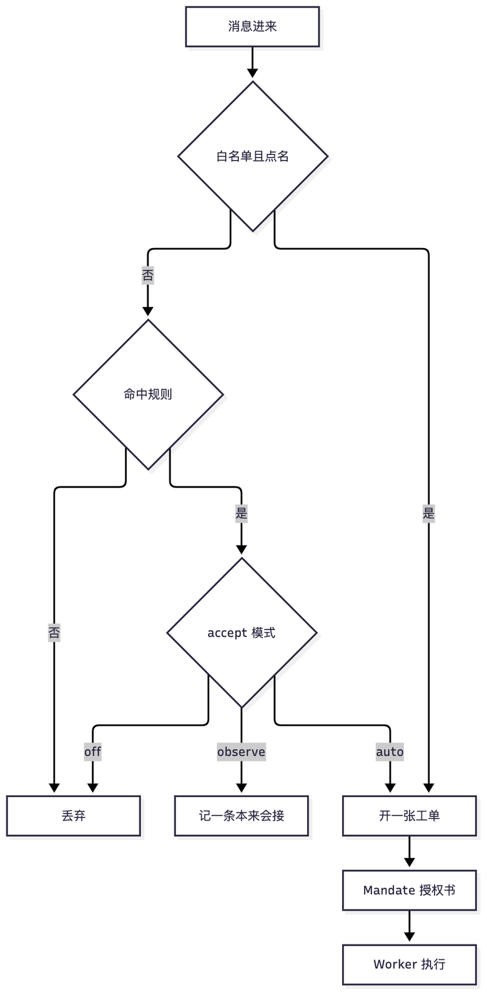
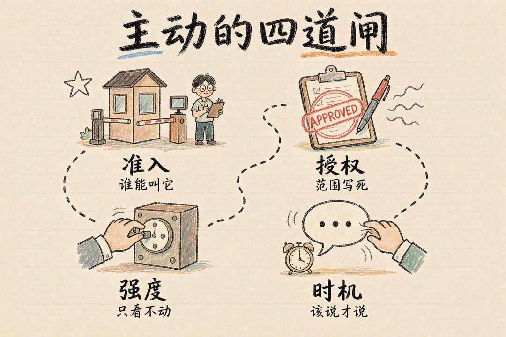

> **摘要**：DeepSeek 开源的主动编程 Agent，默认只看不做。15 个模型、28 种配置的实测里，实时判断该不该插话的准确率只有 19%。四道闸逐条拆开，末尾附一段能落到服务里的 Java 判断。

先设想一个场景。你在改一个接口，项目群里有人顺口说了句：登录最近有点慢。

四十分钟后，一个 agent 在群里回：找到 `TokenService.java` 里的缓存 key 了，少拼了租户 ID，要我提个 PR 吗。

没人 @ 它。

主动 agent 的难点不在写代码，在判断此刻该不该开始处理。

DeepSeek 在 2026 年 10 月 31 日开源的 `dsh-superagent-prototype`，把答案写进了第一条设计原则：默认只看不做。

你能拿走的，是它那四道闸，还有一段能落到自己服务里的判断逻辑。

## 先把这东西说清楚

不是新模型。是一套调度框架，挂在 DeepSeek Harness 上，常驻一个 GitHub 仓库。

分两层。Router 长时间在线，只做接待和分派，自己不下场跑命令。Worker 按工单并行，各自一个会话、一个独立工作目录。

外面再挂一个 Watchdog，盯死循环和卡住的任务。

听起来像多 agent 编排。差别在触发方式：你不用开终端，它自己从 issue、PR 评论、CI 结果、飞书群里捡活。

## 一个提交的原型

它涨得很快。开源八天，仓库页面上两万一千多 star、两千四百多 fork。

但 README 第一行写得很直白：这是研究原型，不是官方产品，代码大量由 coding agent 写成，用之前自己审一遍。

仓库只有一个提交，没有 release，没有 tag。当产品看太早，当设计稿读刚好。

## 先问它凭什么开口

多数人会先想：让它更聪明一点。判断不准，换个更强的模型。

这条思路已经被实测否掉了。

2026 年 10 月 19 日挂上 arXiv 的 PITCH 基准，找了 89 个人做 35 场无脚本群聊。

流程是这样的：每人先写一条候选发言，再把它插到聊天记录里自己认为最合适的位置，然后一组人讨论每条消息的理想轮次和多长一个可接受窗口。

最后攒出 384 条候选、1091 条人工判断。

然后让 15 个模型、28 种配置去做同一件事。

## 离线57.8%，在线19.0%

结果分成两半。

给它完整对话历史，让它离线判断该插在哪，准确率 57.8%。信息一点也不缺，它做得还行。

换成实时决策——对话一条条滚过来，它得当场决定说不说——准确率掉到 19.0%。将近一半的插入位置，比所有参与者能接受的最早时点还早。

在场普通人实时判断的准确率是 23.7%，过早插入比例 39.7%，两项都比模型好。

23.7% 很高吗？

也不高。两边的差距不在谁更准，在错的方向：模型抢着说，人宁可晚一点。

## 缺口不在判断力

为什么掉这么多？

去看模型的推理日志：93% 的介入理由在讲「这条内容相关」，几乎没有一条在考虑「要不要再等一等」。

缺口不在判断力。缺口是它没把沉默当成一个合法选项。

再算另一笔账。另一份研究（arXiv:2609.37267）找了 30 个人做多日实验，结论更难看：任务做对了、时机错了，信任照样塌。

## 加个确认弹窗行不行

那就加个确认弹窗，人工点一下？

主动 agent 的成本本来就是你的注意力。每弹一次窗，就有人要放下手上的事切过来看一眼。

一个能替全组干活的 agent，也能把全组的注意力一起烧掉。

团队在那篇设计文章里把问题定在这儿：单个任务的上限看模型，一堆任务的上限看人的注意力。

换成你的场景想一下。工单系统每天推两百条催办，每条都合规、都准确。你会感谢它还是屏蔽它？

## 权限跟着工单走

这套设计里最值得看的不是 Router/Worker，是一个叫 Mandate 的东西。一条消息进来，先过准入：发信人在不在白名单，有没有点名 agent。

过了准入，开一张工单，工单带一份 Mandate。里面写三件事：谁提的、依据哪一版策略、允许动的范围有多大。

它不可变。后续讨论再多，只往工单里送上下文，不送权限。想要更大范围，得另开一张工单。

这条堵死了权限膨胀。你回想一下平常用的 agent：聊到第三轮，它顺手把范围从「改这个类」扩到「重构这个模块」，中间没人拦。

Mandate 的做法是把扩权变成一个需要重新审批的动作，不是对话里自然长出来的结果。

配套还有策略版本号。规则一改，跑着的评估作废，触发的消息重新排队，在跑的工单收到一条「策略变了」的输入。



## 默认只看不做

accept 模式有三档，写在策略里。

| 模式 | 落到行为上 |
| --- | --- |
| off | 没人点名的消息一律不接 |
| observe | 命中的单照样判，只记一条「本来会接」，不执行 |
| auto | 判定通过就接 |

默认停在 observe。

我第一次读到这里时最没看懂的就是它：光看不动，那这东西装了干嘛。

后来想通了。这不是保守，是把「校准」做成了流程。它先把「agent 本来会干什么」攒成一份记录，你看几天，觉得对了，再切 auto。

官方文档的原话就是先在 observe 里跑，看过记录之后再切。

## 它什么时候被允许说话

最硬的一条在时机上。

文档里写：它只在有人必须行动、或者结果有人能用的时候才说话。确认请求说一次，干活期间闭嘴，结果出来了再说。

还有一条更细：silence rule 可以压掉那条「收到，我开始做了」。

专门写一条规则，用来让 agent 少说一句废话。

这算小题大做吗？

不算。群里那句「收到，我开始做了」，一天响二十遍，就是二十次打断。省掉它，比优化十句提示词都管用。

## 相关性不是时机

回到那个 93%。

模型判断要不要开口，几乎全靠「这条内容跟任务相关」。相关性是个好筛子，挡噪音够用。

但它答不了另一个问题：现在说，是不是比十分钟后说更好。

这两个问题在工程上差得很远。相关性可以离线算，给全量历史，准确率 57.8%。时机必须在线算，信息在滚，人在打字，你手上只有这一秒。

## 告警也卡在同一个地方

所以你看告警那套东西就懂了。告警不准，大家去调阈值。告警很准但一天响两百次，你调的是抑制规则和聚合窗口。

不是让告警更准，是让它少响。

主动 agent 现在停在第一阶段。所有人都在卷「它说得对不对」，没人管「它该不该现在说」。

DeepSeek 的解法是把时机也变成规则：白名单决定谁能叫它，规则决定什么活它能接，模式决定它接不接，silence rule 决定它什么时候闭嘴。

四道闸，全是能写下来、能 review、能回滚的文本。



## 落到你的服务里

任何「系统主动推东西给人」的地方都是同一个结构：工单催办、审批提醒、监控告警、代码审查机器人。

判断逻辑大致长这样。

```java
Decision decide(Signal s) {
    if (s.addressesAgent() && s.requesterAllowed()) return ACCEPT;
    if (mode == Mode.OFF || !s.matchesEnabledRule()) return IGNORE;
    return mode == Mode.OBSERVE ? RECORD_ONLY : ACCEPT;
}
```

六行，四件事：谁有资格叫它、模式关没关、命中哪条规则、这一档该不该真干。

`RECORD_ONLY` 那一支最容易被省掉，也最不该省。它落进日志，是你事后回答「它本来会做什么」的唯一凭据。

真正要改的是 `matchesEnabledRule`。规则别写成「相关就提醒」，把成立条件写清楚：这条提醒发出去，收件人能不能在五分钟内做点什么。

不能，就别发。

## 等等，这套的账还没算完

影子模式有代价：你得定期去看那份「本来会接」的记录。不看，它就是个垃圾场，切 auto 那天等于闭眼开车。

数据边界也是真问题。它读群聊，读的是公司内部讨论。文档里承认这块还没解决，提示注入的防护也还开着口子。

权限更直接。Worker 用你的系统账户跑命令，没有逐条审批。接到一个有写权限的仓库上，那一层权限就等于交出去了。

还有一个容易被忽略的：它默认只接「不需要设计决策」的活。要拍板的事它停下来问你，这个停下来的频率，决定了它到底在省你时间还是在打断你。

最后一句得说明白。文章里讨论的很多设计方向，原型并没有实现，也没有独立基准可查。

## 最后

回到开头那个没被 @ 的 agent。

它写代码这件事已经够用了。难的是它知道什么时候不说话。

这份原型最值钱的地方，是把「主动」拆成了四道可以写下来的闸：谁能叫它、它能干什么、这一档真不真干、什么时候该闭嘴。四样都是文本，都能被人改。

文档最后一句是这么写的：目标是合适的时间给合适的帮助，其他任何时间，什么都不给。

这不是产品口号，是这套设计的验收标准。

下次给系统加一条主动推送，先问一句：这一条发出去，收件人五分钟内能做点什么。答不上来，就把它留在 `RECORD_ONLY` 里。

## 参考资料

1. [dsh-superagent-prototype](https://github.com/deepseek-ai/dsh-superagent-prototype)
2. [When Should AI Chime In? Benchmarking Timely Contribution of Proactive Agents in Multi-Party Chat](https://arxiv.org/abs/2610.25896)
3. [Foundations of Proactive Agents: Principles, Technical Layers, and Proactivity-Gym](https://arxiv.org/abs/2609.37267)
4. [DeepSeek Super-agent 架构拆解：双层 Router/Worker、工单授权与影子模式](https://devpress.csdn.net/aibjcy/6af39dc7e5f4ca4eff8fb46a.html)

