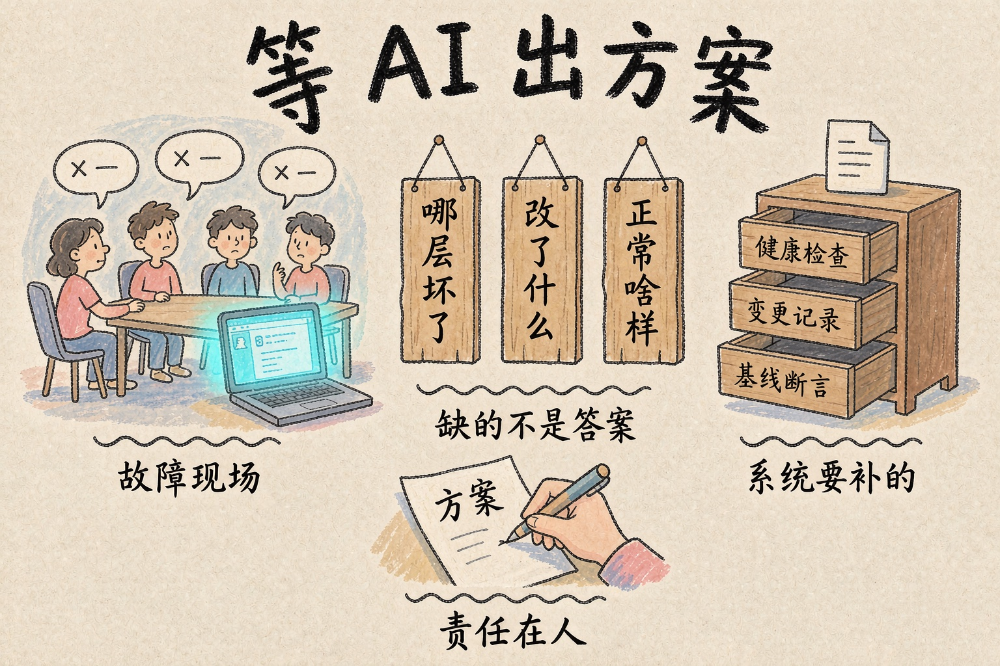
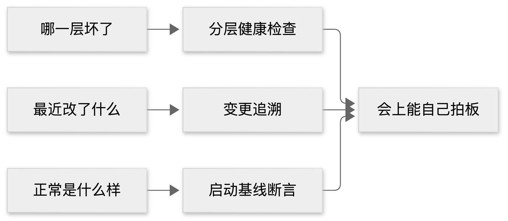

> **摘要**：故障会上所有人打开对话框等 AI 给方案，缺的不是模型，是让人自己下判断的素材。这篇拆开 Agent 为什么天然不给你留诊断面，以及 Java 服务里怎么把判断的位置补回来。

Armin Ronacher 听同行讲过一次故障会。系统崩了，一屋子工程师围着桌子，没人说得清故障落在哪一层。所有人都在做同一件事——打开对话框，问 Claude。

问到后半程，味道变了。他们不光问原因，还在等它拿方案。

那天会议室里真正的麻烦，不是没人会。是没人敢拍板。

Ronacher 的评价只有四个字："这很可怕。"他紧接着补了一句，大意是：我们做软件最终还是为了人，把人彻底移出流程，算不上一个值得追求的目标。

## 先别急着说人变笨了

看到这个场景，最顺的解释是技能退化。代码让 AI 写，人读得少，手就生了。这个解释我认，不打算推翻。

但它解释不了另一半——他们为什么要去问。

如果只是人变笨，那 AI 应该答得上来才对。往细里想一步：就算 Claude 给出三条可能原因，会议桌上谁能判断哪条是真的？

判断方案对不对，和判断故障在哪，用的是同一种能力。这个能力不会因为对话框打开就自动恢复。

所以问题还得往下压一层：那天缺的不是答案，是让人自己下判断的素材。

素材这词听着虚，换成三个问题就实了。哪一层坏了？最近改了什么？正常的时候该是什么样？答不上来，会议室就只剩一个动作可做——问。

## 它给的方案，你凭什么判断

Ronacher 自己做过一个更极端的实验，把这件事的量级摆了出来。

他给一个 Agent 一个目标：给 Python 加上虚拟线程和词法作用域，然后完全放手。Agent 自己管上下文，自己派生子 Agent，自己记笔记。他过了个周末回来。

35 小时。净增 7.5 万行代码，79 次提交，烧掉约 10 亿 token，按 API 原价算约 1200 美元，平均一次提交 15.5 美元。

他的结论是：没有交付任何有价值的东西。

比账单更值得看的，是他翻出来的代码形态。有一段是 Bash 调 Python，Python 调 Node，Node 再调 PowerShell。

层层套下去，只为了验证一次剪贴板行为。他说这东西人基本读不了，想跟上发生了什么，只能最后拿 diff 看成品。

## 问题出在目标函数

这不是模型不努力。它 35 小时没停过。

它被奖励的是"任务完成"，不是"完成后有人能看懂"。当它判断这段代码没人会看，就不再为人类读者写，也不为长期维护写。

把这个机制搬到你的服务上，结论很直接：**Agent 没有动力给系统留诊断面。**

它为什么不顺手加一个？因为加一个健康检查端点，不会让任何一条测试从红变绿。写一段启动自检，也不影响功能验收。这些事在它的评分里权重是零。

所以它不干。这是结构问题，怪不到态度上。



## 写快了，查慢了，这笔账有数

个人的感受靠不住，看调查。

Undo 委托 Coleman Parkes 在 2026 年 7 月到 8 月问过 300 位工程负责人，都是两亿五千万美元以上营收的组织。

结果是这样：团队每周花 9.8 小时写代码，花 16.9 小时调试。调试吃掉四成工作时间，比写码多出七成。

更扎心的是另一项：79% 的人说，代码写得快多了，发布周期一点没变快。

省下来的时间没消失，挪到下游去了。

## 没人说得清，就只剩问

Lightrun 同年问了两百位 SRE 和 DevOps 负责人。43% 的 AI 生成改动，过了 QA 和预发，还得在生产里手工调。

问到高危事故怎么处理，54% 说靠的是组织里的口头经验，不是诊断工具给出的证据。

数据没直接说这些人会去问 AI。可证据不在桌上，问就成了唯一能做的动作。

New Relic 的调查里还有一组对照，最能说明错位在哪：94% 的负责人认为 AI 写的代码在评审阶段质量更高，78% 说上线之后事故更多了。

评审时好看，运行时难查。这两件事不矛盾，是同一个原因的两面。

要留个限定。这些都是受访者的自述和估计，不是受控实验，样本也集中在大型组织。它证明的是这种感受很普遍，不是"AI 代码必然更差"。

## 让人重新拿得回判断

判断力不是靠决心回来的，得靠系统给它留位置。落到 Java 服务上，是三件很土的工作。



最要紧的一件，把"整体健康"拆成"分层可查"。默认的 `/actuator/health` 只回一个 UP，故障时它只告诉你进程还活着。

```java
class DownstreamHealth implements HealthIndicator {
    public Health health() {
        Probe p = client.probe();
        return p.ok()
            ? Health.up().withDetail("p99", p.p99()).build()
            : Health.down().withDetail("why", p.err()).build();
    }
}
```

标了 `@Component` 就自动注册成 Bean，指标名是类名去掉 `HealthIndicator`。

单个指标不够，还要分组。让运维一眼看到是哪一层掉下去了：

```properties
management.endpoint.health.group.live.include=ping,downstream
management.endpoint.health.group.deps.include=db,redis,mq
```

Spring Boot 4 把 `HealthIndicator` 挪到了 `org.springframework.boot.health.contributor` 包下。

3.x 还在 `org.springframework.boot.actuate.health`。升版本时这一行 import 会红。

## 变更也要跟着请求走

故障时最先想知道的是什么？大概是"刚才改了什么"。

版本号和 commit 不该只躺在发布系统里，得跟着每条日志走：

```java
MDC.put("build", buildProperties.getVersion());
MDC.put("commit", gitProperties.getShortCommitId());
```

`git.properties` 由 git-commit-id 插件生成，`build-info` 由 Spring Boot 插件产出。

两个文件都会打进 classpath，`/actuator/info` 就能直接读。故障时先看日志里的 commit，跟上一版比一眼，比问谁都准。

## 把"我以为"写成断言

最容易被跳过的是这一件。

连接池该是 32 个，线程池核心数该是 16，时区该是东八区。这些默认值平时没人提，出事时全是嫌疑。

写进启动自检，配置漂了就直接起不来：

```java
@PostConstruct
void freezeBaseline() {
    if (pool.getMaximumPoolSize() != 32) {
        throw new IllegalStateException("maxPoolSize 不是 32");
    }
}
```

起不来当然难看。可它比"上线三天后在故障会上发现连接池被改成了 4"要好得多。

代价也在这。这些 Indicator 要写、要维护，分组配错还会让服务起不来——Spring Boot 启动时会校验 group 里的指标名，写错了直接失败。

## 还有一件不属于代码的事

上面这些解决的是"看得见"。剩下那件是"敢拍板"。

会议室里等方案，本质是没人愿意承担选错的后果。这件事装不进任何框架，只能靠事先划界。

哪些操作 Agent 可以自己执行，哪些它只能出建议，哪些必须两个人签字——写进 runbook，别停在默契上。事故现场没有余裕讨论流程。

还有一层，是把预演补回来。故障演练不少团队有，但常常演成按剧本点一遍，演完没人记得。

真正能长出判断力的演法，是把信息掐掉一部分：只给三条日志，问你这三条能推出什么，还缺什么。

## 一个判断不了价值的系统

Ronacher 讲过一个反例，很能说明问题。他朋友试过黑灯工厂那套，问他还在用吗，说没用了。

问为什么停，说一直烧 token 很浪费。问那你怎么不停掉，说对啊，我确实该关了。

一个连自己有没有产生价值都判断不了的系统，你没法从里面拿到方案。

## 慢下来的那部分

回头看这趟。一屋子人问 AI，缺的东西其实很具体：分层可查的健康状态、随手可追的变更记录、写明了的判断边界。

Agent 不会主动补这几样，因为它的目标是跑通，不是可诊断。加个健康端点，测试不会变绿。

数据摆在那儿：每周 9.8 小时写码，16.9 小时查问题，79% 的人说发布没变快。写快的钱，付在了查慢上。

所以那天会议室里真正丢掉的，是拍板的位置。这件事没有外包通道——AI 能一口气给你五个方案，它不能替你选，也不能替你担。

方案可以外包。责任不行。

如果断网了，我们还能解决问题不？

---

**参考资料**

1. Armin Ronacher, [Astra for Coding: Why Are We Doing This Again?](https://lucumr.pocoo.org/2026/9/7/astra-why/)
2. Matt Pocock 访谈（Armin Ronacher、Mario Zechner），[InfoQ 中文译文](https://www.163.com/dy/article/LCB5CENQ0511D3QS.html)
3. Undo / Coleman Parkes, [AI Made Writing Code Cheap. Understanding It Is Now the Bottleneck](https://www.devopsdigest.com/ai-made-writing-code-cheap-understanding-it-now-bottleneck)
4. Lightrun, [State of AI-Powered Engineering Report 2026](https://lightrun.com/ebooks/state-of-ai-powered-engineering-2026)
5. Spring Boot, [Actuator Endpoints](https://docs.spring.io/spring-boot/reference/actuator/endpoints.html)
