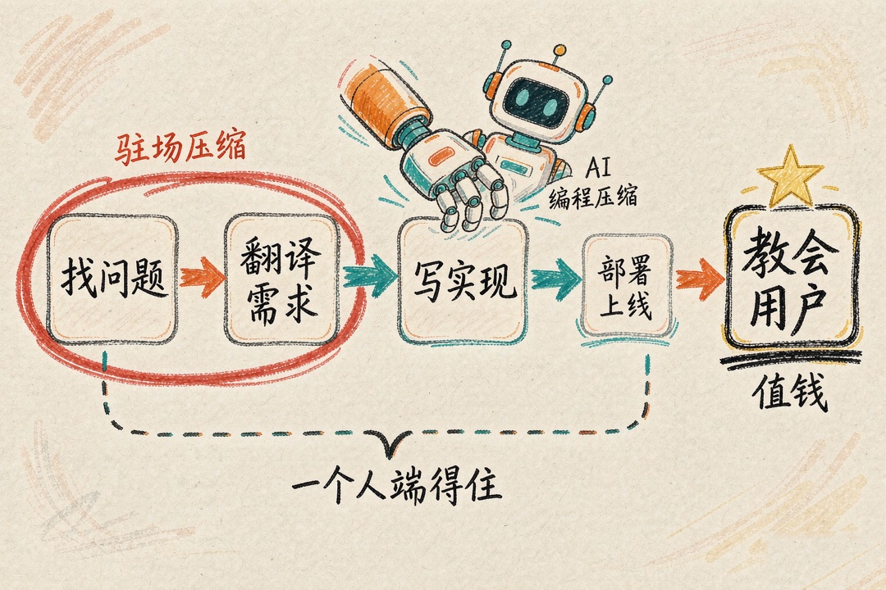

> **摘要**：AI 编程把写压短、驻场把传话压没，一个 FDE 带着 agent 能跑完整条交付线，过去这要一个项目组跑几个月。哪些环节真被压缩、哪些没被压缩？没被压缩的那部分，才是他的价钱。

有个问题最近被反复问到：FDE 不就是驻场实施吗，凭什么说一个 FDE 能干过一个项目组？

问这话的人见过传统交付。一套系统进企业，咨询顾问先访谈两周，架构师出方案，开发团队排期三个月，实施进场，培训走一圈。每个环节一群人，每个交接一次翻译。加起来，就是个项目组半年的活。

可今年跑通的案例长这样：一位零售 FDE 在客户工作群里放了个智能体，先让它观察群里的聊天记录。AI 总结出的问题里，有几条连老板自己都没意识到。然后她分步拆解工作流，人机分工，包装审核里 80% 的低级错误被 AI 拦下，沟通时间省了一半以上。

一个人，几周，可量化的结果。这中间到底发生了什么？

## 项目组的活，先拆开看哪几段

你把传统项目组的活拆开，其实是五段：找问题、翻译需求、写实现、部署上线、教会用户。

先看"写实现"。这段过去最吃人力，也是项目组人头的大头。AI 编程之后，这段被压得最短。你给 agent 一个边界清晰的任务，它当天就能给出可跑的原型。

Palantir 把 FDE 分成两组：Echo 进现场、贴业务、做需求翻译；Delta 把需求变成原型、部署、迭代。Delta 干的正是"写"这一段，而这段恰好是 AI 编程放大最狠的地方。

再看"找问题"加"翻译需求"。过去这两段散在会议纪要和邮件里，信息每传一次就走样一次。驻场的意义就在这：FDE 直接坐在业务旁边，需求不用来回传话。那位零售 FDE 是在客户工作群里放智能体，让 AI 替她盯日常沟通里的堵点——翻译的输入端，信息损耗接近零。

至于"部署上线"和"教会用户"，前者被标准化的交付流水线吃掉一部分，后者恰恰是压缩不掉的。你会看到，这两段的差别，就是这个岗位价钱的来源。

所以"一个 FDE 干过一个项目组"，不是他手速快，是五段活里有三段的单位成本塌了：写实现被 AI 编程压短，找问题和翻译被驻场压没。剩下的活变少了，一个人就端得住。

## 他手里那张纸，叫任务契约

AI 编程压缩了"写"，但 agent 的产出要可控，靠的不是运气。

你有没有试过让 agent"把这个功能优化一下"？出来的改动看起来对，跑起来一堆暗坑。问题不在模型，在于任务没有边界。

圈里现在成型的做法是任务契约：每个任务写清目标、非目标、验收标准、禁止改动区域、回滚方式。验收标准没写清，agent 就自己发明标准；禁改区没划定，它就顺手动了你不许碰的模块。

FDE 恰好是全公司最会写这种契约的人。他要能把模糊需求"翻译成可执行的方案"——这是行业里对 FDE 的定义。翻译的产物，过去叫需求规格，现在就是给 agent 的任务契约。目标是什么、做到什么算完、哪里不许碰，这些句子同时约束人和 agent。

回到那个零售案例。她不是把活一股脑丢给智能体，而是先分步拆解工作流，再决定人和 AI 各管哪段。结果是 80% 的低级错误被 AI 拦截，沟通时间节约 50% 以上，包装审核排队现象基本消失。注意这几个数字是怎么来的：不是"感觉快了"，是拆完工作流之后验证出来的。

这也是 FDE 自己的说法：交付的不是单一工程或软件，而是重新定义的"人+AI"协作组织。任务契约就是这个组织的岗位说明书。

## 没被压缩掉的那几段，才是价钱

五段活里压掉了三段，剩下"教会用户"和横贯全程的验收。这两段恰恰最值钱。

验收为什么压不掉？因为 AI 生成的东西默认"看起来对"。80% 错误拦截率、沟通省 50%，这些数字只能由人设计度量、人确认口径。你让 AI 自己验收 AI，就是把静默出错制度化。这个判断咱们之前聊过：AI 让验证负担更贵，而不是更便宜。FDE 的日常里，审输出占的比重只会越来越大。

信任更压不掉。阿里云副总裁霍嘉说过一句很直白的话：阿里云不靠 FDE 赚钱，考核核心指标是能否带动产品。他还说，能告诉客户"什么做不到"，这本身也是巨大的价值。你看，这个岗位的产出不只是代码和系统，还包括敢说不行的判断——你没法把这些写进 prompt。

商业模式也跟着变。霍嘉更看好按结果付费：传统按功能付费容易打价格战，因为功能价值难量化；按结果付费要求服务商真有交付能力，AI 确实带来降本增效，才有议价空间。长期服务合同取代短期项目合同，是同一个逻辑。

最后一层诚实话。这个行业自己也在吵：FDE 是新工种还是旧角色换皮，规模化交付会不会把质量磨平？门槛高、难速成，需要技术、业务、咨询、项目管理的复合能力。AI 编程既然能放大 FDE，会不会有一天连 FDE 也放大没了？

我的判断没变：被压缩的是"实现"和"传话"，被放大的是"定义问题、审输出、管上下文"。一个 FDE 干过一个项目组，靠的正是把力气花在没被压缩的那几段上。至于这个岗位叫 FDE 还是叫别的什么，反倒不重要。你所在的团队里，哪一段活已经被 AI 压短了？哪一段还压不动？欢迎聊聊。

## 参考资料

- 每日经济新闻：《AI落地"最后一公里"痛点带火FDE岗位，部分年薪高达百万元，阿里云副总裁霍嘉：更看好两类商业化模式》
- 《经济参考报》：《打通AI落地"最后一公里" 职场"特种兵"FDE成香饽饽》
- 工业和信息化部：《关于开展人工智能应用服务商培育专项行动的通知》
- LinkedIn：《2026 年劳动力报告》
- 猎聘大数据研究院：《2026 FDE人才供需趋势洞察报告》
