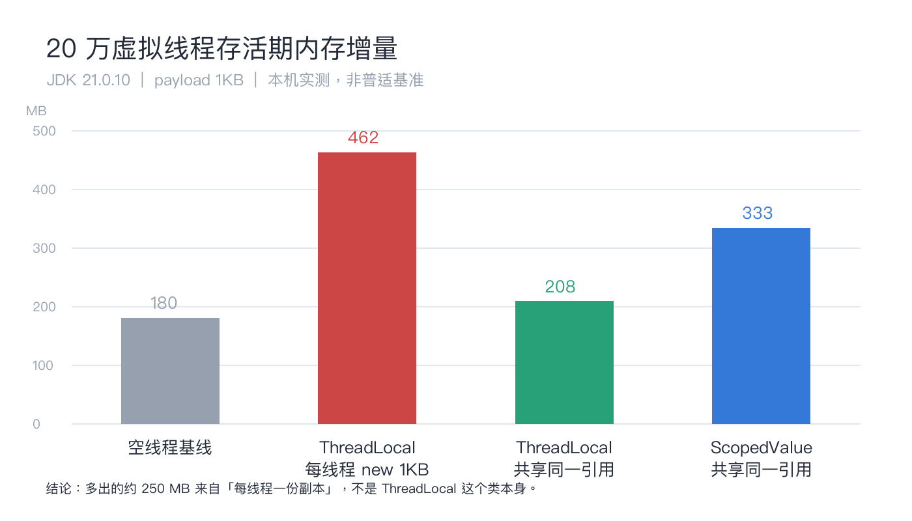
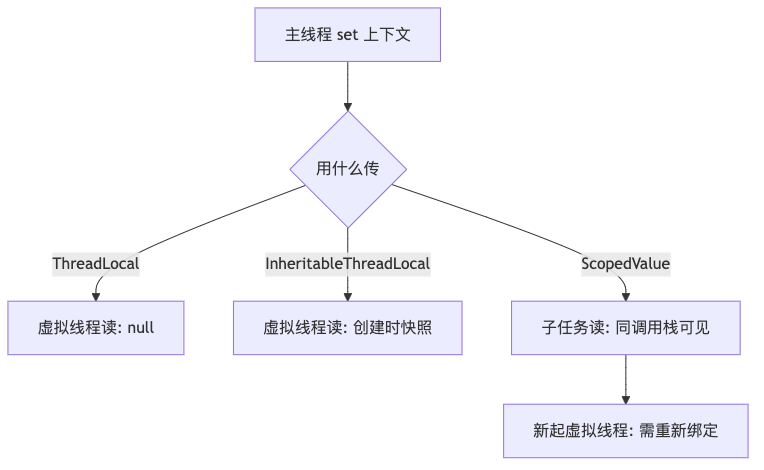

> **摘要**：切到虚拟线程，ThreadLocal 一行没动，行为却变了。实测 20 万虚拟线程，常见写法多吃 250 MB 内存。内存放大、上下文传不过去、ScopedValue 不是万能替代，三个坑和可复现的实测代码都在这。

你把项目切到虚拟线程，压测跑起来，QPS 上去了。然后内存报警，或者日志里的 userId 莫名其妙成了 null。你回头看代码，ThreadLocal 一行没动。

问题就出在这——ThreadLocal 一行没动，但它脚下的线程换了。

## 第一个坑：内存被放大

JEP 444 里有一句提醒，很多人扫过去了。官方说，虚拟线程支持 ThreadLocal，但因为虚拟线程可以非常多，用 ThreadLocal 要"经过仔细考虑"。

JDK 自己就把 java.base 里大量 ThreadLocal 用法的内存占用降了下来，为的就是应对百万级线程。

话比较绕，翻译成你能用的话：ThreadLocal 是每线程一份副本的。平台线程就那么几百个，一份副本占 1KB，微不足道。

虚拟线程能开到几十万，副本数跟着线程数走，乘起来就是另一个量级。

我在本机跑了个数。JDK 21.0.10，20 万个虚拟线程，每个线程阻塞住不退出，往 ThreadLocal 里塞一个 1KB 数组，量峰值堆内存：

| 写法 | 存活期内存增量 |
|------|--------------|
| 空虚拟线程，什么都不塞 | 约 163–211 MB |
| 每个线程 `new byte[1024]` 塞进 ThreadLocal | 约 462 MB |
| 所有线程共享同一个 1KB 数组 | 约 208 MB |



看出问题了吗？多出来的 250 MB 左右，不是线程本身占的，是"每个线程各自 new 了一份"占的。空线程基线和"共享引用"那一行几乎一样，都在 200 MB 上下。

等等，那是不是说 ThreadLocal 本身没问题，只是别往里放大对象？对了一半。

真正的问题是很多人把 ThreadLocal 当成线程级的缓存用，往里塞上下文对象、服务定位器、临时大 Map。

平台线程时代这是一个小 Map，虚拟线程时代这是 20 万个 Map。

JEP 444 把这条写得很直白：别用 ThreadLocal 在共享同一线程的多个任务之间池化昂贵资源，虚拟线程本来就不该被池化，每个线程一辈子只跑一个任务。

线程数一多，"每线程一份"这个设计假设就从优点变成了成本。

## 第二个坑：上下文传不过去

这个坑更隐蔽，因为它不报错，只是值没了。

我在主线程里 `TL.set("req-TL")`，然后开一个虚拟线程去读：

```java
static final ThreadLocal<String> TL = new ThreadLocal<>();
TL.set("req-TL");
Thread.ofVirtual().start(() ->
    System.out.println(TL.get())   // 输出 null
).join();
```

输出是 null。你可能会愣一下：同一个进程，主线程设的值，子线程怎么读不到？

因为虚拟线程也是 Thread 的实例，有自己独立的 ThreadLocalMap。它不是从主线程 fork 出来的子线程，不继承父线程的 ThreadLocal。

你原来在线程池里那套"请求进来先 set 一下，后面随便 get"的写法，一旦最外层换成虚拟线程，链条就从第一环断了。

那 InheritableThreadLocal 呢？我测了，它能读到。但先别急着换。

InheritableThreadLocal 是在线程创建的那一刻把父线程的值复制过来的，是一次快照。

虚拟线程往往是任务来了才创建，创建时机跟你 set 的时机不一定对得上。

而且官方在 JEP 506 里点名了它的毛病：子线程要为父线程写过的每个 ThreadLocal 都分配一份存储，线程一多，这笔内存开销很可观。

所以这不是"换个类就完事"的问题。你要先想清楚：这个上下文是跟着线程走，还是跟着一次调用走。



## 第三个坑：ScopedValue 不是直接替换

官方给的替代方案是 ScopedValue。它在 JDK 20 孵化，21 到 24 一路预览，JDK 25 由 JEP 506 正式转正。

核心特点三个：绑定一次不能改、生命周期由代码块限定、退出作用域自动销毁。听起来正好治 ThreadLocal 的病。

但直接照搬会踩坑。我测了两种情况。

在虚拟线程里 fork 子任务，子任务能读到父作用域的绑定：

```java
ScopedValue.where(SV, "req-SV").run(() -> {
    try (var scope = new StructuredTaskScope.ShutdownOnFailure()) {
        var sub = scope.fork(() -> SV.get());
        scope.join();
        System.out.println(sub.get());   // req-SV
    }
});
```

可如果你在绑定之后，再新起一个虚拟线程，那边读不到。得在新线程里重新 `ScopedValue.where(...)` 绑一次。它传的是"当前调用栈的下方"，不是"我这个线程往后新建的所有线程"。

还有个反直觉的实测结果。同样 20 万虚拟线程，ScopedValue 共享一个 1KB 对象，存活期内存增量约 333 MB，比 ThreadLocal 共享引用的 208 MB 还高。

这不是说 ScopedValue 更差。JDK 21 里它还是预览实现，绑定本身要建作用域数据结构，20 万次绑定不是免费的。这个数字提醒你一件事：换 API 不等于自动省内存，别拿它当性能银弹。

ScopedValue 真正值钱的地方是生命周期和不可变性。作用域结束绑定就没了，你忘不了 remove；只有 `get` 没有 `set`，远处那段代码偷偷改值的可能也被堵死了。

这些是正确性收益，不是性能收益。

一张表把三者的边界摆清楚，你按场景挑：

| 场景 | 该用什么 |
|------|---------|
| 一次请求内传 userId、traceId | ScopedValue |
| 每个线程独立缓存昂贵对象 | 别在虚拟线程里这么干 |
| 老代码，平台线程，能管住 remove | ThreadLocal 留着 |

## 升级前先认清一件事

回过头看，这三个坑其实是同一个根源：ThreadLocal 假设"线程少、活得久、会复用"，虚拟线程恰好反过来——"线程多、活得短、不复用"。假设一翻，同一个类的行为就变了。

所以别急着动手改。先在启动参数上加一行 `-Djdk.traceVirtualThreadLocals=true`。这是 JEP 444 提供的诊断开关，哪个虚拟线程给 ThreadLocal 设了值，JVM 就打一份堆栈出来。

拿这份堆栈去判断：哪些是真需要每线程一份的，哪些只是老习惯顺手 set 的。

我自己的顺序是这样的：先用这个开关把 ThreadLocal 的用法捞出来，再按"跟着线程"还是"跟着调用"分类。

跟着调用的换成 ScopedValue，真正每线程独立的评估一下能不能共享。

内存那条实测先别当成普适结论。它是 JDK 21、20 万线程、1KB 负载下的本机数据，你的负载得自己压一遍。

同源的坑之前聊过一个：虚拟线程默认开启之后，HikariCP 连接池会先被打满。那次是连接数没跟上，这次是上下文和内存没跟上。虚拟线程把并发门槛降下来了，但原来那些"线程稀缺"时代形成的假设，得一个一个重新验。

## 参考资料

1. [JEP 444: Virtual Threads](https://openjdk.org/jeps/444) — OpenJDK，Thread-local variables 小节
2. [JEP 506: Scoped Values](https://openjdk.org/jeps/506) — OpenJDK，JDK 25 正式版
3. [JEP 505: Structured Concurrency](https://openjdk.org/jeps/505) — OpenJDK
